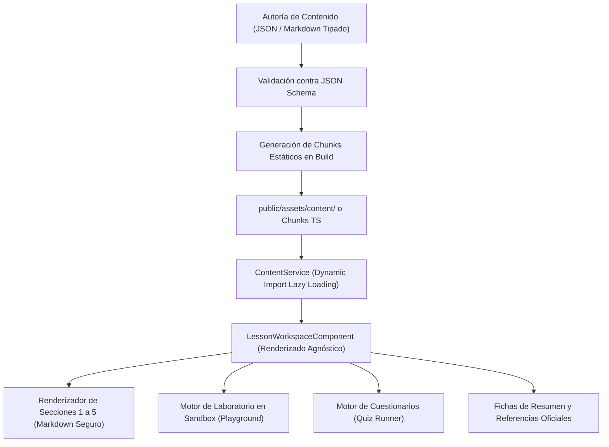

# AppSec Academy — Arquitectura de Contenido y Datos Educativos (Content Architecture)

## 1. Principio de Desacoplamiento de Contenido

> [!IMPORTANT]
> **Separación Estricta**:
> Las lecciones, cuestionarios y laboratorios no se codifican directamente dentro del template HTML de componentes Angular. El contenido educativo reside en **estructuras de datos declarativas tipadas (TypeScript / JSON)**, permitiendo que un único motor de renderizado (`LessonWorkspaceComponent`) procese cualquier lección de manera uniforme y agnóstica.



---

## 2. Modelos de Contenido y Esquemas Tipados

### 2.1. Esquema de Módulo (`module.model.ts`)
```typescript
export interface ModuleMetadata {
  id: string; // ej. "m01-owasp-fundamentals"
  code: string; // ej. "M01"
  title: string;
  description: string;
  discipline: AppSecDiscipline;
  difficulty: 'basico' | 'intermedio' | 'avanzado';
  estimatedMinutes: number;
  lessonCount: number;
  prerequisites: string[]; // IDs de módulos requeridos
  standards: {
    name: string;
    version: string;
    specUrl: string;
  }[];
  lessons: LessonSummary[];
}
```

### 2.2. Esquema de Lección Completa (`lesson.model.ts`)
```typescript
export interface LessonDetail {
  id: string;
  moduleId: string;
  title: string;
  order: number;
  estimatedMinutes: number;
  difficulty: 'basico' | 'intermedio' | 'avanzado';
  standards: {
    cwe?: string[];
    owasp?: string[];
    asvs?: string[];
    nist?: string[];
  };
  sections: {
    introduction: string;
    objectives: string[];
    conceptualExplanation: {
      markdown: string;
      mermaidDiagram?: string;
    };
    technicalExamples: {
      language: string;
      vulnerableSnippet: string;
      vulnerableExplanation: string;
      remediatedSnippet: string;
      remediatedExplanation: string;
    }[];
    realScenarios: {
      incidentTitle: string;
      cveReference?: string;
      summary: string;
      mitigationAnalysis: string;
    }[];
    lab: {
      labId: string;
      missionPrompt: string;
      starterFiles: { [filename: string]: string };
      suiteRunnerId: string;
      hints: string[];
    };
    knowledgeCheck: {
      questions: {
        id: string;
        prompt: string;
        options: {
          id: string;
          text: string;
          isCorrect: boolean;
          feedback: string;
        }[];
      }[];
    };
    summary: {
      goldenRules: string[];
      antipatterns: string[];
    };
    references: {
      title: string;
      organization: string;
      versionDate?: string;
      url: string;
    }[];
  };
}
```

---

## 3. Servicio de Carga de Contenido (ContentService)

El servicio `ContentService` actúa como intermediario para resolver y cargar bajo demanda el contenido:

```typescript
@Injectable({ providedIn: 'root' })
export class ContentService {
  private readonly moduleIndex = signal<ModuleMetadata[]>([]);
  private readonly lessonCache = new Map<string, LessonDetail>();

  async getModuleList(): Promise<ModuleMetadata[]> {
    if (this.moduleIndex().length > 0) return this.moduleIndex();
    const data = await import('./data/modules-index');
    this.moduleIndex.set(data.MODULES_INDEX);
    return data.MODULES_INDEX;
  }

  async getLessonById(lessonId: string): Promise<LessonDetail> {
    if (this.lessonCache.has(lessonId)) {
      return this.lessonCache.get(lessonId)!;
    }
    // Carga diferida del chunk específico de la lección
    const lessonModule = await import(`./data/lessons/${lessonId}.data`);
    const lesson = lessonModule.LESSON_DATA as LessonDetail;
    this.lessonCache.set(lessonId, lesson);
    return lesson;
  }
}
```

---

## 4. Versionado de Contenido y Caché

1. **Versionado Semántico del Currículo**: El catálogo lleva un identificador global (ej. `curriculumVersion: "1.0.0"`).
2. **Estrategia de Caché de Contenido**: Los chunks de datos generados por el compilador de Angular incluyen hashes criptográficos en el nombre del archivo (ej. `m01-lesson-1.2.data-3ab9f8c.js`), garantizando que cuando se actualice una lección en GitHub Pages, los navegadores obtengan la versión renovada sin problemas de caché obsoleto.
3. **Migración de Esquemas**: El servicio de persistencia verifica la versión del esquema antes de cargar datos locales guardados, aplicando migraciones transparentes si el modelo cambia en versiones posteriores.
