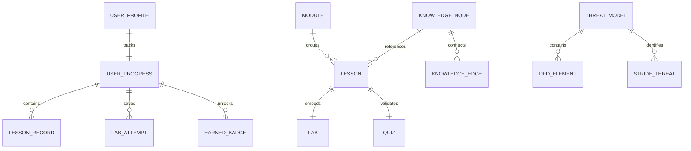

# AppSec Academy — Modelo de Dominio y Datos (Data Model Specification)

## 1. Entidades del Dominio y Relaciones

El modelo de datos unifica los seis componentes del ecosistema y la capacidad transversal del Knowledge Graph mediante interfaces TypeScript estrictas:



---

## 2. Definición Formal de Interfaces de Datos

### 2.1. Perfil y Progreso de Aprendizaje (`progress.model.ts`)
```typescript
export interface UserProgressState {
  schemaVersion: '1.0.0';
  alias: string;
  createdAt: string; // ISO-8601
  updatedAt: string; // ISO-8601
  totalXP: number;
  lastActiveLessonId?: string;
  completedLessons: string[]; // IDs de lecciones aprobadas (lab + quiz)
  lessonRecords: {
    [lessonId: string]: {
      completedAt: string;
      quizScore: number;
      quizAttempts: number;
      labPassed: boolean;
      labScore: number;
      hintsUsed: number;
    };
  };
  labDrafts: {
    [labId: string]: {
      codeFiles: { [filename: string]: string };
      lastSavedAt: string;
    };
  };
  badges: {
    id: string;
    earnedAt: string;
    verificationHash: string;
  }[];
  threatModels: {
    [modelId: string]: ThreatModelDocument;
  };
}
```

### 2.2. Modelo Ontológico del Knowledge Graph (`knowledge-graph.model.ts`)
```typescript
export type NodeType = 'vulnerability' | 'standard' | 'control' | 'tool' | 'lesson';

export interface KnowledgeGraphNode {
  id: string; // ej. "cwe-89"
  type: NodeType;
  label: string; // ej. "CWE-89: SQL Injection"
  summary: string;
  category: string; // ej. "Inyección"
  severity?: 'critica' | 'alta' | 'media' | 'baja';
  officialReferences: {
    source: string; // ej. "MITRE CWE"
    code: string; // ej. "CWE-89"
    url: string;
  }[];
  relatedLessonId?: string; // Enlace bidireccional a lección de la plataforma
}

export interface KnowledgeGraphEdge {
  id: string;
  source: string; // id del nodo de origen
  target: string; // id del nodo de destino
  relation: 'mitigates' | 'standardizes' | 'exploits' | 'implements' | 'teaches';
  description?: string;
}

export interface KnowledgeGraphDataset {
  nodes: KnowledgeGraphNode[];
  edges: KnowledgeGraphEdge[];
}
```

### 2.3. Modelo del Threat Modeling Studio (`threat-model.model.ts`)
```typescript
export type ElementType = 'process' | 'data-store' | 'data-flow' | 'external-entity' | 'trust-boundary';

export type StrideCategory = 
  | 'Spoofing' 
  | 'Tampering' 
  | 'Repudiation' 
  | 'InformationDisclosure' 
  | 'DenialOfService' 
  | 'ElevationOfPrivilege';

export interface DfdElement {
  id: string;
  type: ElementType;
  name: string;
  position: { x: number; y: number };
  boundaryId?: string; // ID del límite de confianza contenedor
}

export interface StrideThreat {
  id: string;
  elementId: string;
  category: StrideCategory;
  title: string;
  description: string;
  severity: 'alta' | 'media' | 'baja';
  mitigated: boolean;
  mitigationStrategy?: string;
  asvsRequirementRef?: string;
}

export interface ThreatModelDocument {
  id: string;
  title: string;
  systemDescription: string;
  version: string;
  createdAt: string;
  updatedAt: string;
  elements: DfdElement[];
  threats: StrideThreat[];
}
```

---

## 3. Esquema de Exportación e Importación Portátil (Snapshot Schema)

Para garantizar la portabilidad entre computadoras, el payload exportado se encapsula en una estructura firmada:

```typescript
export interface ProgressSnapshotEnvelope {
  format: 'appsec-academy-snapshot';
  version: '1.0.0';
  exportedAt: string;
  systemBuild: string;
  data: UserProgressState;
  integrity: {
    algorithm: 'SHA-256';
    digest: string; // Hash del JSON canónico de 'data'
  };
}
```
