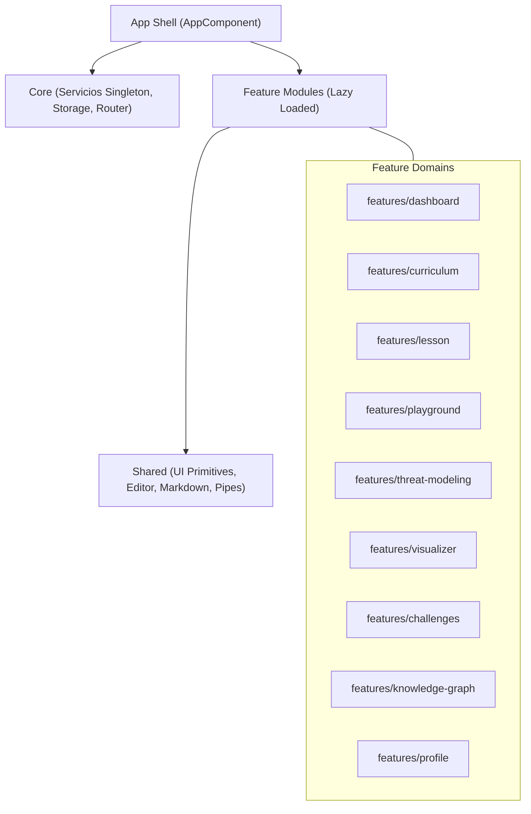
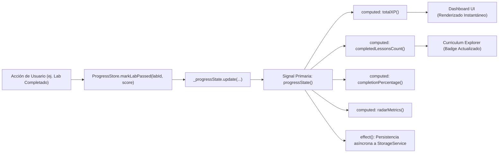

# AppSec Academy — Arquitectura Frontend Angular (Frontend Architecture)

## 1. Patrón Arquitectónico y Estructura de Directorios

La aplicación se estructura siguiendo el principio de **Separación por Características (*Feature-Sliced Domain Design*)**, utilizando exclusivamente **Angular Standalone Components**, directivas e inyección de dependencias moderna mediante `inject()`.



### 1.1. Estructura del Árbol de Código Fuente
```text
src/
├── app/
│   ├── app.config.ts              # Configuración global standalone (router, providers)
│   ├── app.routes.ts              # Rutas con lazy loading estricto
│   ├── app.component.ts           # Shell principal accesible
│   │
│   ├── core/                      # Servicios transversales singleton
│   │   ├── services/
│   │   │   ├── storage.service.ts # Persistencia LocalStorage / IndexedDB
│   │   │   ├── content.service.ts # Carga lazy de lecciones y módulos
│   │   │   ├── sandbox.service.ts # Orquestador de Web Workers y eval
│   │   │   ├── crypto.service.ts  # Generador SHA-256 de credenciales
│   │   │   └── theme.service.ts   # Preferencias visuales y modo accesible
│   │   └── stores/
│   │       ├── progress.store.ts  # Estado reactivo global con Signals
│   │       └── settings.store.ts  # Ajustes locales del usuario
│   │
│   ├── features/                  # Vistas funcionales desacopladas (Lazy Loaded)
│   │   ├── landing/
│   │   ├── dashboard/
│   │   ├── curriculum/
│   │   ├── module-overview/
│   │   ├── lesson-workspace/
│   │   ├── playground/
│   │   ├── threat-modeling/
│   │   ├── visualizer/
│   │   ├── challenges/
│   │   ├── knowledge-graph/
│   │   └── profile/
│   │
│   └── shared/                    # Componentes reutilizables agnósticos
│       ├── components/
│       │   ├── code-editor/       # Editor de código accesible
│       │   ├── code-viewer/       # Visualizador con syntax highlighting
│       │   ├── quiz-runner/       # Motor interactivo de evaluación formativa
│       │   ├── badge-pill/        # Píldora de estándar y nivel
│       │   ├── stat-card/         # Tarjeta de métrica con icono
│       │   ├── modal-dialog/      # Diálogo accesible con focus-trap
│       │   └── tab-group/         # Pestañas táctiles con roles ARIA
│       └── pipes/
│           ├── duration.pipe.ts   # Formateo de minutos a horas/min
│           └── safe-html.pipe.ts  # Sanitización estricta de SVG/HTML
```

---

## 2. Gestión del Estado Reactivo con Angular Signals

Se descartan dependencias de librerías de estado externas pesadas (como NgRx Store tradicional). El estado global y local se administra mediante **Angular Signals nativas**, aprovechando su reactividad fina y preparación para el modo *Zoneless*.



### 2.1. Ejemplo de Arquitectura del Store (`progress.store.ts`):
```typescript
@Injectable({ providedIn: 'root' })
export class ProgressStore {
  private readonly storage = inject(StorageService);

  // Estado privado inmutable externamente
  private readonly _state = signal<UserProgressState>(this.storage.loadInitialState());

  // Señales públicas de solo lectura
  readonly state = this._state.asReadonly();
  readonly completedLessons = computed(() => this._state().completedLessons);
  readonly earnedBadges = computed(() => this._state().badges);
  readonly totalXP = computed(() => this._state().totalXP);
  readonly completionRatio = computed(() => {
    const total = 49;
    return Math.round((this._state().completedLessons.length / total) * 100);
  });

  constructor() {
    // Sincronización automática de estado con persistencia local
    effect(() => {
      this.storage.saveState(this._state());
    });
  }

  markLessonCompleted(lessonId: string, score: number): void {
    this._state.update(current => {
      if (current.completedLessons.includes(lessonId)) return current;
      return {
        ...current,
        completedLessons: [...current.completedLessons, lessonId],
        totalXP: current.totalXP + score,
        lastActiveLessonId: lessonId,
        updatedAt: new Date().toISOString()
      };
    });
  }
}
```

---

## 3. Estrategia de Carga Diferida (Lazy Loading y Granular Chunking)

Para garantizar un bundle inicial extremadamente ligero ($\le 250\text{ KB}$), el router de Angular carga todas las rutas principales bajo demanda mediante `loadComponent`:

```typescript
export const APP_ROUTES: Routes = [
  {
    path: '',
    loadComponent: () => import('./features/landing/landing.component')
  },
  {
    path: 'dashboard',
    loadComponent: () => import('./features/dashboard/dashboard.component')
  },
  {
    path: 'curriculum',
    loadComponent: () => import('./features/curriculum/curriculum.component')
  },
  {
    path: 'leccion/:id',
    loadComponent: () => import('./features/lesson-workspace/lesson-workspace.component')
  },
  {
    path: 'playground/:labId',
    loadComponent: () => import('./features/playground/playground.component')
  },
  {
    path: 'threat-modeling',
    loadComponent: () => import('./features/threat-modeling/threat-modeling.component')
  },
  {
    path: 'knowledge-graph',
    loadComponent: () => import('./features/knowledge-graph/knowledge-graph.component')
  },
  {
    path: 'profile',
    loadComponent: () => import('./features/profile/profile.component')
  },
  {
    path: '**',
    redirectTo: ''
  }
];
```
