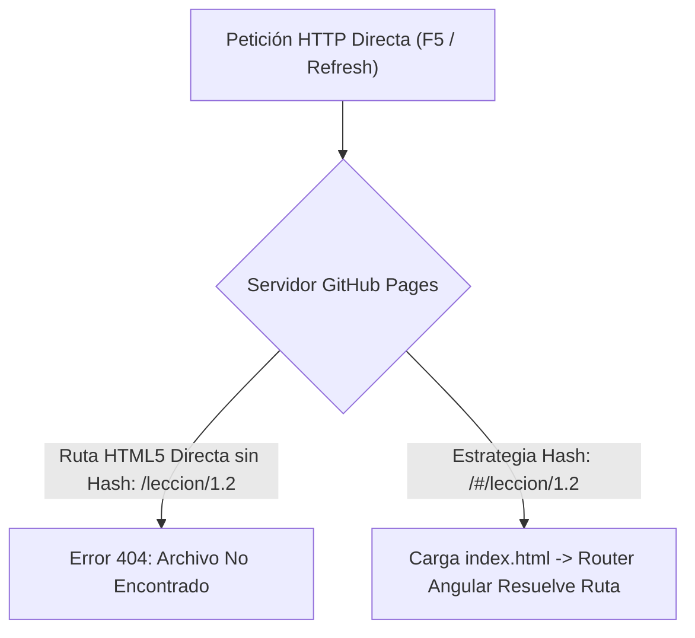
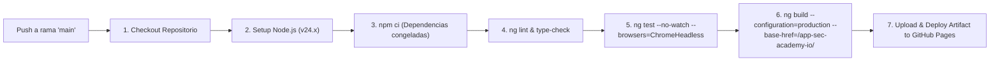

# AppSec Academy — Enrutamiento y Despliegue en GitHub Pages (Routing & Deployment)

## 1. El Desafío del Despliegue Estático en GitHub Pages

GitHub Pages opera como un servidor de archivos estáticos puro (Nginx/Fastly CDN) sin soporte nativo para reescritura de URLs en el lado del servidor (*Server-Side URL Rewriting*). 

En aplicaciones Single Page Applications (SPA), esto genera el conocido problema del **Error 404 al Refrescar**: si un usuario accede a `https://<usuario>.github.io/app-sec-academy-io/leccion/owasp-top-10` y pulsa `F5`, el servidor de GitHub busca un archivo físico en ese directorio y devuelve una página 404.



---

## 2. Decisión Arquitectónica de Enrutamiento: Hash Routing

Para garantizar **cero fallos de recarga**, cero dependencias de trucos frágiles (como scripts pesados en `404.html` que redirigen y provocan parpadeos) y compatibilidad universal:

> [!IMPORTANT]
> **Adopción de Hash Routing (`withHashLocation()`)**:
> La plataforma utilizará la estrategia de localización por hash en Angular.
> Las URLs tendrán el formato: `https://<usuario>.github.io/app-sec-academy-io/#/leccion/m01-broken-access-control`.
> De este modo, la petición al servidor de GitHub Pages siempre solicita `/app-sec-academy-io/index.html` (código HTTP 200), y el enrutador de Angular lee la parte posterior al hash en el cliente sin recargas ni latencia.

### 2.1. Configuración en `app.config.ts`:
```typescript
import { ApplicationConfig } from '@angular/core';
import { provideRouter, withHashLocation, withComponentInputBinding } from '@angular/router';
import { APP_ROUTES } from './app.routes';

export const appConfig: ApplicationConfig = {
  providers: [
    provideRouter(
      APP_ROUTES,
      withHashLocation(),             // Garantiza funcionamiento nativo en GitHub Pages
      withComponentInputBinding()     // Enlaza parámetros de ruta directamente a inputs de componentes
    )
  ]
};
```

---

## 3. Gestión de Rutas Base Relativas y Assets

Para evitar rutas absolutas duras que rompan los assets al desplegarse en subdirectorios de proyectos de GitHub (`/app-sec-academy-io/`):

1. **Configuración de `baseHref` en Angular**:
   - En el archivo `angular.json` o en el comando de build de producción:
     ```bash
     ng build --base-href /app-sec-academy-io/
     ```
2. **Referenciación Relativa de Assets**:
   - Todos los recursos multimedia, esquemas JSON y fuentes se referencian mediante rutas relativas (`assets/icons/...`) o mediante inyección del token `APP_BASE_HREF`.
   - Se prohíbe el uso de barras diagonales directas absolutas (`/assets/...`) en código TypeScript, CSS o plantillas HTML.

---

## 4. Pipeline de Despliegue Automatizado (GitHub Actions)

El despliegue se automatiza al 100% mediante un flujo de trabajo en `.github/workflows/deploy.yml`:



### 4.1. Características del Pipeline:
- **Caché de Dependencias**: Almacenamiento en caché de `~/.npm` para acelerar builds subsiguientes a menos de 90 segundos.
- **Compilador AOT y Minificación**: Generación de bundles optimizados con compresión y tree-shaking agresivo.
- **Permisos Restringidos**: El token de GitHub Actions opera con permisos mínimos:
  ```yaml
  permissions:
    contents: read
    pages: write
    id-token: write
  ```
