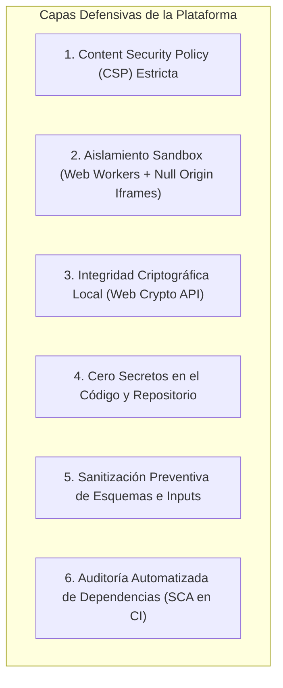

# AppSec Academy — Arquitectura de Seguridad de la Plataforma (Security Architecture)

## 1. El Principio de Ejemplaridad ("Walk the Talk")

> [!IMPORTANT]
> Una academia de Application Security debe ser **inmune a las mismas debilidades que enseña**. La arquitectura de AppSec Academy aplica las defensas más rigurosas de la industria para garantizar que ningún código de prueba, payload educativo o script del estudiante comprometa la aplicación ni a otros usuarios.



---

## 2. Política de Seguridad de Contenido (Content Security Policy)

La plataforma aplica una política CSP estricta inyectada en la cabecera HTML `<meta>` de `index.html`:

```html
<meta http-equiv="Content-Security-Policy" content="
  default-src 'self';
  script-src 'self' 'wasm-unsafe-eval';
  worker-src 'self' blob:;
  style-src 'self' 'unsafe-inline';
  img-src 'self' data:;
  font-src 'self';
  connect-src 'self';
  object-src 'none';
  base-uri 'self';
  form-action 'self';
  frame-src 'self' data:;
">
```

### 2.1. Desglose y Justificación de Directivas:
- `default-src 'self'`: Bloquea cualquier carga de dominios externos no autorizados.
- `script-src 'self' 'wasm-unsafe-eval'`: Permite únicamente scripts originados en el propio bundle y compilación de módulos WebAssembly (necesarios para motores SQL y parsers Wasm en cliente). **Se prohíbe terminantemente `'unsafe-eval'` para JavaScript regular.**
- `worker-src 'self' blob:;`: Permite instanciar Web Workers empaquetados por Angular CLI y creados mediante URLs de tipo Blob para los runners de sandbox en cliente.
- `object-src 'none'`: Deshabilita plugins obsoletos (Flash, Java Applets).
- `base-uri 'self'`: Previene ataques de inyección de `<base href>` malicioso.

---

## 3. Modelo de Aislamiento para la Ejecución de Laboratorios

Para permitir que el usuario experimente con payloads de ataque (XSS, inyecciones de código, regex complejas) sin que la aplicación anfitriona sea vulnerada:

```mermaid
sequenceDiagram
    participant UI as Interfaz Principal (Angular DOM)
    participant Worker as Web Worker Aislado
    participant Iframe as Iframe Sandboxed (Null Origin)

    Note over UI: Usuario ingresa payload en editor
    alt Prueba de Lógica o Backend Mock
        UI->>Worker: postMessage({ code, testSuite })
        Note over Worker: Ejecución sin acceso a window, document ni localStorage
        Worker->>UI: postMessage({ testResults, passed: true })
    else Prueba de Vulnerabilidad DOM / HTML
        UI->>Iframe: Renderiza en iframe sandbox="allow-scripts" (sin allow-same-origin)
        Note over Iframe: Origen tratado como 'null'; no puede leer cookies ni LocalStorage del host
        Iframe-->>UI: Envía resultado de ejecución vía postMessage controlado
    end
```

---

## 4. Gestión de Estado Seguro y Prevención de Inyecciones

1. **Sanitización de Datos Importados**: Cuando un usuario importa un archivo de snapshot JSON con su progreso:
   - Se valida contra un esquema JSON estricto (`ajv` o validador TypeScript en tiempo de ejecución).
   - Se rechazan propiedades desconocidas o prototipos contaminados (`__proto__`, `constructor`).
   - Se recalculan los hashes de integridad antes de fusionar el estado en `localStorage`.
2. **Cero Secretos en el Frontend**: No existen llaves privadas, tokens de API de terceros ni credenciales embebidas en el código compilado.
3. **Cero Comentarios en Código Fuente**: En cumplimiento de los estándares de entrega, los artefactos de producción y el código base omiten comentarios redundantes que puedan filtrar metadatos internos.
4. **Auditoría Continua de Dependencias**:
   - Monitoreo en CI/CD con `npm audit --audit-level=high`.
   - Reglas de Dependabot configuradas para actualización semanal de dependencias críticas.
