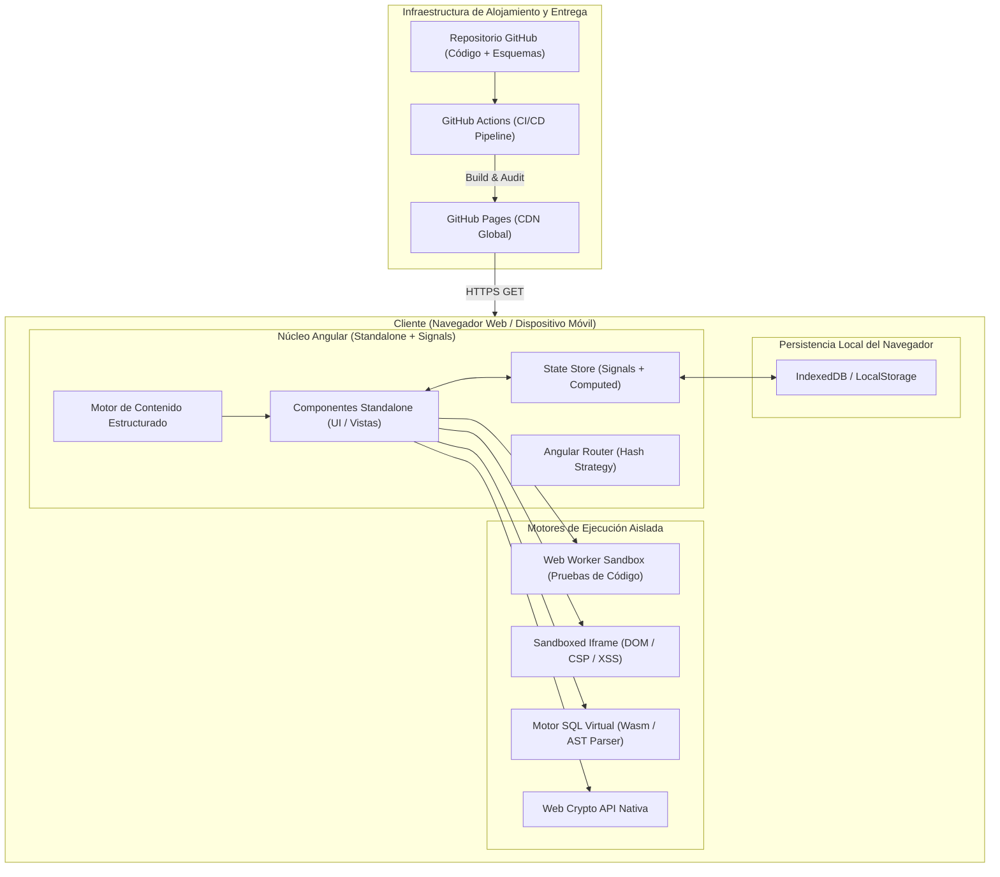

# AppSec Academy — Arquitectura General del Sistema (System Architecture)

## 1. Visión y Topología del Sistema (Static-First Topology)

**AppSec Academy** adopta un modelo arquitectónico **100% Static-First y Serverless en el Cliente**. La aplicación se compila en un conjunto de artefactos estáticos (HTML5, JavaScript ES2022, CSS3 y assets WebAssembly) distribuidos globalmente a través de la Red de Entrega de Contenidos (CDN) de **GitHub Pages**.

---

## 2. Componentes Arquitectónicos Principales

### 2.1. Núcleo Frontend Angular
- Desarrollado bajo la arquitectura moderna de **Angular Standalone Components**, eliminando por completo los `NgModules`.
- Gestión de estado reactiva basada íntegramente en **Angular Signals (`signal`, `computed`, `effect`)**, logrando un rendimiento superior con detección de cambios granular (*zoneless-ready*).
- Desacoplamiento estricto entre presentación visual, lógica de negocio y motores de validación.

### 2.2. Motor de Contenido y Currículo (Content Engine)
- El contenido educativo (lecciones, metadatos, diagramas y cuestionarios) reside en esquemas fuertemente tipados en TypeScript y JSON.
- Los módulos y lecciones se cargan bajo demanda mediante **Lazy Loading dinámico (`import()`)**, evitando que el bundle inicial contenga los 48 laboratorios de forma innecesaria.

### 2.3. Motores de Simulación y Sandboxing
- **Web Worker Runner**: Aísla la ejecución de código de prueba del hilo principal del navegador.
- **Iframe Sandboxed**: Aísla renderizados dinámicos con origen opaco para prácticas de frontend security.
- **In-Memory SQL Parser**: Evalúa sentencias SQL y detecta inyecciones sin conexión a bases de datos externas.

### 2.4. Capa de Persistencia Local (Storage Service)
- Abstracción unificada sobre `LocalStorage` e `IndexedDB`.
- Garantiza la persistencia inmediata de los avances, notas del estudiante, borradores de laboratorios y puntuaciones.
- Incorpora serializador y validador de esquemas con firma criptográfica para exportación e importación portátil de datos.

---

## 3. Justificación de Cero Backend en el MVP

| Criterio | Arquitectura con Backend Tradicional | Arquitectura Static-First (AppSec Academy) |
| :--- | :--- | :--- |
| **Costo Operativo** | Servidores Node/Python + DB (\$20-\$150 USD/mes). | **\$0 USD** (Hospedaje estático en GitHub Pages). |
| **Disponibilidad** | Sujeto a caídas de servidor y mantenimiento de BD. | **99.99%** respaldado por CDN global de GitHub. |
| **Privacidad de Datos** | Datos de usuarios almacenados en servidores externos (requiere GDPR/LOPD). | **100% Soberanía del Usuario** (Datos residen en el navegador). |
| **Latencia de Laboratorios** | 500ms - 2,500ms por llamada a API remota. | **< 15ms** (Ejecución local instantánea en Web Worker). |
| **Escalabilidad** | Cuellos de botella ante picos masivos de usuarios. | **Escalabilidad infinita** de entrega estática. |
