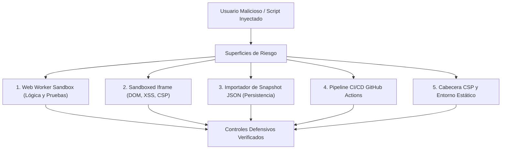

# AppSec Academy — Registro de Riesgos de Seguridad y Modelo de Amenazas (Security Risk Register)

## 1. Alcance del Análisis de Seguridad

Este registro audita exhaustivamente la superficie de ataque de **AppSec Academy**. Al ser una plataforma diseñada para que los usuarios interactúen con código deliberadamente vulnerable y payloads de explotación, el sistema debe garantizar que el entorno del navegador del estudiante y la aplicación anfitriona permanezcan herméticamente protegidos.



---

## 2. Registro y Matriz de Riesgos de Ciberseguridad

| ID | Amenaza / Vector | Categoría STRIDE | Probabilidad | Impacto | Nivel de Riesgo | Control Defensivo Implementado | Aserción / Prueba de Validación |
| :---: | :--- | :---: | :---: | :---: | :---: | :--- | :--- |
| **SEC-01** | Fuga de contexto o escape de Web Worker hacia el DOM anfitrión. | Elevation of Privilege | Baja | Crítico | **HIGH** | Confinamiento en `DedicatedWorkerGlobalScope`. Sin acceso por diseño a `window`, `document`, `localStorage` ni cookies. | Test de integración verifica que `typeof window === 'undefined'` y `typeof document === 'undefined'`. |
| **SEC-02** | Exfiltración de datos de red desde Web Worker mediante `fetch` o `WebSocket`. | Information Disclosure | Media | Alto | **HIGH** | **Shadowing de red**: `self.fetch = undefined; self.XMLHttpRequest = undefined; self.WebSocket = undefined;` antes de ejecutar aserciones, más CSP `connect-src 'self'`. | Test intenta invocar `fetch('https://...')` dentro del worker y comprueba que arroja `SecurityViolationError`. |
| **SEC-03** | Denegación de servicio en cliente por bucle infinito (`while(true)`) o recursión descontrolada. | Denial of Service | Alta | Medio | **HIGH** | **Watchdog Timer estricto**: Temporizador de terminación de 2,000 ms que ejecuta `worker.terminate()` forzoso en el hilo principal. | Test unitario con bucle infinito verifica terminación forzosa en $\le 2,050$ ms sin congelar la UI. |
| **SEC-04** | XSS contra la aplicación anfitriona desde el iframe de pruebas de HTML/DOM. | Tampering / Elevation of Privilege | Media | Alto | **HIGH** | Iframe con `sandbox="allow-scripts"` **sin** `allow-same-origin`. Asignación de origen opaco (`origin: null`). CSP estricta `default-src 'none'`. | Test verifica que script en iframe arroja excepción al intentar acceder a `window.parent.localStorage`. |
| **SEC-05** | Inyección de prototipo (*Prototype Pollution*) mediante archivo de snapshot JSON malicioso. | Tampering | Media | Alto | **HIGH** | Validación de esquema JSON estricta en el cliente (rechazo de claves `__proto__`, `constructor`, `prototype`) y parseo seguro recursivo. | Test unitario importa JSON con carga útil de prototype pollution y verifica que `Object.prototype` no resulta alterado. |
| **SEC-06** | Ilusión de no-repudio / Falsificación de puntuación y logros en cliente. | Repudiation | Alta | Bajo | **MEDIUM** | **Clarificación metodológica**: El digest SHA-256 es una suma de comprobación de integridad contra corrupción accidental, no una firma digital con no-repudio. | Documentación técnica y perfil advierten que los logros son de soberanía local y no certificación PKI oficial. |
| **SEC-07** | Bloqueo de creación de Web Worker por CSP incompleta. | Denial of Service | Alta | Alto | **HIGH** | Inclusión de directiva explícita `worker-src 'self' blob:;` en la cabecera CSP de `index.html`. | Test de carga inicial verifica que `new Worker(blobUrl)` se instancia sin advertencias en consola. |
| **SEC-08** | Inyección de comandos en workflows de GitHub Actions desde Pull Requests no confiables. | Tampering / EoP | Baja | Crítico | **HIGH** | Sustitución de interpolaciones `${{ github.event... }}` en scripts bash por variables de entorno seguras (`env:`). Permisos de token OIDC mínimos (`contents: read`). | Linter de CI verifica ausencia de expresiones directas en bloques `run:`. |
| **SEC-09** | Envenenamiento de dependencias en cadena de suministro (npm packages maliciosos). | Tampering | Media | Alto | **MEDIUM** | Instalación de dependencias congeladas (`npm ci`), auditoría continua con `npm audit --audit-level=high` y Dependabot activo. | Step obligatorio de auditoría en el workflow de GitHub Actions. |

---

## 3. Modelo de Aislamiento de Laboratorios en Detalle

### 3.1. Arquitectura de Confinamiento del Web Worker
```mermaid
sequenceDiagram
    participant Host as Angular SandboxService (Main Thread)
    participant Worker as Web Worker Efímero

    Host->>Worker: postMessage({ type: 'INIT_ENV' })
    Note over Worker: self.fetch = undefined;<br/>self.XMLHttpRequest = undefined;<br/>self.WebSocket = undefined;<br/>Object.freeze(Object.prototype);
    Worker-->>Host: postMessage({ type: 'ENV_READY' })

    Host->>Worker: postMessage({ type: 'RUN_TESTS', code: userCode, suite: testAssertions })
    Note over Host: Inicia Watchdog Timer (2,000ms)

    alt Tests concluyen a tiempo
        Worker-->>Host: postMessage({ type: 'TEST_RESULTS', passed: true, details: [...] })
        Note over Host: Cancela Watchdog Timer y renderiza resultados
    else Tiempo límite excedido (>2,000ms)
        Host->>Worker: worker.terminate()
        Note over Host: Destruye worker y notifica "Tiempo límite excedido"
    end
```

### 3.2. Restricciones del Sandboxed Iframe (Null Origin)
- Para los laboratorios de prevención de XSS y manipulación de DOM:
  - Atributos del elemento: `sandbox="allow-scripts"`.
  - Ausencia deliberada de `allow-same-origin`: Esto fuerza al navegador a tratar el iframe como un origen completamente diferente y opaco (`null`).
  - La API de almacenamiento local (`window.localStorage`), cookies (`document.cookie`) y contexto de sesión del dominio de GitHub Pages son completamente inaccesibles desde el interior del iframe.

---

## 4. Política de Divulgación Responsable y Buenas Prácticas

1. **Entorno Simulado Cerrado**: Ningún ejercicio permite interactuar con servidores, dominios o APIs públicas externas.
2. **Defensa en Profundidad**: Si una capa de aislamiento fallase (ej. navegador con bug en sandbox de Web Worker), la política CSP del documento y la ausencia de APIs de red impiden la fuga de información hacia el exterior.
3. **Auditoría Continua**: Este registro de riesgos se revisará al inicio de cada sprint durante las ceremonias de planificación.
