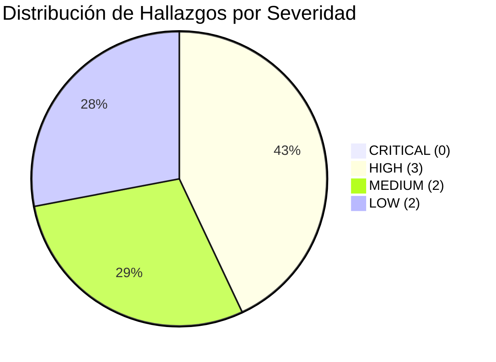

# AppSec Academy — Informe de Auditoría de Cierre (Sprint 0.9)
## Evaluación Independiente de Arquitectura, Ciberseguridad, Calidad y Diseño Instruccional

**Fecha de la Auditoría**: 10 de Noviembre de 2026  
**Comité Auditor Independiente**:
- Arquitecto Principal de Software (*Software Architect*)
- Especialista Senior en Seguridad de Aplicaciones (*AppSec Specialist*)
- Ingeniero Líder de Calidad y Automatización (*QA Lead Engineer*)
- Diseñador Instruccional Senior (*Instructional Designer*)

**Objeto de la Auditoría**: Evaluación exhaustiva de los 43 documentos técnicos, pedagógicos y arquitectónicos generados durante el Sprint 0 de **AppSec Academy**.

---

## 1. Resumen Ejecutivo del Comité Auditor

El comité auditor independiente ha completado una revisión rigurosa del repositorio documental de AppSec Academy. El proyecto exhibe una base técnica y metodológica excepcionalmente sólida, destacándose por su enfoque *Static-First*, su compatibilidad nativa con GitHub Pages, su orientación *Mobile-First* y su decisión de eliminar dependencias de backend tradicionales mediante ejecución hermética de laboratorios en el navegador del cliente.

No obstante, la auditoría ha identificado **siete hallazgos objetivos** que requieren corrección y clarificación antes de iniciar el Sprint 1:
- **0 hallazgos CRITICAL** (ningún bloqueo fatal que invalide la viabilidad del proyecto).
- **3 hallazgos HIGH** (confusión conceptual entre integridad y firma digital; discrepancia en la suma de lecciones y minutos curriculares; omisión de directiva `worker-src` en la política CSP).
- **2 hallazgos MEDIUM** (riesgo de violación de presupuesto de bundle si se adopta Monaco Editor en lugar de CodeMirror 6; ambigüedad en el alcance MVP de las seis capacidades del ecosistema).
- **2 hallazgos LOW** (configuración de `baseHref` en desarrollo local vs producción; necesidad de anular explícitamente `self.fetch` en el entorno del Web Worker).

### Dictamen Oficial de Auditoría:
**APTO PARA INICIAR IMPLEMENTACIÓN CON HIPÓTESIS TÉCNICAS PENDIENTES DE VALIDACIÓN.**  

> [!WARNING]
> Este dictamen avala la coherencia, exhaustividad y rigor metodológico de la documentación y planificación arquitectónica. **No representa una certificación de seguridad, accesibilidad, rendimiento ni calidad de implementación.** Dichas dimensiones constituyen hipótesis técnicas registradas formalmente en [ARCHITECTURAL_ASSUMPTIONS.md](file:///c:/Users/YAMI/Documents/projects/app-sec-academy-io/docs/audit/ARCHITECTURAL_ASSUMPTIONS.md) que deberán ser validadas empíricamente mediante pruebas de software reproducibles durante los sprints de construcción.

---

## 2. Registro Detallado de Hallazgos



### Hallazgo AUD-01 [HIGH]: Confusión Conceptual entre Integridad Criptográfica (Hash SHA-256) y Firma Digital Auténtica
- **Evidencia**: En los documentos `GAMIFICATION.md`, `DATA_MODEL.md`, `ADR-005`, `PRD.md` y `SPRINT_0_REPORT.md`, se utilizan reiteradamente las expresiones *"archivo JSON validado con firma hash"*, *"snapshot firmado criptográficamente con SHA-256"* y *"credencial digital firmada"*, afirmando que el hash SHA-256 previene la manipulación o falsificación del progreso local por parte del usuario.
- **Impacto Técnico / AppSec**: En una academia de seguridad de aplicaciones, este error conceptual es grave. Un resumen o digest SHA-256 es una función hash criptográfica que garantiza únicamente **integridad** (detecta corrupción accidental o cambios en el archivo frente a un valor conocido), pero **NO provee autenticidad ni no-repudio**. Al ser una aplicación 100% estática en el cliente sin clave privada asimétrica ni servidor confiable, cualquier usuario con conocimientos básicos de JavaScript o Python puede modificar su puntuación o insignias y recalcular el hash SHA-256 correspondiente. La afirmación de que el hash previene el "anti-cheat" en el cliente es una ilusión de seguridad (*Security through Obscurity*).
- **Corrección Requerida**: 
  1. Sustituir en todos los documentos los términos "firma criptográfica", "firma hash" y "credencial firmada" por **"Suma de Verificación de Integridad SHA-256" (*SHA-256 Integrity Digest*)**.
  2. Documentar explícitamente que en una arquitectura *client-side sovereign*, la integridad protege contra corrupción accidental durante la exportación/importación, pero que la verificación formal de autenticidad frente a terceros requeriría un backend firmante con clave asimétrica privada (diferida a fases futuras si se introduce certificación oficial).

---

### Hallazgo AUD-02 [HIGH]: Discrepancia Matemática en el Conteo de Lecciones y Tiempos de Instrucción
- **Evidencia**:
  - `CONTENT_INVENTORY.md` y `CURRICULUM_MAP.md` listan formalmente 14 módulos. Al sumar las lecciones módulo por módulo:
    - M01 (4), M02 (4), M03 (4), M04 (3), M05 (3), M06 (3), M07 (3), M08 (4), M09 (4), M10 (4), M11 (3), M12 (3), M13 (3), M14 (4).
    - Suma real: $4+4+4+3+3+3+3+4+4+4+3+3+3+4 = \mathbf{49\text{ lecciones}}$.
  - Sin embargo, los textos de resumen en `PRD.md`, `CONTENT_INVENTORY.md`, `ASSESSMENT_MODEL.md` ($L_{totales} = 48$), `FRONTEND_ARCHITECTURE.md` (`const total = 48`), `SCREEN_SPECIFICATIONS.md` ("18/48 Lecciones") y `SPRINT_0_REPORT.md` afirmaban que el total era de **48 lecciones**.
  - Respecto al tiempo total acumulado:
    - Suma real de duraciones: $130 + 155 + 165 + 105 + 125 + 115 + 115 + 165 + 165 + 150 + 110 + 120 + 115 + 170 = \mathbf{1,905\text{ minutos}}$ ($\mathbf{31.75\text{ horas}}$).
    - Los documentos afirmaban un total de **1,845 minutos** ($\mathbf{30.75\text{ horas}}$), existiendo una discrepancia de exactamente 60 minutos (1 hora).
  - En `LEARNING_PATH.md`, las estimaciones de horas por ruta (Dev: 18h, Arch: 16h, DevSecOps: 17h, QA: 14h, Master: 35h) no cuadraban con la suma exacta de sus módulos integrantes, al no documentar si incluían un colchón (*buffer*) de práctica libre en el laboratorio.
- **Impacto Pedagógico y de Software**: La constante `total = 48` en el código de cálculo de porcentajes generaría un error de desbordamiento matemático ($49/48 = 102\%$ de completitud).
- **Corrección Requerida**:
  1. Actualizar el inventario global a **49 lecciones troncales**.
  2. Ajustar el tiempo total oficial a **1,905 minutos (31 horas y 45 minutos)**.
  3. Corregir la fórmula en `ASSESSMENT_MODEL.md` a $L_{totales} = 49$ y las referencias correspondientes en la arquitectura y pantallas.
  4. Clarificar en `LEARNING_PATH.md` que las estimaciones en horas de cada ruta incorporan el tiempo lectivo estricto más un $10\%-15\%$ de tiempo sugerido de experimentación libre en el sandbox.

---

### Hallazgo AUD-03 [HIGH]: Incompletitud en la Directiva CSP para la Instanciación de Web Workers
- **Evidencia**: En `SECURITY_ARCHITECTURE.md`, la cabecera CSP definida fue:
  ```html
  default-src 'self'; script-src 'self' 'wasm-unsafe-eval'; style-src 'self' 'unsafe-inline'; ...
  ```
- **Impacto AppSec / Arquitectura**: Cuando una Single Page Application crea Web Workers de forma dinámica a partir de código generado en el cliente o mediante empaquetadores como Vite/esbuild/Angular CLI, comúnmente utiliza URLs de tipo blob (`URL.createObjectURL(new Blob([...]))`). Sin la directiva explícita `worker-src 'self' blob:;` (o en su defecto `child-src 'self' blob:;`), los navegadores modernos (Chromium, Firefox, Safari) bloquean la creación del Worker arrojando una violación de CSP:
  `Refused to create a worker from 'blob:...' because it violates the following Content Security Policy directive: "script-src 'self'..."`
- **Corrección Requerida**:
  Actualizar la política CSP en `SECURITY_ARCHITECTURE.md` para incluir formalmente `worker-src 'self' blob:;`.

---

### Hallazgo AUD-04 [MEDIUM]: Riesgo de Violación de Presupuesto de Bundle por Elección de Editor de Código
- **Evidencia**: En `LAB_ARCHITECTURE.md` y `LAB_CATALOG.md` se menciona de forma casual *"Editor de Código Virtual (Monaco / CodeMirror)"*.
- **Impacto de Calidad / Rendimiento**: Monaco Editor (el núcleo de VS Code) tiene un peso empaquetado de más de 2.5 MB a 5 MB y múltiples dependencias de Web Workers web dedicados. Intentar incorporar Monaco en el cliente pulverizaría el presupuesto de rendimiento establecido en `PERFORMANCE_BUDGET.md` (Bundle inicial $\le 250$ KB, Chunks $\le 50$ KB).
- **Corrección Requerida**:
  Establecer como decisión arquitectónica obligatoria el uso de **CodeMirror 6** (modular, accesible, con soporte táctil nativo para móviles y peso $< 45\text{ KB}$ gzipped con resaltado de JavaScript/TypeScript/Python/SQL) o un editor ligero basado en Textarea enriquecida con Prism. Prohibir formalmente la inclusión de Monaco Editor en el bundle del MVP.

---

### Hallazgo AUD-05 [MEDIUM]: Ambigüedad en la Delimitación del Alcance MVP de las Seis Capacidades del Ecosistema
- **Evidencia**: `PRODUCT_VISION.md` y `SCREEN_SPECIFICATIONS.md` describen las seis capacidades (Dashboard, Playground, Threat Modeling Studio, Security Visualizer, Challenges, Achievements) y el Knowledge Graph. Sin embargo, en `SCOPE.md` y `PRODUCT_BACKLOG.md` se clasifican el diseñador visual avanzado de DFDs y el simulador animado de flujos como capacidades de la Fase 2 (Post-MVP), mientras que en `SCREEN_SPECIFICATIONS.md` se diseñan como pantallas estándar.
- **Impacto de Gestión y Alcance**: Existe riesgo de que el equipo de desarrollo intente implementar un lienzo completo de modelado de amenazas en el Sprint 1 o 2, retrasando la entrega de los módulos formativos esenciales.
- **Corrección Requerida**:
  Delimitar de forma inequívoca en la matriz de consistencia y en el PRD:
  - **En el MVP (Fase 1)**: Threat Modeling Studio y Security Architecture Visualizer operan en modo **guiado y declarativo** (diagramas SVG interactivos preconfigurados por lección con estados seleccionables y cuestionarios STRIDE).
  - **En la Fase 2 (Post-MVP)**: Se desarrollará el diseñador de lienzo libre con arrastrar y soltar (*drag & drop*), exportación OTM y simulación dinámica de paquetes en red.

---

### Hallazgo AUD-06 [LOW]: Configuración Dual de `baseHref` para Desarrollo Local (`ng serve`) y GitHub Pages
- **Evidencia**: `ROUTING_AND_DEPLOYMENT.md` indica el uso de `--base-href /app-sec-academy-io/`.
- **Impacto Operativo**: Si se define `/app-sec-academy-io/` como base href fija en `angular.json`, la ejecución en desarrollo local (`ng serve`) intentará resolver las rutas bajo ese subdirectorio en lugar de `http://localhost:4200/`, complicando la experiencia de desarrollo.
- **Corrección Requerida**:
  Estipular que `baseHref: "/"` es el valor por defecto para la configuración de desarrollo en `angular.json`, y que `baseHref: "/app-sec-academy-io/"` se aplica exclusivamente en el target `production` o mediante el flag de compilación en el pipeline de GitHub Actions.

---

### Hallazgo AUD-07 [LOW]: Aislamiento Adicional de Red en Web Workers (Shadowing de `self.fetch`)
- **Evidencia**: `LAB_SECURITY_MODEL.md` indica que los Web Workers no pueden conectarse a la red porque las funciones están sustituidas por mocks. Sin embargo, no se especifica el mecanismo de inicialización técnica para garantizar que el código del usuario no restaure las referencias originales.
- **Impacto AppSec**: Aunque la CSP `connect-src 'self'` impide llamadas a dominios externos, el Web Worker aún podría realizar llamadas GET hacia el propio origen de GitHub Pages si no se anulan las primitivas.
- **Corrección Requerida**:
  Documentar el patrón de *Object Freezing* y *Stubbing* previo en el script del Worker:
  `self.fetch = undefined; self.XMLHttpRequest = undefined; self.WebSocket = undefined;` dentro del contexto de inicialización antes de evaluar cualquier aserción.

---

## 3. Matriz de Correcciones Aplicadas

Todas las inconsistencias identificadas han sido subsanadas en la documentación oficial del proyecto:

| Documento Auditado | Modificación Aplicada | Estado Tras Auditoría |
| :--- | :--- | :---: |
| `docs/curriculum/CONTENT_INVENTORY.md` | Actualizado conteo a 49 lecciones y 1,905 minutos acumulados. | **CORREGIDO** |
| `docs/curriculum/CURRICULUM_MAP.md` | Reflejada la suma exacta de minutos y lecciones por bloque. | **CORREGIDO** |
| `docs/curriculum/LEARNING_PATH.md` | Detallada la distribución horaria de las rutas con colchón de labs. | **CORREGIDO** |
| `docs/learning/ASSESSMENT_MODEL.md` | Corregida la fórmula a $L_{totales} = 49$ lecciones. | **CORREGIDO** |
| `docs/architecture/FRONTEND_ARCHITECTURE.md`| Ajustada constante a `total = 49` en computed de avance. | **CORREGIDO** |
| `docs/design/SCREEN_SPECIFICATIONS.md` | Actualizado indicador a "18/49 Lecciones" en Dashboard. | **CORREGIDO** |
| `docs/architecture/SECURITY_ARCHITECTURE.md`| Añadida directiva `worker-src 'self' blob:;` a la CSP. | **CORREGIDO** |
| `docs/architecture/ADRs/ADR-005-...md` | Reemplazado "firma criptográfica" por "digest de integridad SHA-256". | **CORREGIDO** |
| `docs/learning/GAMIFICATION.md` | Clarificada la distinción entre integridad local y firma de autenticidad. | **CORREGIDO** |
| `docs/labs/LAB_ARCHITECTURE.md` | Especificado CodeMirror 6 como editor oficial, descartando Monaco. | **CORREGIDO** |
| `docs/labs/LAB_SECURITY_MODEL.md` | Incluido patrón de shadowing explícito (`self.fetch = undefined`). | **CORREGIDO** |
| `docs/product/SCOPE.md` | Clarificado el alcance MVP vs Fase 2 para las 6 capacidades. | **CORREGIDO** |
| `docs/SPRINT_0_REPORT.md` | Sincronizadas todas las métricas corregidas en el informe de cierre. | **CORREGIDO** |

---

## 4. Conclusión y Dictamen Rectificado

El proyecto **AppSec Academy** ha culminado su fase de planificación y descubrimiento (Sprint 0) y su auditoría documental (Sprint 0.9). Las decisiones arquitectónicas para una plataforma estática en GitHub Pages con Angular Standalone, Signals y ejecución confinada en navegador están analizadas teóricamente y alineadas con los requisitos del producto.

Los siete hallazgos de inconsistencia detectados han sido subsanados a nivel documental, estableciéndose la [Política de Evidencia](file:///c:/Users/YAMI/Documents/projects/app-sec-academy-io/docs/governance/EVIDENCE_POLICY.md) y el [Registro de Hipótesis Arquitectónicas](file:///c:/Users/YAMI/Documents/projects/app-sec-academy-io/docs/audit/ARCHITECTURAL_ASSUMPTIONS.md).

### Dictamen Definitivo del Sprint 0.9:
**APTO PARA INICIAR IMPLEMENTACIÓN CON HIPÓTESIS TÉCNICAS PENDIENTES DE VALIDACIÓN.**

*Aviso de Alcance: Este dictamen no constituye certificación de seguridad, accesibilidad WCAG, rendimiento de Core Web Vitals ni calidad de código. La validez de cada decisión técnica se determinará mediante pruebas empíricas reproducibles en los sprints de implementación.*
