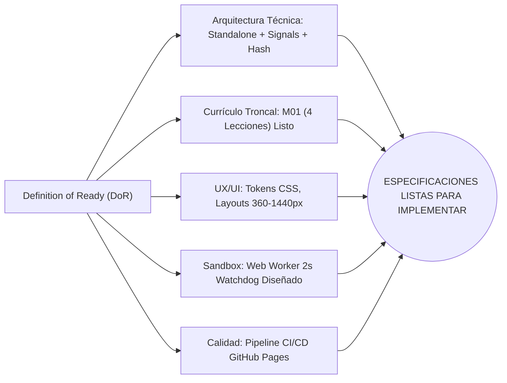

# AppSec Academy — Evaluación de Preparación para el Sprint 1 (Sprint 1 Readiness Assessment)

## 1. Declaración de Preparación y Dictamen

El comité evaluador establece que el proyecto **AppSec Academy** ha completado sus especificaciones documentales conforme a los criterios de la **Definición de Preparado (*Definition of Ready - DoR*)** para dar paso a la fase de construcción.

### Dictamen Oficial:
**APTO PARA INICIAR IMPLEMENTACIÓN CON HIPÓTESIS TÉCNICAS PENDIENTES DE VALIDACIÓN.**

> [!WARNING]
> **Aviso de Alcance y Rigor Metodológico**:
> Este dictamen avala la coherencia de los modelos y la planificación arquitectónica. **No representa una certificación de seguridad, accesibilidad, rendimiento ni calidad de implementación.**
> De conformidad con la [Política de Evidencia](file:///c:/Users/YAMI/Documents/projects/app-sec-academy-io/docs/governance/EVIDENCE_POLICY.md), todas las decisiones técnicas permanecen catalogadas como hipótesis en [ARCHITECTURAL_ASSUMPTIONS.md](file:///c:/Users/YAMI/Documents/projects/app-sec-academy-io/docs/audit/ARCHITECTURAL_ASSUMPTIONS.md) y deberán ser demostradas empíricamente mediante pruebas de software reproducibles durante el Sprint 1.



---

## 2. Checklist de la Definición de Preparado (Definition of Ready - DoR)

| Criterio DoR | Estado Epistémico | Evidencia / Ubicación Documental |
| :--- | :---: | :--- |
| **Visión y Requisitos de Producto Aprobados** | **DEFINIDO** | `PRD.md`, `PRODUCT_VISION.md` y `SCOPE.md` completamente alineados. |
| **Trazabilidad Curricular al 100%** | **DEFINIDO** | `CONTENT_INVENTORY.md` audita 49 lecciones con fuentes normativas oficiales y versiones verificadas. |
| **Arquitectura Técnica Justificada** | **ANALIZADO** | ADR-001 a ADR-005 aprobados; stack propuesto: Angular 22 Standalone + Signals. |
| **Estrategia de Despliegue en GitHub Pages** | **ANALIZADO (HYP-01)** | Hash Routing (`withHashLocation()`) propuesto; pendiente de verificación en despliegue real. |
| **Modelo de Seguridad de Laboratorios** | **ANALIZADO (HYP-05/06)**| Web Workers con Watchdog de 2s y CSP diseñada; pendiente de PoC ejecutable. |
| **Sistema de Diseño y Ergonomía** | **DEFINIDO (HYP-10/11)** | Tokens CSS y layouts especificados; pendiente de auditoría Axe y responsive en vivo. |
| **Alcance Realista y Priorizado (MoSCoW)** | **DEFINIDO** | Sprint 1 focalizado exclusivamente en el *Walking Skeleton* (44 Story Points). |
| **Presupuesto de Rendimiento** | **ANALIZADO (HYP-03)** | Presupuesto $\le 250$ KB definido; CodeMirror 6 adoptado; pendiente de build de producción. |
| **Entorno de Desarrollo Validado** | **VERIFICADO** | Node.js v24.19.0, npm 11.17.0, Angular CLI 22.1.2 instalados y probados en terminal. |

---

## 3. Alcance Focalizado del Sprint 1 (Walking Skeleton)

Para evitar sobreingeniería y asegurar una primera entrega funcional desplegada en producción en GitHub Pages:

### Lo que SÍ se construirá en el Sprint 1:
1. **Shell de Ingeniería**: Encabezado, navegación lateral colapsable (escritorio) y barra inferior táctil (móvil).
2. **Sistema de Enrutamiento Hash**: URLs compatibles con GitHub Pages (`/#/`, `/#/dashboard`, `/#/curriculum`, `/#/leccion/:id`).
3. **Persistencia Reactiva**: `ProgressStore` con Signals y sincronización transparente con `LocalStorage`.
4. **Espacio de Trabajo de Lección**: Renderizador de las 9 secciones estandarizadas.
5. **Sandbox de Laboratorio**: Web Worker aislado con Watchdog Timer (2s) y suite de aserciones en memoria.
6. **Editor de Código Ligero**: CodeMirror 6 / Textarea enriquecida accesible (peso $< 50$ KB).
7. **Motor de Quizzes Formativos**: Baterías interactivas con retroalimentación inmediata y barajado de distractores.
8. **Módulo 01 Completo (OWASP Fundamentals)**:
   - Lección 1.1: Anatomía de Debilidades y Metodología OWASP.
   - Lección 1.2: Broken Access Control (con laboratorio interactivo `LAB-BAC-01` en sandbox).
   - Lección 1.3: Fallos Criptográficos y de Configuración.
   - Lección 1.4: Marco de Verificación OWASP ASVS (L1, L2, L3).
9. **Pipeline CI/CD**: Despliegue automatizado a GitHub Pages ante push a `main`.

### Lo que se posterga para Sprints posteriores (Fase 2):
- Diseñador visual libre con drag & drop de diagramas DFD (Threat Modeling Studio avanzado).
- Simulador interactivo animado de paquetes de red (Security Architecture Visualizer dinámico).
- Grafo tridimensional / visual interactivo complejo (Knowledge Graph avanzado).
- Módulos 02 al 14 (se construirán progresivamente en los Sprints 2, 3 y 4).

---

## 4. Secuencia de Implementación del Sprint 1

```text
Día 1-2: Inicialización del Shell Standalone + Tokens CSS + Configuración Router Hash
Día 3-4: StorageService + ProgressStore con Signals + Dashboard con métricas reales
Día 5-6: LessonWorkspaceComponent (9 secciones) + CodeViewer accesible
Día 7-8: SandboxService (Web Worker + Watchdog) + CodeEditor (CodeMirror 6) + Lab BAC-01
Día 9-10: Autoría Módulo 01 (4 lecciones) + Quizzes + Tests E2E Playwright + GitHub Actions Deploy
```

---

## 5. Cierre Documental del Sprint 0.9 y Solicitud de Aprobación

Se da por completado el proceso de cierre y rectificación documental del **Sprint 0** y **Sprint 0.9**. 

Conforme al dictamen emitido:
**APTO PARA INICIAR IMPLEMENTACIÓN CON HIPÓTESIS TÉCNICAS PENDIENTES DE VALIDACIÓN.**

Se solicita la confirmación y autorización expresa del propietario del proyecto antes de arrancar los trabajos de implementación de software del Sprint 1.
