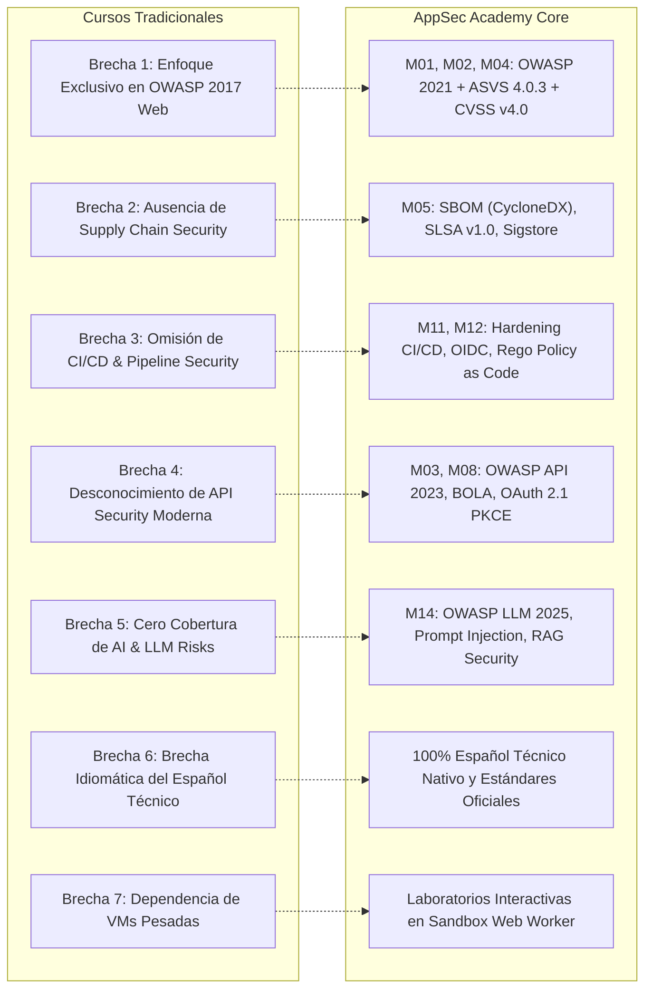

# AppSec Academy — Análisis de Brechas de Contenido (Content Gap Analysis)

## 1. Justificación y Propósito del Análisis

La mayoría de los programas de formación en seguridad de aplicaciones existentes en el mercado padecen desfases temporales significativos o sesgos teóricos que limitan la efectividad del ingeniero en el mundo real. 

Este documento identifica las **siete brechas críticas** detectadas en la oferta formativa tradicional y detalla la estrategia de contenidos aplicada por AppSec Academy para cerrar cada una de ellas con rigor de ingeniería.

---

## 2. Detalle de Brechas y Soluciones de Ingeniería

### Brecha 1: Obsolescencia Metodológica y Enfoque Limitado a OWASP Top 10 Tradicional
- **El Problema**: Muchos cursos continúan enseñando el OWASP Top 10 de 2013 o 2017, centrando el 80% de su tiempo en Inyección SQL clásica de formularios web y Cross-Site Scripting reflejado en PHP. Ignoran que en OWASP 2021 el vector predominante es *Broken Access Control* (A01:2021) y fallos de configuración.
- **La Solución en AppSec Academy**:
  - Incorporación prioritaria de OWASP Top 10:2021, OWASP ASVS v4.0.3 y FIRST CVSS v4.0 (publicado en noviembre de 2023).
  - Laboratorios específicos donde el estudiante experimenta cómo la falta de verificación de tenencia o privilegios verticales compromete microservicios modernos.

### Brecha 2: Omisión Total de Seguridad en la Cadena de Suministro (Supply Chain Security)
- **El Problema**: Los ataques modernos como SolarWinds, Log4j, Codecov y las inyecciones maliciosas en registros npm y PyPI demuestran que el software se compromete mediante sus dependencias. La educación tradicional rara vez aborda SBOMs, atestados o procedencia.
- **La Solución en AppSec Academy**:
  - Creación del **Módulo 05 completo**, dedicado a Software Supply Chain Security.
  - Prácticas interactivas con Software Bill of Materials (SBOM en estándar CycloneDX y SPDX), niveles de aseguramiento SLSA v1.0 y simulación de firmas criptográficas con Sigstore/Cosign.

### Brecha 3: Ignorar la Seguridad de los Pipelines CI/CD y Policy as Code
- **El Problema**: Los ingenieros aprenden a proteger el código pero dejan los runners de CI/CD con permisos administrativos en la nube, usando tokens estáticos y workflows vulnerables a inyección de comandos desde Pull Requests no confiables.
- **La Solución en AppSec Academy**:
  - **Módulos 11 y 12**, dedicados a DevSecOps y seguridad en CI/CD.
  - Ejercicios prácticos de detección de inyecciones de contexto en GitHub Actions, adopción de identidades federadas OIDC para eliminar credenciales permanentes, y autoría de reglas Policy as Code con Open Policy Agent (OPA/Rego).

### Brecha 4: Desconexión de las APIs REST, GraphQL y la Autenticación Moderna
- **El Problema**: Los programas convencionales enseñan autenticación basada en sesiones por cookies de frameworks monolíticos. Rara vez profundizan en los riesgos específicos de APIs (OWASP API Security Top 10:2023), BOLA (Broken Object Level Authorization), ataques a JWT o el intercambio seguro con PKCE en OAuth 2.1.
- **La Solución en AppSec Academy**:
  - **Módulos 03 y 08**, con cobertura profunda de la especificación OWASP API Security 2023, manipulación de Claims en JWT, ataque `alg:none` y autenticación moderna sin contraseñas (Passkeys / WebAuthn).

### Brecha 5: Cero Preparación frente a Riesgos de Inteligencia Artificial y LLMs
- **El Problema**: La proliferación de agentes de IA y aplicaciones basadas en LLMs (GenAI) ha generado una nueva superficie de ataque (Prompt Injection directa/indirecta, envenenamiento de RAG, fugas en llamadas a herramientas) que ningún plan de estudios de AppSec tradicional incluye.
- **La Solución en AppSec Academy**:
  - **Módulo 14 pionero en español**, alineado con el estándar OWASP Top 10 for LLM Applications (versiones 2023/2025) y MITRE ATLAS, con laboratorios de mitigación de inyección de prompts, sanitización de salidas y sandboxing de invocación de herramientas.

### Brecha 6: La Gran Brecha Idiomática del Español Técnico Riguroso
- **El Problema**: La literatura de calidad en ciberseguridad se publica casi exclusivamente en inglés. El material existente en español a menudo sufre de traducciones automáticas deficientes, terminología confusa o falta de actualización frente a los RFCs y estándares actuales.
- **La Solución en AppSec Academy**:
  - Plataforma desarrollada de forma nativa en español técnico preciso, cuidando la equivalencia conceptual con los términos universales de la industria (ej. *Sanitización contextual*, *Límites de confianza*, *Procedencia de artefactos*, *Vector de ataque*).

### Brecha 7: Fricción Operativa y Barrera de Infraestructura
- **El Problema**: Los laboratorios de ciberseguridad en línea suelen requerir arrancar máquinas virtuales en la nube que tardan minutos en inicializar, se desconectan con frecuencia o exigen suscripciones costosas.
- **La Solución en AppSec Academy**:
  - Arquitectura estática en el navegador (*Browser-native sandbox*): Cero tiempo de espera, ejecución instantánea en Web Workers, sin costo de infraestructura para el estudiante y operable en cualquier máquina o dispositivo móvil.

---

## 3. Reconciliación Curricular: Temas Específicos del Propietario

En cumplimiento del Hito 0.9.3, se contrastan los temas requeridos por el propietario del proyecto clasificando su nivel de cobertura en:
- **Cobertura Explícita**: Tema con módulo o lección dedicada con código o estándares normativos.
- **Cobertura Parcial**: Tema cubierto de forma transversal dentro de explicaciones conceptuales que requiere refuerzo de nomenclatura.
- **Contenido Pendiente**: Tema no incorporado en el catálogo actual que debe programarse.

| Tema Requerido por Propietario | Módulo / Lección Asociada | Nivel de Cobertura | Detalle y Referencias Normativas | Acción de Reconciliación |
| :--- | :---: | :---: | :--- | :--- |
| **Defense in Depth (Defensa en Profundidad)** | M01.1, M02.1, M06.1 | **Cobertura Explícita** | Principio de arquitectura multicapa (validación en cliente, validación en servidor, sentencias preparadas, CSP, WAF). | Mantener como principio troncal visible en los resúmenes de lección. |
| **Application Security Goals (CIA + AAA)** | M01.1 | **Cobertura Parcial** | Se explican Confidencialidad, Integridad y Disponibilidad; se debe formalizar Autenticación, Autorización y Auditoría. | Reforzar explícitamente en el texto de la Lección 1.1 la tríada CIA y los objetivos AAA. |
| **NIST (Frameworks y Publicaciones Especiales)** | M04, M06, M09, M10, M11, M14 | **Cobertura Explícita** | NIST SP 800-53 Rev. 5, SP 800-63B (Identidad digital), SP 800-145 (Cloud), SP 800-204D (DevSecOps), AI RMF 1.0. | Conservar las citas con número de versión y año de publicación. |
| **CSA (Cloud Security Alliance)** | M06.1, M06.2 | **Cobertura Parcial** | Se citaban CIS Cloud Benchmarks y AWS Well-Architected, sin mención explícita al Cloud Controls Matrix (CCM). | **Reconciliado**: Incorporar explícitamente la matriz CSA Cloud Controls Matrix (CCM v4) y Top Threats de CSA en M06. |
| **API Security** | M03 (3.1 a 3.4) | **Cobertura Explícita** | Módulo completo dedicado a OWASP API Security Top 10 (2023), BOLA, BFLA, Rate Limiting y Mass Assignment. | Cobertura integral consolidada. |
| **Content Security Policy (CSP)** | M01.3, M02.1, Lab 04 | **Cobertura Explícita** | Directivas CSP evaluadas en lecciones de cabeceras defensivas, mitigación de XSS y arquitectura de la plataforma. | Cobertura integral consolidada. |
| **Server-Side Request Forgery (SSRF)** | M03.4, Lab 03 | **Cobertura Explícita** | Lección dedicada 3.4 y laboratorio interactivo `LAB-SSRF-03` con filtrado de rangos privados e IMDSv2. | Cobertura integral consolidada. |
| **Vulnerability Management** | M04 (4.1 a 4.3) | **Cobertura Explícita** | Módulo completo dedicado a CVE, CWE, FIRST CVSS v4.0 (Nov 2023), EPSS v3 y catálogo CISA KEV. | Cobertura integral consolidada. |

---

## 4. Diferenciación Operativa: 12 Laboratorios Troncales vs. 49 Actividades Prácticas

Para evitar confusiones en la planificación de desarrollo y estimaciones de esfuerzo:

1. **12 Laboratorios Troncales Catalogados (`LAB_CATALOG.md`)**:
   - Son entornos de laboratorio de **codificación e inspección profunda en sandbox hermético** (`LAB-BAC-01` a `LAB-AI-12`).
   - Cuentan con archivos de código inicial vulnerable en TypeScript/JavaScript/SQL/YAML/Rego, consola de salida de aserciones en Web Worker, sistema de 3 pistas graduadas y verificación automática de neutralización del exploit y conservación de la funcionalidad legítima.
2. **49 Actividades Prácticas de Lección (`CURRICULUM_MAP.md` / `CONTENT_INVENTORY.md`)**:
   - Cada una de las 49 lecciones del currículo incorpora una actividad práctica interactiva en su **Sección 6**.
   - De estas 49 actividades, **12 corresponden a los laboratorios troncales** antes descritos, mientras que las **37 restantes son actividades interactivas guiadas en el cliente**:
     - *Simuladores y comparadores visuales* (ej. Comparador dinámico OWASP 2017 vs 2021).
     - *Calculadoras especializadas* (ej. Calculador de vector CVSS v4.0).
     - *Constructores de checklists* (ej. Generador de checklist ASVS según criticidad).
     - *Auditorías de manifiestos guiadas* (ej. Inspección de árbol SBOM CycloneDX, linter de Dockerfile).
     - *Diagramación guiada* (ej. Flujos de intercambio OAuth 2.1 con PKCE en SVG interactivo).
