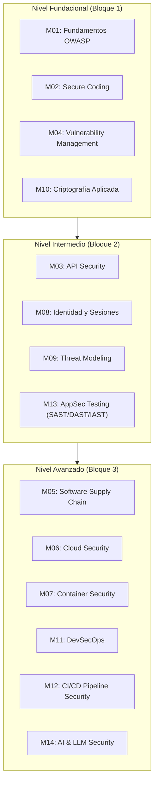

# AppSec Academy — Mapa Curricular Integral (Curriculum Map)

## 1. Estructura y Taxonomía Curricular

El currículo de AppSec Academy está estructurado en **14 Módulos Troncales**, subdivididos en Unidades de Aprendizaje y Lecciones Prácticas. Cada lección contiene una duración estimada estandarizada (lectura conceptual + laboratorio práctico + evaluación/quiz), alineada con estándares internacionales vigentes.

---

## 2. Desglose Detallado de Módulos y Lecciones

### Módulo 01: Fundamentos OWASP y Marcos de Seguridad
- **Estándares Oficiales**: OWASP Top 10:2021, OWASP ASVS v4.0.3 (2021), OWASP SAMM v2.0.1 (2020).
- **Lección 1.1**: Anatomía de las Debilidades de Software y la Metodología OWASP.
  - *Duración*: 25 min (10 min lectura + 10 min demo interactiva + 5 min quiz).
  - *Demo/Lab*: Comparador interactivo de categorías OWASP 2017 vs 2021 y matriz de riesgo.
- **Lección 1.2**: Broken Access Control (A01:2021) — El vector #1 de compromiso.
  - *Duración*: 40 min (15 min lectura + 20 min lab sandbox + 5 min quiz).
  - *Lab*: Detección y parche de elevación horizontal de privilegios en API REST.
- **Lección 1.3**: Fallos Criptográficos y de Configuración (A02 & A05:2021).
  - *Duración*: 35 min (15 min lectura + 15 min lab sandbox + 5 min quiz).
  - *Lab*: Auditoría y corrección de cabeceras de respuesta y cifrado inseguro en tránsito.
- **Lección 1.4**: Marco de Verificación OWASP ASVS y Niveles 1, 2 y 3.
  - *Duración*: 30 min (15 min lectura + 10 min ejercicio guiado + 5 min quiz).
  - *Demo*: Generador de checklist de verificación ASVS según criticidad de la aplicación.

### Módulo 02: Codificación Segura (Secure Coding)
- **Estándares Oficiales**: MITRE CWE Top 25 (2023/2024), SEI CERT Coding Standards.
- **Lección 2.1**: Validación de Entrada y Codificación de Salida Contextual.
  - *Duración*: 45 min (15 min lectura + 25 min lab sandbox + 5 min quiz).
  - *Lab*: Refactorización de renderizado HTML vulnerable a Cross-Site Scripting (XSS).
- **Lección 2.2**: Consultas Parametrizadas y Prevención de Inyecciones (SQLi, NoSQLi, OS Injection).
  - *Duración*: 45 min (15 min lectura + 25 min lab sandbox + 5 min quiz).
  - *Lab*: Transformación de concatenación dinámica en sentencias preparadas y ORM seguro.
- **Lección 2.3**: Manejo Seguro de Memoria, Tipado y Prevención de Desbordamientos.
  - *Duración*: 35 min (15 min lectura + 15 min demo interactiva + 5 min quiz).
  - *Lab*: Análisis de fallos de buffer overflow e integer overflow en código de bajo nivel.
- **Lección 2.4**: Manejo Seguro de Errores y Prevención de Fugas de Información.
  - *Duración*: 30 min (10 min lectura + 15 min lab sandbox + 5 min quiz).
  - *Lab*: Configuración de excepciones estructuradas sin exposición de stack traces al cliente.

### Módulo 03: Seguridad en APIs (API Security)
- **Estándares Oficiales**: OWASP API Security Top 10 (2023), RFC 6749, RFC 7519, OpenAPI 3.1 Security Schemes.
- **Lección 3.1**: Broken Object Level Authorization (API1:2023 BOLA / IDOR).
  - *Duración*: 45 min (15 min lectura + 25 min lab sandbox + 5 min quiz).
  - *Lab*: Implementación de validación de propiedad de recursos en middleware de API.
- **Lección 3.2**: Broken Function Level Authorization (API5:2023 BFLA) y Asignación Masiva.
  - *Duración*: 40 min (15 min lectura + 20 min lab sandbox + 5 min quiz).
  - *Lab*: Control de roles granulares en endpoints administrativos y filtrado de DTOs.
- **Lección 3.3**: Rate Limiting, Throttling y Prevención de Abuso de Recursos.
  - *Duración*: 35 min (15 min lectura + 15 min lab sandbox + 5 min quiz).
  - *Lab*: Configuración de algoritmos Token Bucket y Leaky Bucket en un API Gateway simulado.
- **Lección 3.4**: Server-Side Request Forgery (SSRF) en APIs Modernas.
  - *Duración*: 45 min (15 min lectura + 25 min lab sandbox + 5 min quiz).
  - *Lab*: Restricción de parsers de webhooks y filtrado de rangos de direcciones IP privadas/loopback.

### Módulo 04: Gestión de Vulnerabilidades (Vulnerability Management)
- **Estándares Oficiales**: FIRST CVSS v4.0 (Nov 2023), CVSS v3.1, NIST NVD, MITRE CVE.
- **Lección 4.1**: Taxonomía de Vulnerabilidades: CVE, CWE y CPE.
  - *Duración*: 30 min (15 min lectura + 10 min demo interactiva + 5 min quiz).
  - *Demo*: Rastreo y navegación de relaciones entre fallos CWE y boletines CVE reales.
- **Lección 4.2**: Cálculo y Evaluación de Métricas CVSS v3.1 vs CVSS v4.0.
  - *Duración*: 40 min (15 min lectura + 20 min lab calculador interactivo + 5 min quiz).
  - *Lab*: Simulación de cálculo de vector CVSS (Base, Threat, Environmental).
- **Lección 4.3**: Priorización Basada en Riesgo (EPSS y CISA KEV) y SLAs de Remediación.
  - *Duración*: 35 min (15 min lectura + 15 min caso de estudio + 5 min quiz).
  - *Lab*: Matriz de triaje y priorización de hallazgos críticos vs exposición real.

### Módulo 05: Seguridad de la Cadena de Suministro (Software Supply Chain Security)
- **Estándares Oficiales**: OpenSSF SLSA v1.0 (2023), CycloneDX v1.5 / SPDX 2.3, NIST SP 800-161r1.
- **Lección 5.1**: Amenazas a la Cadena de Suministro: Dependency Confusion y Typosquatting.
  - *Duración*: 40 min (15 min lectura + 20 min lab sandbox + 5 min quiz).
  - *Lab*: Configuración de namespaces privados y políticas de resolución de registros npm/PyPI.
- **Lección 5.2**: Software Bill of Materials (SBOM): Generación, Análisis y Validación.
  - *Duración*: 40 min (15 min lectura + 20 min lab interactivo + 5 min quiz).
  - *Lab*: Inspección y validación de documentos SBOM CycloneDX buscando componentes vulnerables.
- **Lección 5.3**: Marco SLSA (Supply-chain Levels for Software Artifacts) y Firma Criptográfica.
  - *Duración*: 45 min (15 min lectura + 25 min lab interactivo + 5 min quiz).
  - *Lab*: Simulación de firma y verificación de atestados de procedencia mediante Sigstore/Cosign.

### Módulo 06: Seguridad en la Nube (Cloud Security)
- **Estándares Oficiales**: CIS Cloud Benchmarks, NIST SP 800-145, AWS/Azure/GCP Well-Architected Security Pillars.
- **Lección 6.1**: Modelo de Responsabilidad Compartida y Seguridad en Arquitecturas Cloud-Native.
  - *Duración*: 30 min (15 min lectura + 10 min demo interactiva + 5 min quiz).
  - *Demo*: Simulador de responsabilidades IaaS, PaaS y Serverless.
- **Lección 6.2**: Principio de Menor Privilegio en IAM y Políticas de Acceso Basadas en Roles.
  - *Duración*: 45 min (15 min lectura + 25 min lab sandbox + 5 min quiz).
  - *Lab*: Auditoría y reducción de políticas IAM wildcard permisivas (`*`) a permisos mínimos.
- **Lección 6.3**: Gestión Segura de Secretos y Blindaje del Servicio de Metadatos (IMDSv2).
  - *Duración*: 40 min (15 min lectura + 20 min lab sandbox + 5 min quiz).
  - *Lab*: Prevención de robo de credenciales temporales mediante configuración de IMDSv2 y Vault.

### Módulo 07: Seguridad en Contenedores (Container Security)
- **Estándares Oficiales**: CIS Docker Benchmark v1.6.0, Kubernetes Pod Security Standards (PSS), OCI Specification.
- **Lección 7.1**: Hardening de Dockerfiles y Reducción de Superficie de Ataque.
  - *Duración*: 40 min (15 min lectura + 20 min lab sandbox + 5 min quiz).
  - *Lab*: Refactorización de Dockerfile: usuarios no-root, distroless y multi-stage builds.
- **Lección 7.2**: Escaneo Estático de Imágenes OCI y Detección de Malware/Vulnerabilidades.
  - *Duración*: 35 min (15 min lectura + 15 min lab interactivo + 5 min quiz).
  - *Lab*: Análisis de reportes de escaneo de capas y selección de imágenes base limpias.
- **Lección 7.3**: Seguridad en Runtime de Contenedores y Kubernetes Pod Security Admission.
  - *Duración*: 40 min (15 min lectura + 20 min lab interactivo + 5 min quiz).
  - *Lab*: Definición de perfiles de seguridad `restricted` de Kubernetes y seccomp.

### Módulo 08: Gestión de Identidad, Autenticación y Sesiones
- **Estándares Oficiales**: RFC 6749/RFC 8252 (OAuth 2.0 / 2.1 Draft), OpenID Connect Core 1.0, RFC 7519 (JWT), NIST SP 800-63B.
- **Lección 8.1**: OAuth 2.1, Proof Key for Code Exchange (PKCE) y Autenticación Moderna.
  - *Duración*: 45 min (15 min lectura + 25 min lab interactivo + 5 min quiz).
  - *Lab*: Trazado y validación de flujo de autorización con PKCE para Single Page Applications.
- **Lección 8.2**: Seguridad Robusta en Tokens JWT: Firmas, Ataques `alg: none` y Rotación de JWKS.
  - *Duración*: 45 min (15 min lectura + 25 min lab sandbox + 5 min quiz).
  - *Lab*: Detección de manipulación de tokens JWT y validación rigurosa de Claims en cliente y servidor.
- **Lección 8.3**: Gestión Segura de Sesiones, Cookies (`HttpOnly`, `SameSite`, `Partitioned`) y CSRF.
  - *Duración*: 40 min (15 min lectura + 20 min lab sandbox + 5 min quiz).
  - *Lab*: Blindaje de cookies de sesión contra Session Fixation y Cross-Site Request Forgery.
- **Lección 8.4**: Autenticación Multifactor (MFA) y Passkeys (WebAuthn / FIDO2).
  - *Duración*: 35 min (15 min lectura + 15 min demo interactiva + 5 min quiz).
  - *Demo*: Flujo de registro y autenticación con WebAuthn sin contraseñas.

### Módulo 09: Modelado de Amenazas (Threat Modeling)
- **Estándares Oficiales**: Metodología STRIDE (Microsoft), PASTA (Risk-Centric), OWASP Threat Dragon Spec, NIST SP 800-154.
- **Lección 9.1**: Fundamentos de Threat Modeling: ¿Qué construimos y qué puede salir mal?
  - *Duración*: 35 min (15 min lectura + 15 min caso de estudio + 5 min quiz).
  - *Demo*: Identificación de los 4 pilares de Shostack en un sistema de comercio electrónico.
- **Lección 9.2**: Diagramas de Flujo de Datos (DFD) y Delimitación de Trust Boundaries.
  - *Duración*: 45 min (15 min lectura + 25 min lab interactivo en Threat Modeling Studio + 5 min quiz).
  - *Lab*: Construcción interactiva de un DFD señalando límites de confianza y puntos de ingreso.
- **Lección 9.3**: Aplicación de la Metodología STRIDE a Componentes de Software.
  - *Duración*: 45 min (15 min lectura + 25 min lab interactivo + 5 min quiz).
  - *Lab*: Matriz de amenazas STRIDE sobre un microservicio de pagos y selección de mitigaciones.
- **Lección 9.4**: Árboles de Ataque y Modelado de Amenazas Centrado en el Riesgo (PASTA).
  - *Duración*: 40 min (15 min lectura + 20 min lab interactivo + 5 min quiz).
  - *Lab*: Composición de un árbol de ataque interactivo para el compromiso de credenciales.

### Módulo 10: Criptografía Aplicada al Software
- **Estándares Oficiales**: NIST SP 800-175B, FIPS 140-3, RFC 8446 (TLS 1.3), Password Hashing Competition (Argon2 RFC 9106).
- **Lección 10.1**: Algoritmos Criptográficos Modernos: Simétricos vs Asimétricos.
  - *Duración*: 40 min (15 min lectura + 20 min lab interactivo + 5 min quiz).
  - *Lab*: Cifrado autenticado AES-256-GCM y verificación de integridad mediante HMAC.
- **Lección 10.2**: Almacenamiento Seguro de Contraseñas: Salt, Work Factor, Argon2id y Bcrypt.
  - *Duración*: 40 min (15 min lectura + 20 min lab sandbox + 5 min quiz).
  - *Lab*: Comparativa de coste computacional de hashing y protección contra tablas Rainbow.
- **Lección 10.3**: Seguridad en Comunicaciones: Protocolo TLS 1.3 y Certificate Pinning.
  - *Duración*: 35 min (15 min lectura + 15 min demo interactiva + 5 min quiz).
  - *Demo*: Inspección de Handshake TLS 1.3, Cipher Suites seguras y Perfect Forward Secrecy (PFS).
- **Lección 10.4**: Ciclo de Vida y Gestión Segura de Claves Criptográficas (KMS / HSM).
  - *Duración*: 35 min (15 min lectura + 15 min lab interactivo + 5 min quiz).
  - *Lab*: Configuración de rotación automática y separación de responsabilidades de claves.

### Módulo 11: DevSecOps y Cultura Shift-Left
- **Estándares Oficiales**: NIST SP 800-204D, DoD DevSecOps Reference Design, OWASP SAMM.
- **Lección 11.1**: Principios DevSecOps: De la Seguridad Perimetral a la Seguridad Continua.
  - *Duración*: 30 min (15 min lectura + 10 min caso de estudio + 5 min quiz).
  - *Demo*: Mapeo del ciclo SDLC tradicional versus pipeline DevSecOps colaborativo.
- **Lección 11.2**: Security as Code y Policy as Code (Open Policy Agent - OPA / Rego).
  - *Duración*: 45 min (15 min lectura + 25 min lab sandbox + 5 min quiz).
  - *Lab*: Redacción y prueba de reglas Rego para impedir despliegues con privilegios elevados.
- **Lección 11.3**: Automatización de Quality Gates y Métricas de Desempeño DevSecOps.
  - *Duración*: 35 min (15 min lectura + 15 min caso interactivo + 5 min quiz).
  - *Lab*: Configuración de umbrales de bloqueo de despliegue basados en severidad CVSS.

### Módulo 12: Seguridad en Pipelines CI/CD
- **Estándares Oficiales**: OWASP Top 10 CI/CD Security Risks (2024), CIS Software Supply Chain Benchmark.
- **Lección 12.1**: Riesgos de Seguridad en CI/CD: Inyección de Comandos en Pipelines y Robo de Secretos.
  - *Duración*: 40 min (15 min lectura + 20 min lab sandbox + 5 min quiz).
  - *Lab*: Detección y corrección de expresión de inyección de contexto en GitHub Actions workflow.
- **Lección 12.2**: Aislamiento de Runners y Tokens Efímeros (OIDC en GitHub Actions/GitLab CI).
  - *Duración*: 45 min (15 min lectura + 25 min lab interactivo + 5 min quiz).
  - *Lab*: Sustitución de claves estáticas de nube por autenticación OIDC con roles federados.
- **Lección 12.3**: Blindaje de Flujos de Trabajo: Git Hooks, Escaneo Pre-Commit y Protección de Ramas.
  - *Duración*: 35 min (15 min lectura + 15 min lab sandbox + 5 min quiz).
  - *Lab*: Implementación de reglas pre-commit con escáneres de secretos (TruffleHog / Gitleaks simulados).

### Módulo 13: Pruebas de Seguridad en Aplicaciones (AppSec Testing)
- **Estándares Oficiales**: OWASP Web Security Testing Guide (WSTG v4.2), ISO/IEC 29119-3.
- **Lección 13.1**: Static Application Security Testing (SAST): Reglas, ASTs y Falsos Positivos.
  - *Duración*: 40 min (15 min lectura + 20 min lab interactivo + 5 min quiz).
  - *Lab*: Creación de una regla semántica (Semgrep simulado) para atrapar usos inseguros de API.
- **Lección 13.2**: Dynamic Application Security Testing (DAST) e Interactive AST (IAST).
  - *Duración*: 40 min (15 min lectura + 20 min lab interactivo + 5 min quiz).
  - *Lab*: Análisis de trazas DAST activas versus telemetría interna IAST.
- **Lección 13.3**: Fuzzing Automatizado de Software y Pruebas de Resiliencia.
  - *Duración*: 35 min (15 min lectura + 15 min lab sandbox + 5 min quiz).
  - *Lab*: Generación de payloads mutacionales en cliente para comprobar límites de parsers JSON.

### Módulo 14: Seguridad en Inteligencia Artificial y LLMs
- **Estándares Oficiales**: OWASP Top 10 for LLM Applications (2025/2023), MITRE ATLAS, NIST AI Risk Management Framework (AI RMF 1.0).
- **Lección 14.1**: Prompt Injection Directa e Indirecta (LLM01).
  - *Duración*: 45 min (15 min lectura + 25 min lab sandbox + 5 min quiz).
  - *Lab*: Pruebas de evasión de restricciones y diseño de filtros defensivos con validación de salida.
- **Lección 14.2**: Insecure Output Handling (LLM02) y Ataques XSS / SSRF vía LLMs.
  - *Duración*: 40 min (15 min lectura + 20 min lab sandbox + 5 min quiz).
  - *Lab*: Aislamiento de respuestas generadas por IA y sanitización antes de su ejecución en el cliente.
- **Lección 14.3**: Envenenamiento de Datos (Data Poisoning) y Exfiltración de Información en RAG.
  - *Duración*: 40 min (15 min lectura + 20 min lab interactivo + 5 min quiz).
  - *Lab*: Auditoría de vectores de contexto en pipelines RAG (Retrieval-Augmented Generation).
- **Lección 14.4**: Sandboxing y Permisos Restringidos para Agentes Autónomos con Herramientas.
  - *Duración*: 45 min (15 min lectura + 25 min lab sandbox + 5 min quiz).
  - *Lab*: Definición de listas blancas de herramientas (*Tool Calling Security*) y control de ejecución.

---

## 3. Métricas Consolidadas del Currículo

- **Total Módulos Troncales**: 14 módulos.
- **Total Lecciones Estructuradas**: 49 lecciones.
- **Total Laboratorios y Demos en Sandbox**: 49 laboratorios interactivos.
- **Total Evaluaciones Formativas (Quizzes)**: 49 cuestionarios.
- **Duración Total de Instrucción**: 1,905 minutos (31 horas y 45 minutos de formación técnica rigurosa).
