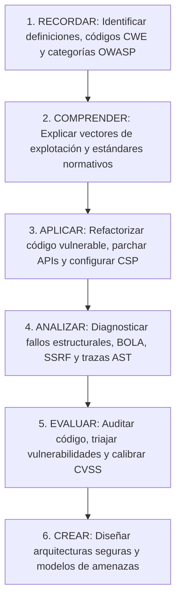

# AppSec Academy — Objetivos de Aprendizaje y Competencias Operativas (Learning Objectives)

## 1. Marco Pedagógico y Diseño Instruccional

El currículo de AppSec Academy aplica la **Taxonomía Revisada de Bloom** orientada a la ingeniería de software y la ciberseguridad. Los objetivos evitan el conocimiento puramente memorístico ("Recordar") y priorizan los niveles cognitivos superiores: **Aplicar, Analizar, Evaluar y Crear**.

---

## 2. Objetivos de Aprendizaje por Módulo Troncal

### Módulo 01: Fundamentos OWASP y Marcos de Seguridad
Al finalizar este módulo, el ingeniero será capaz de:
1. **Comprender**: Explicar la diferencia entre una debilidad de software (CWE), una vulnerabilidad conocida (CVE) y un vector de ataque.
2. **Analizar**: Diferenciar los cambios metodológicos y vectores de riesgo entre las versiones históricas y actuales de OWASP Top 10.
3. **Aplicar**: Implementar controles de autorización a nivel de código para erradicar fallos de Broken Access Control (A01:2021).
4. **Evaluar**: Seleccionar el nivel de verificación adecuado (Nivel 1, 2 o 3) de OWASP ASVS según la exposición y criticidad del sistema.

### Módulo 02: Codificación Segura (Secure Coding)
Al finalizar este módulo, el ingeniero será capaz de:
1. **Aplicar**: Implementar esquemas estrictos de validación de entrada por lista blanca y codificación contextual de salida para neutralizar Cross-Site Scripting (XSS).
2. **Crear**: Refactorizar código dinámico vulnerable a Inyección SQL/NoSQL/Comandos hacia sentencias parametrizadas y abstracciones ORM seguras.
3. **Analizar**: Diagnosticar fugas de memoria, integer overflows y condiciones de carrera en el manejo de estructuras de datos.
4. **Aplicar**: Configurar manejadores globales de excepciones que impidan la revelación de stack traces y metadatos sensibles al usuario final.

### Módulo 03: Seguridad en APIs (API Security)
Al finalizar este módulo, el ingeniero será capaz de:
1. **Evaluar**: Auditar endpoints REST/GraphQL para detectar fallos de autorización a nivel de objeto (BOLA) y función (BFLA).
2. **Aplicar**: Diseñar middlewares de validación de tenencia (*multi-tenancy scoping*) y esquemas DTO estrictos que prevengan la asignación masiva.
3. **Aplicar**: Configurar mecanismos de control de tasa (*Rate Limiting*) mediante algoritmos de Token Bucket para proteger recursos contra agotamiento y ataques de fuerza bruta.
4. **Remediar**: Neutralizar vectores de Server-Side Request Forgery (SSRF) implementando resolución previa de DNS y listas de bloqueo para rangos IP privados y loopback.

### Módulo 04: Gestión y Triaje de Vulnerabilidades
Al finalizar este módulo, el ingeniero será capaz de:
1. **Analizar**: Relacionar alertas de escaneo con su identificador CVE, su clasificación en el árbol de debilidades CWE y sus plataformas CPE.
2. **Evaluar**: Calcular con precisión el vector de severidad CVSS v4.0 (métricas Base, Threat y Environmental) distinguiéndolo de CVSS v3.1.
3. **Crear**: Elaborar matrices de priorización operativa que crucen CVSS con probabilidad real de explotación (EPSS) y catálogo CISA KEV para cumplir SLAs de remediación realistas.

### Módulo 05: Seguridad de la Cadena de Suministro (Supply Chain)
Al finalizar este módulo, el ingeniero será capaz de:
1. **Analizar**: Identificar vectores de ataque por Dependency Confusion, Namesquatting y compromiso de dependencias transitivas.
2. **Crear**: Generar y validar especificaciones Software Bill of Materials (SBOM) en formatos estándar CycloneDX y SPDX.
3. **Aplicar**: Configurar atestados de procedencia y verificación de firmas criptográficas de artefactos y paquetes utilizando Sigstore/Cosign bajo el marco SLSA v1.0.

### Módulo 06: Seguridad en la Nube (Cloud Security)
Al finalizar este módulo, el ingeniero será capaz de:
1. **Evaluar**: Delimitar responsabilidades de seguridad según el modelo de servicio (IaaS, PaaS, SaaS, FaaS) bajo la arquitectura Well-Architected.
2. **Aplicar**: Diseñar políticas IAM de menor privilegio (*least privilege*) eliminando comodines y asignando roles efímeros.
3. **Remediar**: Proteger los servicios de metadatos de instancia (migración a IMDSv2) y centralizar secretos en bóvedas seguras (KMS / HashiCorp Vault) evitando credenciales quemadas en código o variables de entorno.

### Módulo 07: Seguridad en Contenedores (Container Security)
Al finalizar este módulo, el ingeniero será capaz de:
1. **Crear**: Construir Dockerfiles endurecidos aplicando imágenes base distroless/alpine, multi-stage builds y ejecución obligatoria como usuario no-root.
2. **Analizar**: Auditar reportes de escaneo de vulnerabilidades en imágenes OCI identificando paquetes base prescindibles.
3. **Aplicar**: Configurar políticas de admisión de pods en Kubernetes (*Pod Security Standards*) en perfil `restricted` y perfiles seccomp/AppArmor.

### Módulo 08: Identidad, Autenticación y Sesiones
Al finalizar este módulo, el ingeniero será capaz de:
1. **Comprender**: Trazar el flujo criptográfico de intercambio de código con PKCE en OAuth 2.1 y la emisión de tokens de identidad en OpenID Connect.
2. **Evaluar**: Auditar la validez y seguridad de tokens JWT (verificación de algoritmo, firma JWKS, expiración y audience claims).
3. **Aplicar**: Blindar cookies de sesión con directivas `HttpOnly`, `Secure` y `SameSite=Strict/Lax`, eliminando vectores de Session Fixation y CSRF.
4. **Analizar**: Diseñar flujos de autenticación resistentes al phishing mediante el estándar WebAuthn / Passkeys (FIDO2).

### Módulo 09: Modelado de Amenazas (Threat Modeling)
Al finalizar este módulo, el ingeniero será capaz de:
1. **Crear**: Dibujar Diagramas de Flujo de Datos (DFDs) rigurosos identificando almacenes, procesos, entidades externas y límites de confianza (*Trust Boundaries*).
2. **Analizar**: Descubrir amenazas sistemáticas aplicando la mnemotecnia STRIDE a cada elemento arquitectónico.
3. **Evaluar**: Cuantificar el impacto y asociar controles de mitigación normativos vinculados a OWASP ASVS y NIST.
4. **Crear**: Modelar árboles de ataque con cálculo de probabilidad y esfuerzo para escenarios críticos de negocio.

### Módulo 10: Criptografía Aplicada al Software
Al finalizar este módulo, el ingeniero será capaz de:
1. **Aplicar**: Seleccionar e implementar cifrado simétrico autenticado (AES-256-GCM / ChaCha20-Poly1305) evitando modos inseguros como ECB o CBC sin autenticación.
2. **Crear**: Implementar funciones de derivación y hashing de contraseñas de alta resistencia computacional (Argon2id y bcrypt) con parámetros de memoria y coste calibrados.
3. **Comprender**: Explicar las garantías de confidencialidad hacia adelante (*Perfect Forward Secrecy*) en TLS 1.3 y la negociación de suites criptográficas.
4. **Aplicar**: Diseñar esquemas de cifrado de sobre (*Envelope Encryption*) y rotación automática de claves criptográficas.

### Módulo 11: DevSecOps y Cultura Shift-Left
Al finalizar este módulo, el ingeniero será capaz de:
1. **Evaluar**: Mapear el ciclo de desarrollo de software identificando puntos de inserción de controles automatizados sin penalizar la velocidad de despliegue.
2. **Crear**: Redactar y testear políticas como código (Policy as Code) utilizando Open Policy Agent (OPA) y Rego para auditar manifiestos de infraestructura y despliegue.
3. **Aplicar**: Configurar compuertas de calidad (*Quality Gates*) con umbrales objetivos de parada de compilación basados en severidad y explotabilidad.

### Módulo 12: Seguridad en Pipelines CI/CD
Al finalizar este módulo, el ingeniero será capaz de:
1. **Analizar**: Detectar vulnerabilidades de inyección de comandos e inyección de contexto en flujos de trabajo de GitHub Actions y GitLab CI.
2. **Aplicar**: Configurar runners aislados y federación de identidades OIDC efímeras para eliminar credenciales de nube de larga duración en repositorios.
3. **Crear**: Implementar hooks de pre-commit y políticas de protección de ramas con firma obligatoria de commits y escaneo de secretos en tiempo de commit.

### Módulo 13: Pruebas de Seguridad en Aplicaciones (AppSec Testing)
Al finalizar este módulo, el ingeniero será capaz de:
1. **Crear**: Escribir reglas personalizadas de escaneo estático (SAST con Semgrep o ASTs) para detectar patrones inseguros propios del negocio.
2. **Evaluar**: Correlacionar hallazgos de análisis dinámico (DAST) con telemetría interactiva (IAST) para reducir la tasa de falsos positivos.
3. **Aplicar**: Diseñar generadores mutacionales de datos para pruebas de fuzzing sobre interfaces de análisis sintáctico y serialización.

### Módulo 14: Seguridad en Inteligencia Artificial y LLMs
Al finalizar este módulo, el ingeniero será capaz de:
1. **Analizar**: Diferenciar ataques de Prompt Injection directa frente a inyecciones indirectas en flujos de datos externos y RAG.
2. **Remediar**: Sanitizar y aislar las respuestas emitidas por modelos LLM antes de pasarlas a clientes web, APIs o intérpretes de comandos para prevenir XSS o SSRF indirectos.
3. **Evaluar**: Auditar la integridad de almacenes vectoriales y bases de conocimiento RAG contra contaminación maliciosa de contexto.
4. **Crear**: Configurar listas de permisos estrictas (*Allowlists*) y sandboxes restringidos para la ejecución de herramientas por agentes de IA autónomos.
