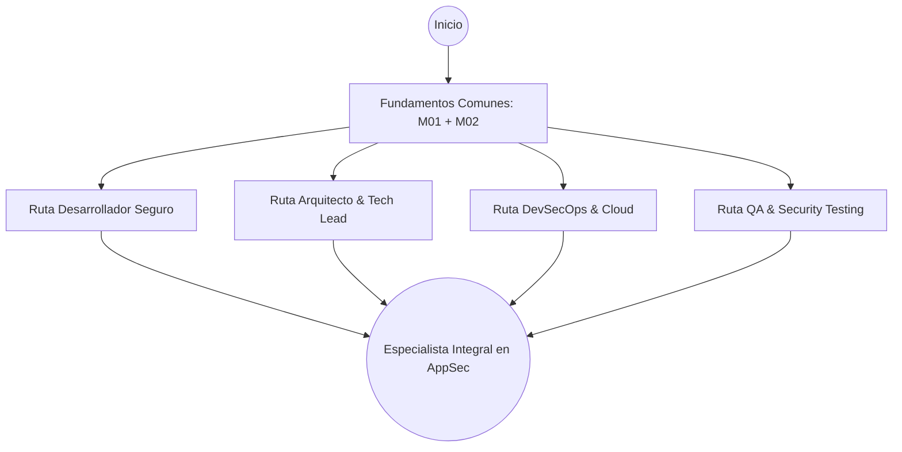
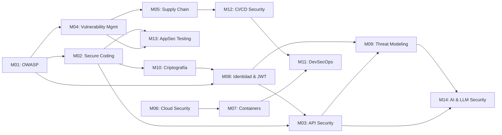

# AppSec Academy — Rutas de Aprendizaje y Prerrequisitos (Learning Paths)

## 1. Visión General de las Rutas

Para adaptarse a los diversos perfiles de ingeniería y objetivos de carrera, AppSec Academy ofrece **una Ruta Troncal Completa** y **cuatro Rutas de Especialización Guiadas**, diseñadas para maximizar el retorno de inversión formativo según el rol técnico del estudiante.

---

## 2. Grafo Dirigido de Prerrequisitos y Dependencias (DAG)

Para asegurar una progresión lógica sin lagunas conceptuales, los módulos respetan el siguiente grafo de dependencias:

---

## 3. Catálogo de Rutas de Especialización

### 3.1. Ruta 1: Desarrollador Seguro (Secure Software Engineer)
- **Audiencia**: Desarrolladores Backend, Frontend, Fullstack y Mobile.
- **Enfoque**: Escribir código resistente a vulnerabilidades comunes, implementar autenticación robusta y blindar APIs y modelos de IA en el código fuente.
- **Duración Estimada**: 18 horas de estudio y práctica.
- **Módulos Comprendidos**:
  1. `M01`: Fundamentos OWASP y Marcos de Seguridad.
  2. `M02`: Codificación Segura (Secure Coding).
  3. `M03`: Seguridad en APIs (BOLA, BFLA, SSRF).
  4. `M08`: Identidad, Autenticación y Tokens JWT.
  5. `M10`: Criptografía Aplicada al Software.
  6. `M14`: Seguridad en Inteligencia Artificial y LLMs.
- **Hito de Certificación Interna**: Insignia *Certified Secure Software Developer (CSSD)*.

---

### 3.2. Ruta 2: Arquitecto de Software & Tech Lead (Security Architecture & Threat Modeling)
- **Audiencia**: Arquitectos de Soluciones, Tech Leads, Engineering Managers.
- **Enfoque**: Identificación temprana de riesgos, diseño con límites de confianza, evaluación con STRIDE y selección de controles antes de la fase de implementación.
- **Duración Estimada**: 16 horas de estudio y práctica.
- **Módulos Comprendidos**:
  1. `M01`: Fundamentos OWASP y Niveles ASVS.
  2. `M06`: Seguridad en la Nube y Principio de Menor Privilegio (IAM).
  3. `M08`: Identidad Moderna, OAuth 2.1 y PKCE.
  4. `M09`: Modelado de Amenazas (STRIDE / PASTA en Threat Modeling Studio).
  5. `M10`: Criptografía Aplicada y Gestión de Claves (KMS).
  6. `M11`: Principios DevSecOps y Gobernanza Técnica.
  7. `M14`: Seguridad y Arquitectura en Aplicaciones con Inteligencia Artificial.
- **Hito de Certificación Interna**: Insignia *Security Architecture & Threat Modeling Practitioner*.

---

### 3.3. Ruta 3: DevSecOps & Cloud Security (Pipeline & Supply Chain Defender)
- **Audiencia**: Ingenieros DevOps, SREs, Especialistas de Infraestructura y Plataforma.
- **Enfoque**: Integración de escáneres en CI/CD, hardening de contenedores e imágenes OCI, gestión de SBOMs, cumplimiento de niveles SLSA y automatización de Policy as Code.
- **Duración Estimada**: 17 horas de estudio y práctica.
- **Módulos Comprendidos**:
  1. `M04`: Gestión y Triaje de Vulnerabilidades (CVSS v4.0, EPSS).
  2. `M05`: Seguridad de la Cadena de Suministro (SBOM, SLSA, Sigstore).
  3. `M06`: Seguridad en la Nube e IMDSv2.
  4. `M07`: Seguridad en Contenedores y Kubernetes Admission Control.
  5. `M11`: DevSecOps y Policy as Code (OPA / Rego).
  6. `M12`: Seguridad en Pipelines CI/CD y Hardening de Runners.
  7. `M13`: Static Application Security Testing (SAST) en CI/CD.
- **Hito de Certificación Interna**: Insignia *DevSecOps & Supply Chain Security Specialist*.

---

### 3.4. Ruta 4: QA & Seguridad Dinámica (Application Security Testing)
- **Audiencia**: Ingenieros de QA, Especialistas en Automatización de Pruebas, Pentesters junior.
- **Enfoque**: Abuso de lógica de negocio, pruebas dinámicas con DAST y fuzzing, verificación de reglas SAST y detección de inyecciones en APIs y LLMs.
- **Duración Estimada**: 14 horas de estudio y práctica.
- **Módulos Comprendidos**:
  1. `M01`: Fundamentos OWASP Top 10 y ASVS.
  2. `M03`: Seguridad en APIs (BOLA y análisis de endpoints).
  3. `M04`: Triaje de Vulnerabilidades y CVSS.
  4. `M13`: Pruebas de Seguridad en Aplicaciones (SAST, DAST, Fuzzing).
  5. `M14`: Seguridad y Evaluación Adversarial en Modelos LLM.
- **Hito de Certificación Interna**: Insignia *AppSec QA & Testing Practitioner*.

---

### 3.5. Ruta Maestra: Especialista Integral en Application Security (AppSec Master)
- **Audiencia**: Ingenieros de Seguridad de Aplicaciones dedicados y profesionales que buscan dominio exhaustivo.
- **Enfoque**: Cobertura integral de los 14 módulos (49 lecciones con sus laboratorios y quizzes).
- **Duración Total Estimada**: 35 horas académicas (31.75 horas de instrucción directa + margen de experimentación libre en sandbox).
- **Hito de Certificación Interna**: Insignia *AppSec Engineering Master Credential*.

---

## 4. Ritmo y Modalidad de Estudio

| Régimen de Dedicación | Horas por Semana | Tiempo Estimado Ruta de Especialización | Tiempo Estimado Ruta Maestra |
| :--- | :---: | :---: | :---: |
| **Intensivo** | 8 a 10 hrs/semana | ~2 semanas | ~4 semanas |
| **Moderado (Recomendado)** | 4 a 5 hrs/semana | ~3.5 semanas | ~7 a 8 semanas |
| **Flexible (Micro-learning)** | 2 hrs/semana | ~8 semanas | ~16 semanas |
