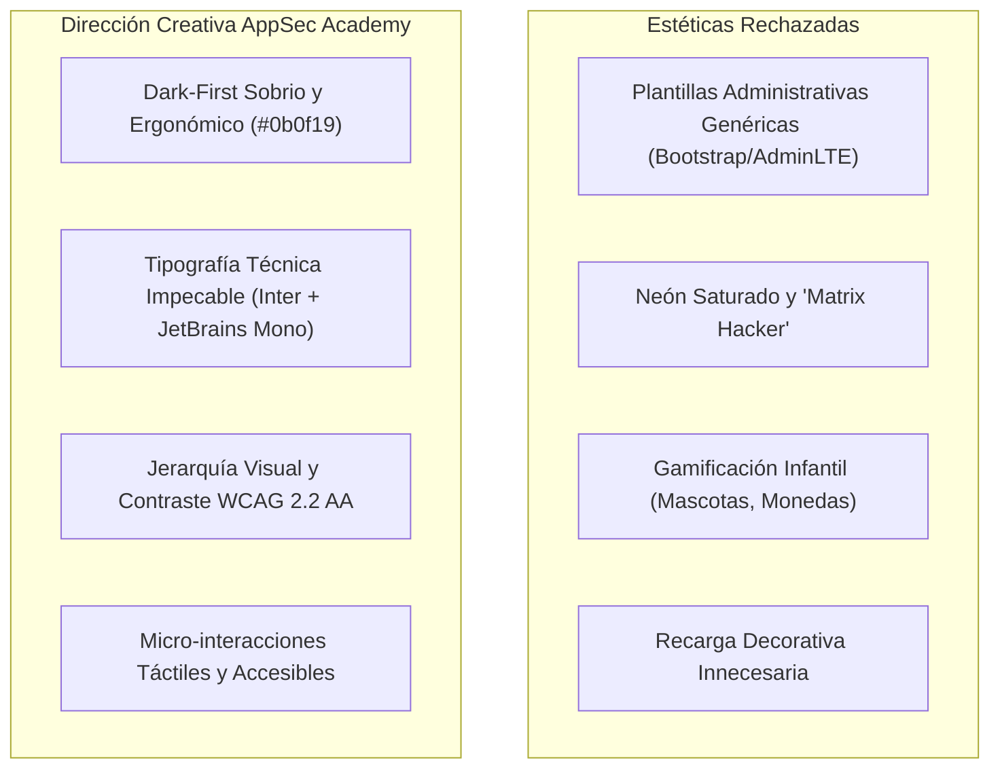
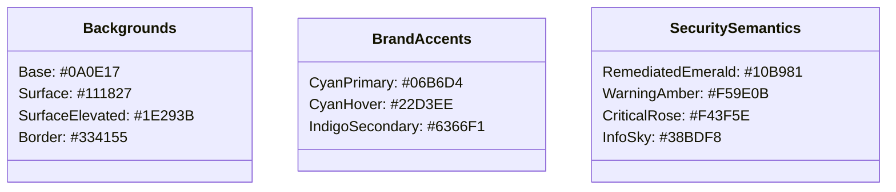

# AppSec Academy — Identidad de Marca y Dirección Creativa (Brand Identity)

## 1. Declaración de Identidad y Posicionamiento

**AppSec Academy** proyecta la sobriedad, precisión y sofisticación de una **estación de trabajo de ingeniería de seguridad moderna**. No es una escuela infantil ni una academia con estética de película de espionaje o estética "hacker" con texto verde fosforescente sobre negro puro.

Es un entorno de trabajo serio, claro y de alta concentración (*focus-first*), comparable con interfaces de grado profesional como Linear, Raycast, Vercel o JetBrains, pero adaptado a la pedagogía de la ciberseguridad.

---

## 2. Los Cuatro Principios de Diseño Visual

1. **Claridad sobre Ornamento**: Cada píxel, borde y color cumple una función informativa. Si un elemento visual no aporta a la comprensión técnica, se elimina.
2. **Ergonomía de Ingeniería (Dark-First)**: El fondo primario oscuro minimiza la fatiga visual de ingenieros que pasan 8 a 12 horas diarias frente a pantallas, complementado con contrastes certificados superiores a 7:1 para lectura prolongada.
3. **Semántica de Seguridad Coherente**: Los colores de estado no se usan como adorno. El ámbar denota riesgo potencial o advertencia; el rojo denota vulnerabilidad crítica o vector explotable; el esmeralda denota mitigación verificada o control efectivo; el cian técnico denota navegación y elementos interactivos.
4. **Mobile First sin Concesiones**: Los desarrolladores consultan documentación técnica en smartphones. El diseño móvil no es una versión recortada o degradada del escritorio; es una experiencia de primer nivel con tipografía calculada, botones cómodos de pulsar y diagramas adaptables.

---

## 3. Paleta Cromática y Tokens de Marca

### 3.1. Superficies y Fondos
- **`--bg-base` (`#0a0e17`)**: Fondo primario ultra oscuro, neutral y profundo.
- **`--bg-surface` (`#111827`)**: Superficie para tarjetas de lecciones, paneles de navegación y bloques de contenido.
- **`--bg-surface-elevated` (`#1e293b`)**: Superficie para barras de herramientas, modales y editores de código.
- **`--border-subtle` (`#1f293d`)**: Bordes divisores discretos para mantener separación sin ruido visual.
- **`--border-focus` (`#38bdf8`)**: Anillo de foco accesible de 2px con offset de 2px para navegación por teclado.

### 3.2. Colores Semánticos de Seguridad
- **`--sec-critical` (`#f43f5e`)**: Vulnerabilidad detectada, vector de ataque explotable, fallo crítico.
- **`--sec-warning` (`#f59e0b`)**: Prerrequisito pendiente, vector mitigado parcialmente, advertencia de configuración.
- **`--sec-secure` (`#10b981`)**: Parche verificado, aserción de seguridad aprobada, estado seguro en producción.
- **`--sec-interactive` (`#06b6d4`)**: Acciones primarias, botones interactivos, selección de pestañas.

---

## 4. Tipografía Técnica

La jerarquía tipográfica equilibra la lectura fluida en prosa técnica con la máxima legibilidad de identificadores, códigos y parámetros de terminal:

- **Tipografía de Interfaz y Prose**: `Inter, system-ui, -apple-system, sans-serif`.
  - Excelente legibilidad en cuerpos de texto pequeños en pantallas móviles.
  - Gran distinción de glifos (`l`, `1`, `I`).
- **Tipografía de Código y Terminal**: `JetBrains Mono, Fira Code, monospace`.
  - Diseñada específicamente para desarrolladores, con soporte de ligaduras de programación opcionales, números tabulares claros y signos de puntuación ampliados para evitar confusiones sintácticas.

---

## 5. Tono de Voz y Estilo de Redacción

- **Profesional, directo y riguroso**: "El vector de inyección ocurre debido a la concatenación directa de parámetros no sanitizados en el intérprete SQL."
- **Evitar la condescendencia o lenguaje excesivamente informal**: Se evita el trato paternalista ("¡Ups, te equivocaste de botón!"). Se prefiere: "La aserción falló: la carga útil maliciosa no fue neutralizada por el validador."
- **Constructivo y centrado en la solución**: Cada error señala el estándar normativo relevante y la referencia para estudiar la mitigación.
