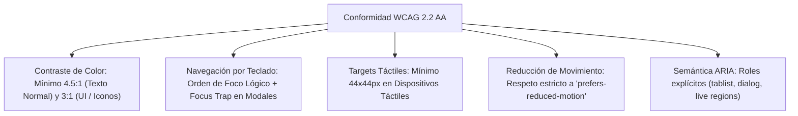

# AppSec Academy — Sistema de Diseño UI (Design System Tokens & Components)

## 1. Tokens de Diseño CSS (Design Tokens)

El sistema de diseño de AppSec Academy se implementa mediante propiedades personalizadas CSS (CSS Custom Properties) nativas, garantizando cero sobrecarga de librerías externas pesadas y reactividad instantánea.

### 1.1. Tokens de Espaciado y Dimensiones
```css
:root {
  --space-1: 0.25rem;  /* 4px */
  --space-2: 0.5rem;   /* 8px */
  --space-3: 0.75rem;  /* 12px */
  --space-4: 1.0rem;   /* 16px */
  --space-5: 1.25rem;  /* 20px */
  --space-6: 1.5rem;   /* 24px */
  --space-8: 2.0rem;   /* 32px */
  --space-10: 2.5rem;  /* 40px */
  --space-12: 3.0rem;  /* 48px */
  --space-16: 4.0rem;  /* 64px */
}
```

### 1.2. Tokens de Tipografía y Escala
```css
:root {
  --font-family-sans: 'Inter', -apple-system, BlinkMacSystemFont, 'Segoe UI', Roboto, sans-serif;
  --font-family-mono: 'JetBrains Mono', 'Fira Code', 'Cascadia Code', monospace;

  --text-xs: 0.75rem;     /* 12px / line-height: 1.0rem */
  --text-sm: 0.875rem;    /* 14px / line-height: 1.25rem */
  --text-base: 1.0rem;    /* 16px / line-height: 1.6rem */
  --text-lg: 1.125rem;    /* 18px / line-height: 1.75rem */
  --text-xl: 1.25rem;     /* 20px / line-height: 1.85rem */
  --text-2xl: 1.5rem;     /* 24px / line-height: 2.0rem */
  --text-3xl: 1.875rem;   /* 30px / line-height: 2.25rem */
  --text-4xl: 2.25rem;    /* 36px / line-height: 2.5rem */

  --font-weight-regular: 400;
  --font-weight-medium: 500;
  --font-weight-semibold: 600;
  --font-weight-bold: 700;
}
```

### 1.3. Puntos de Ruptura (Breakpoints)
- **`--breakpoint-sm` (360px)**: Teléfonos móviles compactos.
- **`--breakpoint-md` (768px)**: Tabletas en vertical y pantallas plegables.
- **`--breakpoint-lg` (1024px)**: Laptops compactas y tabletas en horizontal.
- **`--breakpoint-xl` (1440px)**: Estaciones de trabajo de escritorio y monitores de alta resolución.

---

## 2. Especificación de Componentes Clave

### 2.1. Botones de Acción (Button Component)
- **Variantes**:
  - `Primary`: Fondo `--sec-interactive` (`#06b6d4`), texto oscuro de alto contraste (`#0a0e17`), peso semibold.
  - `Secondary`: Fondo `--bg-surface-elevated` (`#1e293b`), borde `--border-subtle`, texto blanco.
  - `Danger`: Fondo `rgba(244, 63, 94, 0.15)`, borde y texto `--sec-critical` (`#f43f5e`).
  - `Ghost`: Fondo transparente, hover sutil, ideal para acciones secundarias de barra de herramientas.
- **Ergonomía Táctil**: Altura mínima de 44px en móviles y padding horizontal de 16px.
- **Accesibilidad**: Focus visible con contorno cian de 2px desplazado 2px (`outline-offset: 2px`).

### 2.2. Tarjetas de Módulo y Lección (Card Component)
- **Fondo**: `--bg-surface` (`#111827`) con borde de 1px `--border-subtle` (`#1f293d`).
- **Estados**:
  - `Hover / Focus-within`: Borde transmuta a `--sec-interactive` con transición suave de 150ms.
  - `Completado`: Indicador visual esmeralda discreto en la esquina superior derecha (`#10b981`).
  - `En Progreso`: Barra de progreso lineal sutil en el borde inferior.

### 2.3. Contenedor de Código de Ingeniería (Code Block Component)
- **Estructura**:
  1. Barra superior (*Header*): Nombre del archivo (ej. `auth.middleware.ts`), etiqueta de lenguaje (`TypeScript`), y botón accesible "Copiar código" con confirmación sonora/visual.
  2. Área de visualización: Números de línea fijos no seleccionables, resaltado de sintaxis accesible (contrastes superiores a 4.5:1), desplazamiento horizontal contenido dentro del bloque (evitando overflow de la página).
  3. Marcadores de línea: Diferenciación visual de líneas añadidas/remediadas (fondo verde translúcido) y líneas defectuosas (fondo rojo translúcido).

### 2.4. Componente de Cuestionario Interactivo (Quiz Item Component)
- **Área del Reactivo**: Enunciado claro con tipografía `18px`, con posibilidad de incluir fragmento de código contextual.
- **Opciones de Respuesta**:
  - Botones de selección táctiles de altura mínima de 48px con etiquetas semánticas (`<label>` accesible vinculado a `<input type="radio">`).
  - Estado no seleccionado: borde `--border-subtle`, fondo `--bg-surface`.
  - Estado seleccionado: borde `--sec-interactive`, fondo interactivo suave.
  - Estado revelado (tras envío): La opción correcta se resalta en esmeralda (`#10b981`) y la opción incorrecta elegida en rojo (`#f43f5e`).
- **Panel de Justificación**: Se expande automáticamente explicando detalladamente el porqué técnico y citando el estándar oficial (ej. "Conforme a OWASP ASVS V5.1...").

### 2.5. Píldoras de Metadatos y Estándares (Badges & Tags)
- Píldoras compactas para categorizar lecciones:
  - `Nivel`: Básico (Azul), Intermedio (Ámbar), Avanzado (Violeta).
  - `Estándar`: `OWASP A01`, `CWE-89`, `ASVS V5`, `SLSA v1.0`.

---

## 3. Directrices de Accesibilidad (WCAG 2.2 Nivel AA)



- **Soporte `prefers-reduced-motion`**:
  ```css
  @media (prefers-reduced-motion: reduce) {
    *, ::before, ::after {
      animation-duration: 0.01ms !important;
      animation-iteration-count: 1 !important;
      transition-duration: 0.01ms !important;
      scroll-behavior: auto !important;
    }
  }
  ```
