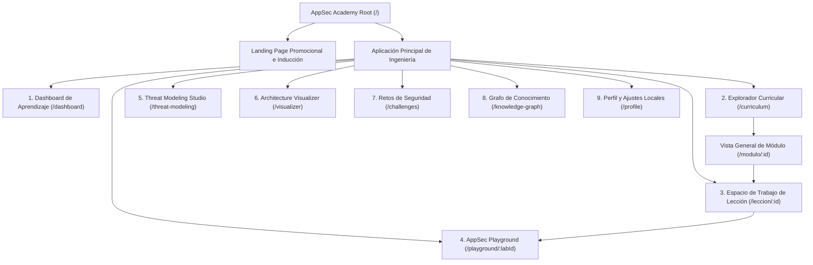

# AppSec Academy — Arquitectura de Información y Mapa de Navegación (Information Architecture)

## 1. Mapa del Sitio y Jerarquía de Navegación

La arquitectura de información de AppSec Academy unifica las seis capacidades del ecosistema y el explorador curricular en una jerarquía clara, intuitiva y accesible.

---

## 2. Definición de Rutas y Estructura de URLs

Para garantizar compatibilidad absoluta con el hospedaje estático de **GitHub Pages**, todas las rutas internas se gestionan mediante el enrutador de Angular con estrategia de **Hash Routing** (`#/ruta`) o fallback compatible:

| Ruta | Nombre de la Vista | Propósito Principal |
| :--- | :--- | :--- |
| `#/` | **Landing Page** | Presentación de valor, visión del ecosistema y llamada a iniciar el aprendizaje sin registro obligatorio. |
| `#/dashboard` | **Security Learning Dashboard** | Métricas de progreso, XP acumulado, radar de competencias y acceso rápido a lecciones pendientes. |
| `#/curriculum` | **Curriculum Explorer** | Árbol curricular completo de los 14 módulos con filtros por nivel, disciplina y estándares. |
| `#/modulo/:moduleId` | **Module Overview** | Desglose de lecciones de un módulo específico, prerrequisitos, tiempo total y objetivos. |
| `#/leccion/:lessonId` | **Lesson Workspace** | Entorno completo de estudio con las 9 secciones estandarizadas y laboratorio embebido. |
| `#/playground` | **AppSec Playground** | Estación de trabajo independiente para experimentar con laboratorios y código vulnerable libremente. |
| `#/threat-modeling` | **Threat Modeling Studio** | Lienzo para crear diagramas DFD, límites de confianza y matrices STRIDE. |
| `#/visualizer` | **Security Architecture Visualizer** | Diagramas interactivos de arquitecturas seguras vs inseguras (OAuth PKCE, mTLS, Zero Trust). |
| `#/challenges` | **Security Challenges** | Banco de retos prácticos y desafíos de auditoría de código con puntuación. |
| `#/knowledge-graph` | **Knowledge Graph Explorer** | Grafo ontológico interactivo de vulnerabilidades, estándares, controles y mitigaciones. |
| `#/profile` | **Perfil y Ajustes** | Gestión del alias local, exportación/importación de estado JSON, borrado de datos y preferencias de tema. |

---

## 3. Navegación Global y Ergonomía

### 3.1. Barra Lateral de Navegación en Escritorio (Desktop Sidebar)
- Ubicada en el lateral izquierdo, fija, colapsable a modo solo-iconos para maximizar el área de trabajo de código.
- Agrupa las herramientas operativas: *Aprender* (Dashboard, Currículo, Grafo), *Experimentar* (Playground, Threat Modeling, Visualizador), *Evaluar* (Retos, Perfil).

### 3.2. Navegación Móvil (Mobile Bottom Bar & Drawer)
- Barra de navegación inferior (*Bottom Navigation Bar*) con los 4 destinos más frecuentes: **Inicio/Dashboard**, **Currículo**, **Playground** y **Perfil**.
- Menú deslizable (*Navigation Drawer*) accesible desde el encabezado superior para ingresar al resto de capacidades (Knowledge Graph, Threat Modeling Studio, Retos).
- Altura ergonómica de 56px con botones táctiles de 48x48px y soporte para la zona segura de dispositivos modernos (*Safe Area Insets* en iOS y Android).
