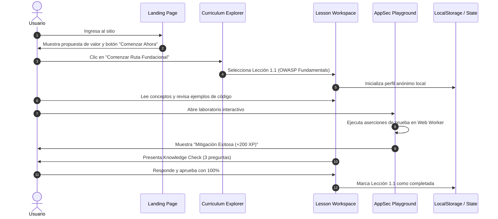
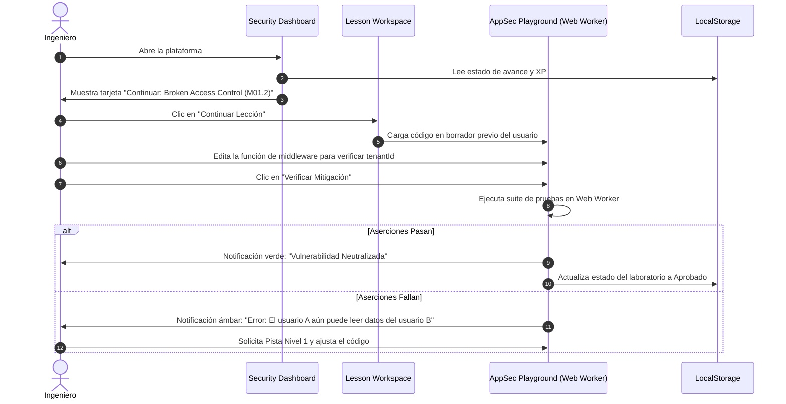
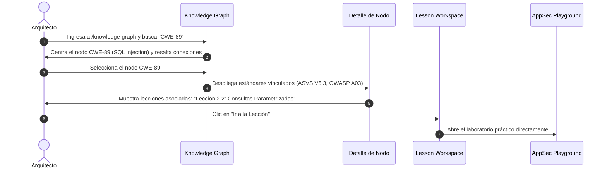
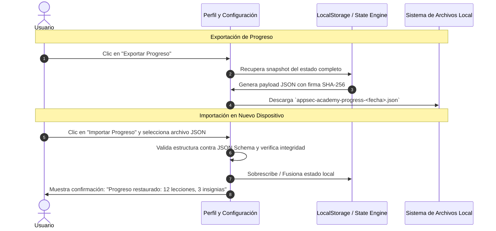

# AppSec Academy — Flujos de Usuario Principales (User Flows)

## 1. Flujo 1: Inducción y Primera Lección Sin Registro (Zero-Friction Onboarding)

El estudiante puede comenzar a aprender y programar en segundos, sin formularios de registro, verificación de correo electrónico ni barreras de entrada.

---

## 2. Flujo 2: Ingeniero Retornante y Ciclo de Laboratorio (Returning Learner)

Un usuario habitual retoma su estudio exactamente donde lo dejó:

---

## 3. Flujo 3: Navegación Cruzada a través del Knowledge Graph

El estudiante utiliza el grafo ontológico para conectar teoría con práctica:

---

## 4. Flujo 4: Portabilidad de Progreso (Exportar / Importar Snapshot)

Permite transferir el progreso entre la computadora de la oficina y el dispositivo personal sin necesidad de servidores en la nube:

