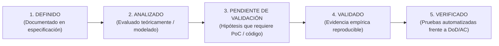

# AppSec Academy — Política de Evidencia y Rigor Técnico (Evidence Policy)

## 1. Principio Rector

> **"La documentación expresa intenciones, decisiones y modelos conceptuales; únicamente las pruebas reproducibles y las mediciones empíricas producen evidencia."**

En el desarrollo de **AppSec Academy**, ningún agente (humano o de inteligencia artificial) podrá presentar hipótesis teóricas, especificaciones arquitectónicas o intenciones de diseño como hechos comprobados, certificados o validados sin aportar evidencia empírica directa y verificable.

---

## 2. Taxonomía de Estados del Conocimiento

Todo requisito, componente, control de seguridad o decisión técnica debe clasificarse estrictamente en uno de los siguientes cinco estados:

1. **DEFINIDO**: El requisito, decisión arquitectónica o estándar pedagógico está redactado, estructurado y versionado en la documentación.
2. **ANALIZADO**: La propuesta ha sido sometida a revisión teórica, contraste normativo y evaluación preliminar de riesgos (ej. modelado STRIDE conceptual).
3. **PENDIENTE DE VALIDACIÓN**: Hipótesis técnica o pedagógica que requiere una prueba de concepto (PoC), prototipo ejecutable o implementación instrumental para confirmar su viabilidad real.
4. **VALIDADO**: El comportamiento, rendimiento o mecanismo de aislamiento ha sido comprobado mediante ejecución práctica con evidencia empírica reproducible (logs, mediciones instrumentadas, capturas de red, trazas).
5. **VERIFICADO**: La implementación de software ha superado suites de pruebas automatizadas continuas (unitarias, integración, E2E, accesibilidad) frente a los criterios de aceptación y la Definición de Terminado (DoD).

> [!CAUTION]
> Queda terminantemente prohibido utilizar los calificativos **"VALIDADO"**, **"VERIFICADO"**, **"CERTIFICADO"** o **"COMPROBADO"** para describir elementos que solo se encuentran en estado DEFINIDO o ANALIZADO.

---

## 3. Los Diez Mandamientos de Evidencia del Proyecto

1. **Cero Porcentajes Subjetivos de Confianza**: Se prohíbe emitir cifras porcentuales de "confianza", "certeza" o "preparación" (ej. "98% de confianza") sin un modelo cuantitativo formal, reproducible y respaldado por métricas estadísticas reales.
2. **Cero Declaraciones de Seguridad sin Pruebas Reproducibles**: Ningún aislamiento de sandbox (Web Worker, Iframe, CSP) se considerará seguro por el mero hecho de describirlo. La seguridad se demuestra mediante pruebas de explotación controlada en tiempo de ejecución.
3. **Cero Declaraciones de Cumplimiento WCAG sin Auditoría Formal**: No se afirmará que la plataforma "cumple WCAG 2.2 AA" hasta que la interfaz esté implementada y evaluada mediante herramientas automatizadas (Axe-Core / Lighthouse) y verificación manual de navegación por teclado y lectores de pantalla.
4. **Cero Afirmaciones de Rendimiento sin Mediciones Reales**: Los presupuestos de Core Web Vitals (LCP $< 2.0$s, bundle $\le 250$ KB) son **metas de diseño**, no logros consolidados, hasta que se ejecute la compilación de producción y se mida mediante Lighthouse CI y Chrome DevTools.
5. **La Documentación No Valida la Arquitectura**: Un diagrama de arquitectura, un ADR o un flujo de datos expresa una hipótesis de diseño. La viabilidad técnica permanece como *Pendiente de Validación* hasta su despliegue y prueba en el entorno objetivo.
6. **Transparencia en la Autoría de Auditorías**: Ninguna auditoría técnica realizada por el mismo agente, equipo o modelo que elaboró la documentación original podrá calificarse como "independiente". Debe declararse explícitamente como una *revisión interna asistida*.
7. **Distinción Epistémica Estricta**: Cada afirmación técnica debe clasificar su naturaleza:
   - **Propuesta**: Lo que se planea hacer.
   - **Evidencia**: Datos medidos o registros observables.
   - **Inferencia**: Deducción lógica a partir de la evidencia.
   - **Resultado**: Consecuencia directa demostrada.
8. **Documentación Obligatoria de Limitaciones Técnicas**: Ninguna limitación conocida (ej. falta de autenticidad en hashes locales, restricciones de CSP en workers de navegador) debe suavizarse, minimizarse u ocultarse.
9. **Conservación de la Trazabilidad de Hallazgos**: Ningún hallazgo de auditoría puede eliminarse arbitrariamente; debe cerrarse mediante una acción documentada, conservando la referencia a su causa raíz.
10. **Soberanía y Aprobación del Propietario**: La aprobación humana explícita del propietario del proyecto es obligatoria e indispensable para autorizar cambios de alcance, redefiniciones presupuestarias o el inicio de nuevos sprints de implementación.
