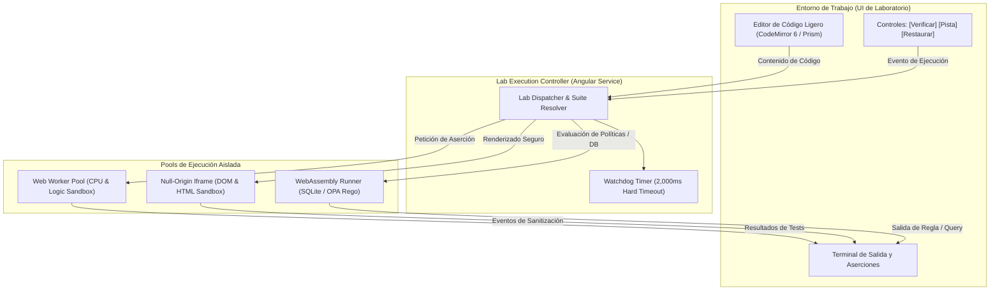

# AppSec Academy — Arquitectura de Laboratorios (Lab Architecture)

## 1. Visión y Topología del Playground de Ingeniería

El **AppSec Playground** es el motor central de simulación interactiva de la academia. Opera como un entorno hermético en el navegador que proporciona una experiencia similar a un IDE con consola de pruebas automatizadas en tiempo real.

> [!IMPORTANT]
> **Decisión de Editor de Código**: Se prohíbe formalmente la inclusión de Monaco Editor en el bundle del MVP debido a su tamaño excesivo (2.5 MB a 5 MB), incompatible con el presupuesto de rendimiento ($\le 250\text{ KB}$ inicial). Se adopta **CodeMirror 6** (modular, con soporte táctil para móviles, accesible y peso inferior a 45 KB gzipped) o un editor ligero enriquecido con Prism.

---

## 2. Componentes del Motor de Laboratorio

### 2.1. Despachador de Laboratorios (Lab Dispatcher)
- Resuelve la suite de pruebas correspondiente al `labId`.
- Inyecta el código modificado por el estudiante dentro del entorno de prueba virtual.
- Gestiona el ciclo de vida de los trabajadores efímeros (*Web Workers*).

### 2.2. Temporizador de Seguridad (Watchdog Timer)
- Para evitar que código mal diseñado o bucles infinitos (`while(true)`) congelen el hilo del navegador, el despachador inicia una cuenta regresiva estricta de **2,000 milisegundos**.
- Si el Worker no responde dentro del plazo, el controlador ejecuta `worker.terminate()`, levanta una alerta de "Tiempo de ejecución excedido" y reinicia el pool.

### 2.3. Motor de Pruebas Dual (Exploit vs Remediation Assertion)
Cada laboratorio valida dos condiciones obligatorias:
1. **Neutralización del Vector de Ataque**: Se inyectan payloads maliciosos de prueba (ej. `' OR '1'='1`, `../etc/passwd`, tokens adulterados). El código debe neutralizarlos o rechazarlos formalmente.
2. **Conservación de la Funcionalidad Legítima**: Se envían datos válidos de prueba para asegurar que el parche no rompió el comportamiento esperado del sistema (ej. consultas de usuarios legítimos retornan sus propios datos).

---

## 3. Estrategia de Confinamiento por Capas

| Capa de Aislamiento | Tecnología Utilizada | Restricciones Aplicadas | Disciplinas Aplicables |
| :--- | :--- | :--- | :--- |
| **Capa 1: Aislamiento de Lógica** | Web Worker estándar de navegador | Sin acceso a `window`, `document`, `localStorage`, `sessionStorage`, `cookies` o DOM. | Broken Access Control, Secure Coding, JWT, Criptografía, Algoritmos. |
| **Capa 2: Aislamiento DOM / UI** | `<iframe>` con `sandbox="allow-scripts"` | Origen nulo (`null origin`), sin `allow-same-origin`, sin `allow-top-navigation`, CSP estricta. | Prevención de XSS, Sanitización de HTML, Cabeceras CSP, Clickjacking. |
| **Capa 3: Aislamiento de Persistencia** | Motor SQLite en WebAssembly / Parser AST | Memoria RAM efímera del cliente; se destruye al reiniciar el laboratorio. | Inyección SQL, consultas parametrizadas, blindaje ORM. |
| **Capa 4: Aislamiento de Red** | Virtual Mock HTTP Client | Interceptor en memoria; cero sockets abiertos, cero conexiones salientes TCP/UDP. | API Security (BOLA, BFLA, Rate Limiting), SSRF. |
| **Capa 5: Aislamiento de Políticas** | Open Policy Agent (OPA) WebAssembly | Compilador Wasm en navegador para auditar reglas Rego sin dependencias de CLI externa. | DevSecOps, Policy as Code, Manifiestos K8s. |
