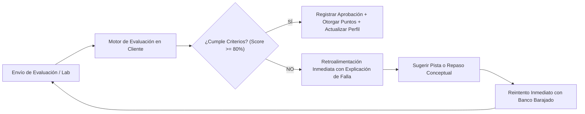

# AppSec Academy — Modelo de Evaluación y Calificación (Assessment Model)

## 1. Filosofía de Evaluación Formativa

El modelo de evaluación de AppSec Academy tiene como propósito **afianzar la competencia técnica**, no penalizar punitivamente el error. El error en seguridad es una oportunidad de aprendizaje guiado para comprender por qué falla un supuesto y cómo actúa un atacante.

---

## 2. Tipología de Evaluaciones

### 2.1. Evaluación Formativa Continua (Knowledge Check)
- **Momento**: Al concluir cada lección.
- **Formato**: 3 a 5 reactivos de opción múltiple con casos de análisis contextual.
- **Objetivo**: Verificar que el estudiante no solo ejecutó el laboratorio mecánicamente, sino que comprende la causa raíz de la debilidad y el estándar que la norma.
- **Ponderación**: 100 puntos base por lección.
- **Umbral de Aprobación**: $80\%$ de aciertos.

### 2.2. Evaluación Práctica en Sandbox (Lab Verification Suite)
- **Momento**: Integrado en la Sección 6 de la lección y en los retos de seguridad.
- **Formato**: Ejecución automatizada de un conjunto de aserciones de prueba sobre el código o configuración remediada por el usuario.
- **Objetivo**: Demostrar que el parche defensivo neutraliza el exploit sin romper el caso de uso funcional legítimo.
- **Ponderación**: 200 puntos base por laboratorio.

---

## 3. Modelo de Puntuación y Gestión de Pistas

Para incentivar la autonomía sin provocar frustración, el sistema implementa una política de **Pistas Progresivas (*Tiered Hints*)** con ajuste proporcional de puntuación:

| Nivel de Pista | Información Revelada | Ajuste en Puntuación del Lab | Puntuación Obtenible |
| :---: | :--- | :---: | :---: |
| **Sin Pistas** | El estudiante resuelve el problema con la documentación de la lección. | $0\%$ deducción | **200 pts** ($100\%$) |
| **Pista 1 (Conceptual)** | Señala el vector de amenaza o el método de la API involucrado. | $-10\%$ deducción | **180 pts** ($90\%$) |
| **Pista 2 (Ubicación)** | Identifica la función o línea exacta donde se origina la debilidad. | $-25\%$ deducción | **150 pts** ($75\%$) |
| **Pista 3 (Estructural)** | Proporciona un esqueleto o pseudocódigo del parche requerido. | $-40\%$ deducción | **120 pts** ($60\%$) |

> [!NOTE]
> La puntuación mínima por completar un laboratorio exitosamente nunca descenderá por debajo del **$50\%$ (100 puntos)**, garantizando que el esfuerzo de completar la práctica siempre sume valor al perfil del estudiante.

---

## 4. Política de Recuperación e Intentos (Retry Policy)

1. **Intentos Ilimitados**: El estudiante puede intentar resolver las evaluaciones formativas y los laboratorios cuantas veces sea necesario.
2. **Barajado Dinámico de Distractores**: En cada reintento de un Knowledge Check, las opciones de respuesta se presentan en un orden pseudoaleatorio para evitar que el usuario memorice únicamente la letra de la opción (`A, B, C, D`).
3. **Cero Penalizaciones por Tiempo**: No se aplican cronómetros regresivos estresantes en las lecciones regulares. El estudiante aprende a su propio ritmo.
4. **Conservación de la Mejor Calificación**: El sistema almacena la puntuación máxima histórica obtenida por el usuario en cada ejercicio.

---

## 5. Fórmulas de Cálculo de Progreso y Dominio

El progreso en la plataforma se cuantifica mediante tres indicadores matemáticos transparentes:

### 5.1. Porcentaje de Avance Curricular ($P_{curriculo}$)
$$P_{curriculo} = \left( \frac{\sum L_{completadas}}{L_{totales}} \right) \times 100$$
Donde $L_{totales} = 49$ lecciones troncales y una lección se considera completada únicamente cuando el laboratorio está aprobado y el quiz tiene una calificación $\ge 80\%$.

### 5.2. Nivel de Maestría por Disciplina ($M_{disciplina}$)
Para cada una de las 14 disciplinas:
$$M_{disciplina} = \frac{Pts_{obtenidos}}{Pts_{maximos\_disciplina}} \times 100$$

### 5.3. Rango Técnico de Ingeniería
Los puntos de experiencia acumulados (*Engineering XP*) asignan rangos técnicos formales:
- **0 a 1,200 XP**: *AppSec Apprentice* (Nivel Fundacional inicial).
- **1,201 a 3,500 XP**: *Secure Software Practitioner* (Nivel Intermedio en progreso).
- **3,501 a 7,000 XP**: *AppSec Engineer* (Dominio intermedio consolidado).
- **7,001 a 11,000 XP**: *Senior AppSec Specialist* (Capacidades avanzadas demostradas).
- **11,001+ XP**: *Principal AppSec Architect* (Currículo completo y retos avanzados resueltos).
