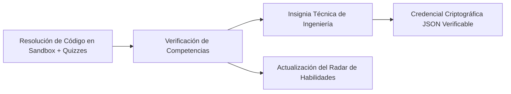

# AppSec Academy — Modelo de Reconocimiento y Gamificación Técnica (Gamification & Proof of Skill)

## 1. Principio Rector: Rigor Profesional vs. Gamificación Infantil

> [!IMPORTANT]
> **La gamificación nunca debe sustituir la comprensión técnica ni infantilizar la profesión.**
> En AppSec Academy se descartan explícitamente las mecánicas de "juego de casino" comunes en apps de consumo masivo (vidas que se pierden, castigos por no conectarse un día, mascotas virtuales, confeti animado estridente o monedas virtuales sin valor).

La plataforma implementa un modelo de **Reconocimiento de Competencias de Ingeniería (*Proof of Skill*)**, similar al avance de carrera técnica en organizaciones tecnológicas de alto nivel.



---

## 2. Catálogo de Insignias Técnicas de Ingeniería (Badges)

Las insignias reconocen la culminación de retos complejos y la especialización en disciplinas formales:

| Identificador | Título de la Insignia | Criterio de Obtención | Competencia Comprobada |
| :--- | :--- | :--- | :--- |
| `BADGE-OWASP-DEF` | **OWASP Top 10 Defender** | Completar M01 al 100% con todos los labs aprobados. | Mitigación demostrada de los 10 riesgos críticos de OWASP. |
| `BADGE-CODE-GUARDIAN` | **Secure Code Guardian** | Completar M02 (labs de SQLi, XSS y Memory). | Codificación segura y parametrización en producción. |
| `BADGE-API-SHIELD` | **API Security Auditor** | Completar M03 resolviendo laboratorios BOLA y SSRF. | Blindaje de endpoints REST y control de tenencia. |
| `BADGE-VULN-MASTER` | **Vulnerability Triaging Lead** | Completar M04 y calcular 5 vectores CVSS v4.0. | Evaluación de riesgo, métricas EPSS y priorización de SLAs. |
| `BADGE-SUPPLY-CHAIN` | **Supply Chain Custodian** | Completar M05 y validar un SBOM CycloneDX con SLSA. | Trazabilidad de dependencias y atestados criptográficos. |
| `BADGE-CLOUD-SEC` | **Cloud Least-Privilege Architect** | Completar M06 y auditar políticas IAM complejas. | Reducción de permisos en nube y protección IMDSv2. |
| `BADGE-CONTAINER-HARD` | **Container Hardening Specialist** | Completar M07 con Dockerfile distroless no-root. | Hardening OCI y Kubernetes Pod Security Standards. |
| `BADGE-TOKEN-AUDITOR` | **OAuth 2.1 & JWT Auditor** | Completar M08 y detectar manipulación de Claims. | Arquitectura de identidad moderna, PKCE y blindaje JWT. |
| `BADGE-STRIDE-ENG` | **Threat Modeling Engineer** | Completar M09 y componer 2 DFDs completos en TMS. | Análisis sistemático STRIDE y diseño con Trust Boundaries. |
| `BADGE-CRYPTO-PRACT` | **Applied Cryptography Practitioner** | Completar M10 y configurar Argon2id y AES-GCM. | Cifrado autenticado y almacenamiento robusto de claves. |
| `BADGE-OPA-AUTHOR` | **Policy as Code Author** | Completar M11 redactando 3 reglas Rego en OPA. | Automatización de compuertas de seguridad en DevSecOps. |
| `BADGE-CICD-DEFENDER` | **CI/CD Pipeline Hardener** | Completar M12 y parchar inyección de contexto. | Seguridad en workflows de GitHub Actions y tokens OIDC. |
| `BADGE-AST-ANALYST` | **Application Security Tester** | Completar M13 y redactar reglas SAST/DAST. | Auditoría híbrida estática, dinámica y fuzzing. |
| `BADGE-AI-DEFENDER` | **AI & LLM Security Pioneer** | Completar M14 y neutralizar Prompt Injections. | Blindaje de modelos GenAI, sanitización y RAG seguro. |
| `BADGE-APPSEC-MASTER` | **AppSec Engineering Master** | Completar los 14 módulos y retos avanzados. | Dominio integral del ecosistema de seguridad de software. |

---

## 3. Credencial Exportable con Verificación de Integridad (Proof of Skill JSON)

Los estudiantes pueden generar una credencial técnica portátil que resume su trabajo y competencias alcanzadas. El objeto JSON contiene:
- Metadatos de la persona (alias de ingeniería).
- Lista de módulos e insignias completadas.
- Sello de tiempo ISO-8601.
- Hash criptográfico de integridad SHA-256 generado sobre el contenido del progreso y las pruebas aprobadas.

> [!NOTE]
> **Distinción Criptográfica**: En una arquitectura puramente estática sin backend, el hash SHA-256 actúa como una **suma de verificación de integridad (*Integrity Checksum / Digest*)** que protege contra corrupción de datos en transferencia. No constituye una firma digital asimétrica con no-repudio; para certificaciones de validez externa ante terceros, se requeriría una entidad certificadora con clave privada en servidor (capacidad opcional para fases futuras).

### Ejemplo de Credencial:
```json
{
  "schemaVersion": "1.0.0",
  "issuer": "AppSec Academy Open Verification",
  "recipientAlias": "carlos-dev",
  "issuedAt": "2026-11-10T12:00:00Z",
  "rank": "Senior AppSec Specialist",
  "totalXP": 8450,
  "completedModules": [
    "m01-owasp-fundamentals",
    "m02-secure-coding",
    "m03-api-security",
    "m08-identity-jwt",
    "m10-applied-cryptography"
  ],
  "earnedBadges": [
    "BADGE-OWASP-DEF",
    "BADGE-CODE-GUARDIAN",
    "BADGE-API-SHIELD",
    "BADGE-TOKEN-AUDITOR",
    "BADGE-CRYPTO-PRACT"
  ],
  "evidenceDigestSha256": "8f4e2b01c3d9a74a123984eaf098b67234f9a56c4d7e8b9a0c1d2e3f4a5b6c7d"
}
```

---

## 4. Radar de Habilidades de Ingeniería (Engineering Skill Radar)

En lugar de una barra de nivel plana, el Dashboard visualiza las competencias en un **Gráfico de Radar Multiaxial** que cubre las 6 dimensiones clave de la profesión:
1. **Defensa en Código (Code Defense)**: M01, M02, M10.
2. **Arquitectura y Modelado (Threat Architecture)**: M08, M09.
3. **Seguridad en APIs y Servicios (API & Services)**: M03.
4. **Infraestructura, Nube y Contenedores (Cloud & Platforms)**: M06, M07.
5. **Cadena de Suministro y Pipelines (Supply Chain & CI/CD)**: M04, M05, M11, M12.
6. **Auditoría e IA Emergente (Testing & AI AppSec)**: M13, M14.
