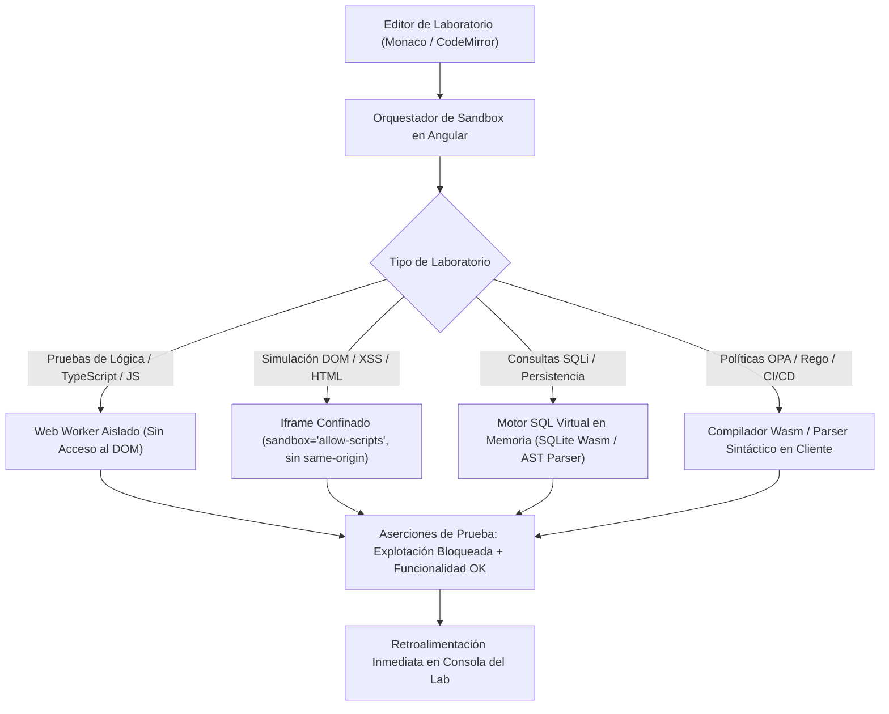

# AppSec Academy — Estrategia de Laboratorios y Sandboxing (Laboratory Strategy)

## 1. Visión y Principios del Laboratorio en el Cliente (Client-Side First)

> [!IMPORTANT]
> **Seguridad por Defecto (Secure by Default)**:
> Ningún laboratorio de AppSec Academy realiza peticiones de red hacia servidores externos, no escanea redes ajenas ni expone servicios vulnerables a Internet. Todos los entornos de laboratorio se ejecutan dentro del navegador del usuario de forma estrictamente confinada.



---

## 2. Tecnologías de Aislamiento y Sandboxing en el Navegador

### 2.1. Web Workers para Ejecución Segura de Lógica
- **Objetivo**: Ejecutar pruebas de remediación de código sin congelar la interfaz de usuario y sin otorgar acceso al árbol DOM, a `localStorage`, a `cookies` ni a objetos globales sensibles de la aplicación.
- **Mecanismo**: El código del usuario y la suite de aserciones se transfieren al Web Worker mediante mensajes estructurados (`postMessage`).
- **Control de Tiempo (Watchdog Timer)**: Se establece un temporizador de terminación forzosa de **2,000 ms** para neutralizar de inmediato bucles infinitos accidentales o ataques de denegación de servicio en el cliente (DoS).

### 2.2. Iframes con Sandbox Estricto para Pruebas Web y DOM
- **Objetivo**: Demostrar vectores de Cross-Site Scripting (XSS), manipulación de templates y cabeceras CSP.
- **Configuración de Atributos**:
  ```html
  <iframe
    sandbox="allow-scripts"
    csp="default-src 'none'; script-src 'unsafe-inline'; style-src 'unsafe-inline';"
    srcdoc="...código de prueba sanitizado..."
  ></iframe>
  ```
- **Aislamiento de Origen**: Al omitir intencionalmente `allow-same-origin`, el navegador trata el iframe como un origen opaco único (`null origin`), imposibilitando el acceso a los datos de la aplicación anfitriona.

### 2.3. Motor SQL Virtual y Parsers AST para Pruebas de Inyección
- **Objetivo**: Practicar ataques y parches de SQL Injection sin necesidad de una base de datos PostgreSQL/MySQL en la nube.
- **Implementación**: Motor SQLite compilado a WebAssembly (Wasm) o motor ligero de parsing de sentencias SQL en TypeScript en memoria.
- **Evaluación**: El sistema verifica que la consulta generada utilice marcadores posicionales (`$1`, `?`) y parámetros enlazados en lugar de concatenaciones de cadenas de texto.

### 2.4. Simulador de Red y API Gateway en Memoria
- **Objetivo**: Ejercitar ataques BOLA, BFLA, Rate Limiting y SSRF sin realizar llamadas HTTP externas.
- **Implementación**: Interceptor virtual de peticiones HTTP en el cliente que simula respuestas de endpoints `/api/v1/...` con estados HTTP, cabeceras y payloads JSON.
- **Validación SSRF**: El simulador comprueba si la función de resolución de URL del estudiante bloquea llamadas a direcciones RFC 1918 (`10.0.0.0/8`, `172.16.0.0/12`, `192.168.0.0/16`), loopback (`127.0.0.1`, `localhost`) e IP de metadatos de nube (`169.254.169.254`).

---

## 3. Matriz de Ejecución Técnica por Disciplina

| Disciplina | Tipo de Sandbox en Cliente | Lenguaje / Entorno | Criterio de Verificación Automatizada |
| :--- | :--- | :--- | :--- |
| **Broken Access Control (OWASP M01)** | Mock HTTP Client + Web Worker | TypeScript / Node.js | Petición con ID ajeno retorna `403 Forbidden` y no expone el recurso. |
| **Secure Coding: SQLi (M02)** | Virtual SQLite Engine / AST | SQL / TypeScript | Query generada es AST de sentencia preparada; payloads `' OR 1=1--` fallan como literales. |
| **Secure Coding: XSS (M02)** | Sandboxed Iframe (Null Origin) | HTML / JavaScript | Payload `<script>` o `onerror` es codificado y se renderiza como texto inofensivo. |
| **API Security: BOLA (M03)** | Virtual API Gateway | TypeScript / Express Mock | Tenant ID en token JWT debe coincidir con la tenencia del recurso solicitado. |
| **API Security: SSRF (M03)** | Mock URL Resolver | TypeScript | Intentos de fetch a `169.254.169.254` o `127.0.0.1` lanzan excepción de validación. |
| **Supply Chain: SBOM (M05)** | CycloneDX JSON Validator | JSON / TypeScript | Identificación exitosa de paquetes CVE críticos dentro del documento SBOM. |
| **Container Hardening (M07)** | Dockerfile Linter en Wasm/TS | Dockerfile / RegExp AST | Dockerfile cuenta con directiva `USER nonroot`, base distroless y sin paquetes de depuración. |
| **JWT Vulnerabilities (M08)** | Cripto Web Crypto API nativa | JWT / TypeScript | Token con cabecera `{"alg":"none"}` o firma alterada es rechazado con error formal. |
| **Threat Modeling (M09)** | Threat Modeling Canvas | SVG / JSON Graph Engine | Diagrama DFD cuenta con todos los procesos mapeados a amenazas STRIDE y mitigaciones. |
| **Criptografía: Password (M10)** | WebAssembly / Web Crypto API | Argon2 Wasm / WebCrypto | Hash generado cumple parámetros mínimos de memoria (64MB) y tiempo de iteración. |
| **DevSecOps: OPA / Rego (M11)** | OPA WebAssembly Evaluator | Rego / Wasm | Regla Rego evalúa manifiesto y deniega permisos con `allow = false` ante configuraciones inseguras. |
| **CI/CD Security (M12)** | GitHub Actions Workflow Parser | YAML / AST Parser | Expresión `${{ github.event... }}` no interpolada directamente en bloques `run:`. |
| **AI Prompt Injection (M14)** | Mock LLM Pipeline + Guardrails | TypeScript / Regex Guardrail | Entrada con instrucciones de jailbreak es neutralizada por capa de validación previa. |

---

## 4. Gestión de Recursos y Rendimiento del Sandbox

1. **Liberación de Memoria (Garbage Collection)**: Cada instancia de Web Worker o Iframe se destruye (`worker.terminate()`, remoción de nodo iframe) al concluir la suite de pruebas o al cambiar de lección para evitar fugas de memoria en sesiones prolongadas.
2. **Límite de Consumo de CPU**: Se prohíbe el uso de SharedArrayBuffer y threads intensivos que provoquen bloqueos del navegador.
3. **Cero Dependencia de Red**: Una vez cargados los chunks estáticos de la plataforma, el 100% de los laboratorios puede resolverse sin conexión a Internet activa.
