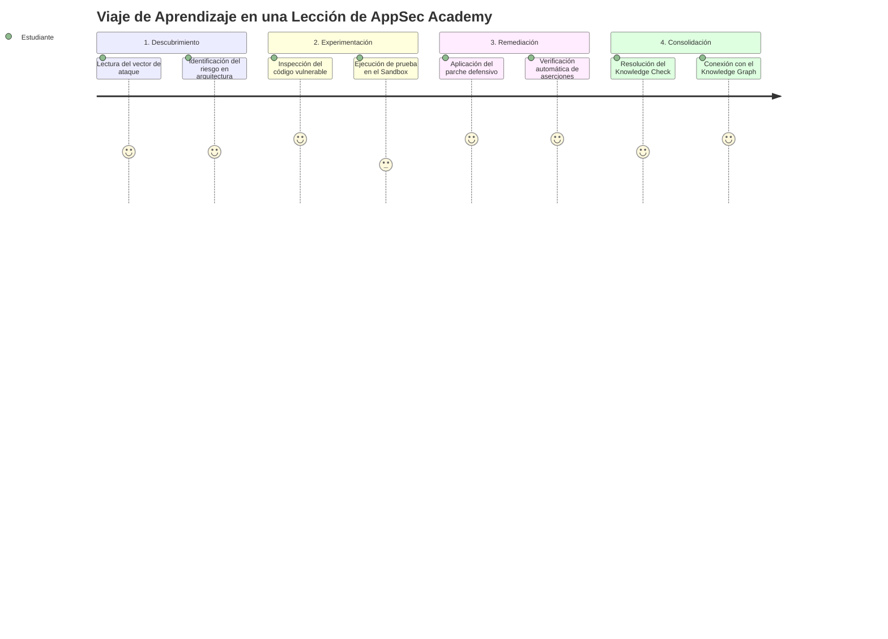
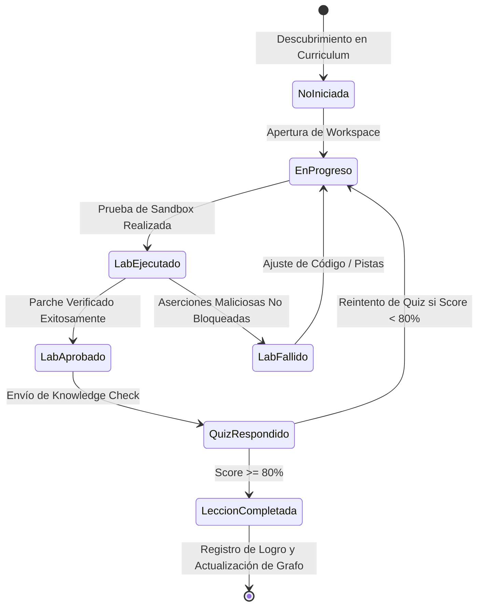

# AppSec Academy — Experiencia de Aprendizaje (Learning Experience Architecture)

## 1. Filosofía del Aprendizaje de Ingeniería

La experiencia de aprendizaje en **AppSec Academy** trasciende el modelo pasivo de consumo de información. Está fundamentada en la **pedagogía constructivista y el aprendizaje basado en problemas (PBL - Problem-Based Learning)**, adaptada al rigor que exige la ingeniería de software y la seguridad de aplicaciones.

---

## 2. Los Cuatro Pilares de la Experiencia

### 2.1. Sentirse en una Estación de Trabajo de Ingeniería (*Workstation Feel*)
- La interfaz de aprendizaje prescinde de adornos superfluos y elementos distractores.
- Presenta herramientas de trabajo reales: editores de código con números de línea y soporte de atajos habituales, terminales de salida formateadas, visores de árboles AST, diagramadores de flujos y calculadoras de métricas normalizadas.

### 2.2. Ciclos Rápidos de Retroalimentación (*Fast Feedback Loops*)
- Cuando un estudiante escribe o ajusta un parche de código en el sandbox, la evaluación tarda menos de **200 milisegundos**.
- No hay colas de espera en servidores remotos ni necesidad de refrescar la página. La retroalimentación es inmediata, precisa y contextual.

### 2.3. Respeto al Tiempo del Profesional (*Micro-Learning Estructurado*)
- Las lecciones están diseñadas para completarse en bloques de **25 a 45 minutos** en su totalidad.
- Si el usuario dispone únicamente de 10 minutos en su teléfono móvil, puede consultar la explicación conceptual y los diagramas de arquitectura sin perder la posición de su laboratorio para cuando vuelva a su ordenador de trabajo.

### 2.4. Defensa en Profundidad Pedagógica
- Un concepto nunca se enseña de forma aislada. Por ejemplo, al estudiar Inyecciones SQL:
  1. Se enseña el fallo en el código fuente (concatenación).
  2. Se explica el vector en el protocolo (manipulación del AST del motor de base de datos).
  3. Se muestra la perspectiva de la arquitectura (por qué un WAF perimetral es insuficiente y la solución debe residir en sentencias preparadas en la capa de persistencia).
  4. Se asocia al estándar (CWE-89 y OWASP ASVS V5).

---

## 3. Dinámica de Interacción y Estados de una Lección

Cada lección interactiva transiciona a través de estados claros y visibles para el usuario:

---

## 4. Adaptabilidad Multi-Dispositivo (Responsive Ergonomics)

La experiencia está optimizada ergónomicamente para diferentes contextos de uso:

| Contexto / Dispositivo | Modos de Lectura | Comportamiento del Sandbox | Ergonomía Táctil |
| :--- | :--- | :--- | :--- |
| **Móvil (360px - 430px)** | Columna única vertical fluida, tipografía escalada (16px base), tabla de contenidos colapsable en drawer inferior. | Editor colapsable con vista de "diff" interactivo y botones de inserción de snippets para evitar tecleo masivo en teclado virtual. | Touch targets mínimos de 48px, gestos de swipe para avanzar entre pestañas de código y resultados. |
| **Tableta (768px - 1023px)** | Disposición en dos paneles apilables o divididos 50/50 en orientación horizontal. | Editor táctil con barra de herramientas de acciones rápidas (Verificar, Pista, Reset). | Zonas de toque holgadas y soporte para teclado físico externo. |
| **Escritorio (1024px - 1440px+)** | Panel dual sincronizado: Panel izquierdo con contenido conceptual y referencias; Panel derecho con estación de laboratorio interactiva y terminal. | Editor de código a pantalla completa o dividido, atajos de teclado (`Ctrl+Enter` para ejecutar pruebas). | Soporte completo de navegación por teclado (`Tab`, `Shift+Tab`, atajos accesibles). |
