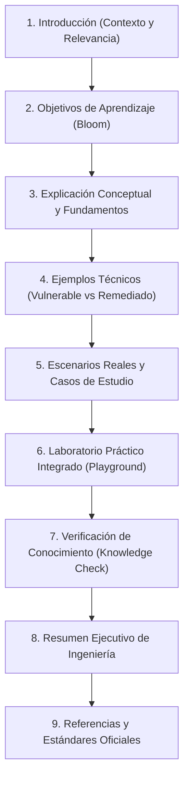

# AppSec Academy — Plantilla Estándar de Lección (Lesson Template Specification)

## 1. Especificación Estructural Obligatoria

Toda lección publicada en AppSec Academy debe cumplir rigurosamente con el esquema de **nueve secciones**. Esta uniformidad reduce la carga cognitiva del estudiante y permite automatizar el renderizado modular en el frontend de Angular.



---

## 2. Definición Detallada de las Nueve Secciones

### Sección 1: Introducción
- **Propósito**: Enganchar al estudiante explicando por qué este tema es crítico para la seguridad del software en producción.
- **Contenido Requerido**:
  - Breve descripción del vector de amenaza o principio de seguridad.
  - Criticidad según estándares de la industria (ej. clasificación en OWASP Top 10 o CWE Top 25).
  - Tiempo estimado de dedicación (lectura + lab + quiz).

### Sección 2: Objetivos de Aprendizaje
- **Propósito**: Definir explícitamente qué habilidades operativas adquirirá el estudiante.
- **Contenido Requerido**:
  - Mínimo 3 objetivos redactados con verbos de acción medibles (Taxonomía de Bloom: *Analizar*, *Implementar*, *Remediar*, *Auditar*).

### Sección 3: Explicación Conceptual
- **Propósito**: Exponer los fundamentos teóricos y arquitectónicos sin tecnicismos innecesarios ni vaguedades.
- **Contenido Requerido**:
  - Explicación del mecanismo subyacente que causa la debilidad.
  - Diagrama arquitectónico en Mermaid (flujo de datos, límites de confianza o secuencia de ataque).
  - Impacto técnico y de negocio (confidencialidad, integridad, disponibilidad).

### Sección 4: Ejemplos Técnicos (Vulnerable vs. Remediado)
- **Propósito**: Mostrar el contraste directo en código fuente real.
- **Contenido Requerido**:
  - Fragmento de código vulnerable con anotación precisa de la línea defectuosa.
  - Fragmento de código remediado aplicando el patrón seguro (*Secure by Design*).
  - Explicación de por qué el parche neutraliza el vector sin romper la funcionalidad legítima.

### Sección 5: Escenarios Reales y Casos de Estudio
- **Propósito**: Conectar el concepto con incidentes documentados y boletines de vulnerabilidad históricos.
- **Contenido Requerido**:
  - Reseña de un caso real (ej. brecha en Capital One por SSRF, incidente de Log4Shell, ataque a SolarWinds).
  - Análisis post-mortem: qué falló y cómo los controles modernos lo habrían prevenido.

### Sección 6: Laboratorio Práctico Integrado (AppSec Playground)
- **Propósito**: Espacio de experimentación e implementación interactiva en el sandbox.
- **Contenido Requerido**:
  - Misión del laboratorio: instrucción clara de qué debe lograr el estudiante.
  - Archivo(s) de código inicial con el fallo presente.
  - Suite de aserciones automatizadas de prueba (en TypeScript/JavaScript) que validan:
    1. Que la funcionalidad legítima siga respondiendo correctamente.
    2. Que el vector malicioso de prueba sea efectivamente neutralizado.
  - Sistema de 3 pistas progresivas (*Hints*).

### Sección 7: Verificación de Conocimiento (Knowledge Check)
- **Propósito**: Evaluación formativa para validar la asimilación conceptual y práctica.
- **Contenido Requerido**:
  - Batería de 3 a 5 preguntas de opción múltiple o análisis de fragmentos de código.
  - Retroalimentación explicativa para cada distractor (por qué es incorrecta) y para la respuesta correcta.

### Sección 8: Resumen Ejecutivo de Ingeniería
- **Propósito**: Tarjeta de síntesis (*Cheatsheet*) para repaso rápido y consulta futura.
- **Contenido Requerido**:
  - Lista de 4 o 5 viñetas concisas con las reglas de oro de defensa.
  - Anti-patrones que deben evitarse a toda costa en revisiones de código (*Code Reviews*).

### Sección 9: Referencias y Estándares Oficiales
- **Propósito**: Respaldar el contenido en fuentes normativas primarias.
- **Contenido Requerido**:
  - Mapeo exacto a códigos CWE (con enlace oficial a `cwe.mitre.org`).
  - Mapeo a requisitos OWASP ASVS v4.0.3 (ej. Sección V5.1.2).
  - RFCs de IETF o publicaciones especiales NIST (ej. NIST SP 800-63B).

---

## 3. Esquema Modelo de Contenido (JSON / Markdown Frontmatter)

```typescript
export interface LessonSchema {
  id: string; // ej. "owasp-broken-access-control"
  moduleId: string; // ej. "m01-owasp-fundamentals"
  title: string;
  order: number;
  estimatedMinutes: number;
  difficulty: 'basico' | 'intermedio' | 'avanzado';
  standards: {
    cwe?: string[];
    owasp?: string[];
    asvs?: string[];
    nist?: string[];
  };
  sections: {
    introduction: string;
    objectives: string[];
    conceptualExplanation: {
      content: string;
      diagramMermaid?: string;
    };
    technicalExamples: {
      language: string;
      vulnerableSnippet: string;
      vulnerableExplanation: string;
      remediatedSnippet: string;
      remediatedExplanation: string;
    }[];
    realScenarios: {
      incidentTitle: string;
      cveRef?: string;
      description: string;
      lessonsLearned: string;
    }[];
    lab: {
      labId: string;
      mission: string;
      starterCode: { [filename: string]: string };
      verificationSuiteId: string;
      hints: string[];
    };
    knowledgeCheck: {
      questions: {
        id: string;
        prompt: string;
        options: { id: string; text: string; isCorrect: boolean; feedback: string }[];
      }[];
    };
    summary: {
      goldenRules: string[];
      antipatternsToAvoid: string[];
    };
    references: {
      title: string;
      organization: string;
      versionDate?: string;
      url: string;
    }[];
  };
}
```
