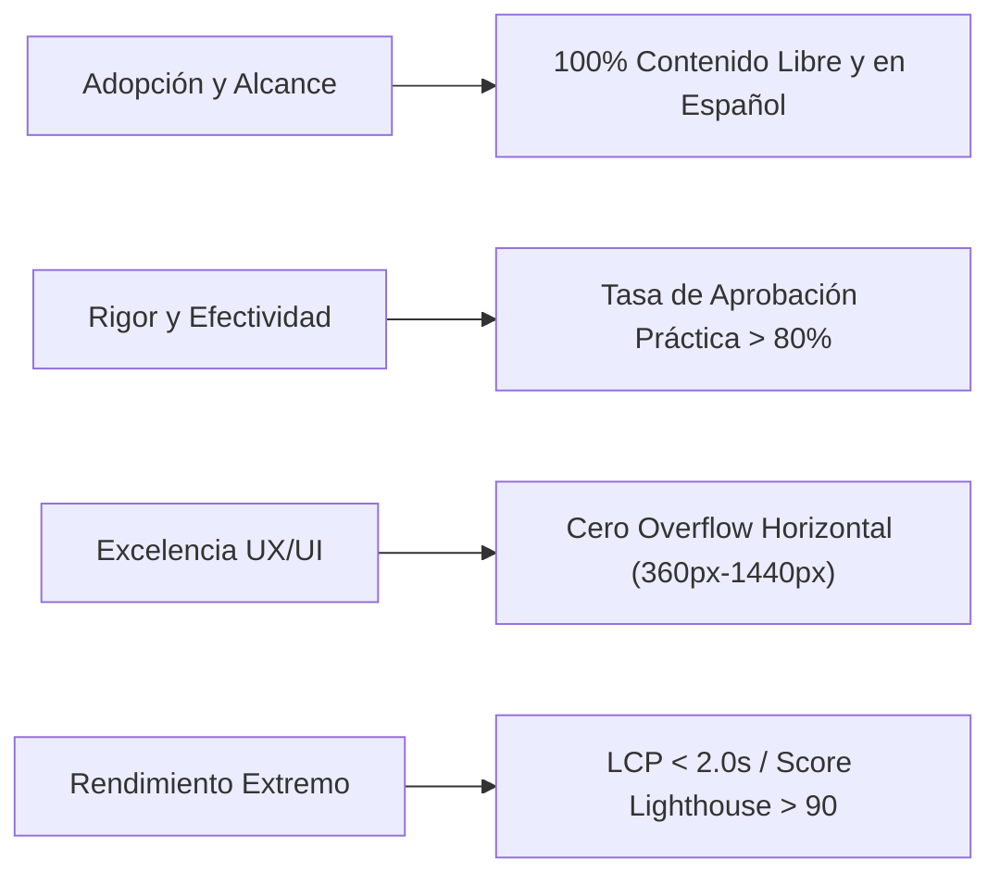

# AppSec Academy — Documento de Requisitos de Producto (PRD)

## 1. Información del Documento

- **Producto**: AppSec Academy
- **Versión**: 1.0.0 (Sprint 0 Baseline)
- **Estado**: Aprobado para Diseño y Planificación
- **Propietario del Producto**: Product Manager / Application Security Architect
- **Target Deployment**: GitHub Pages (Static Site Architecture)
- **Idioma Principal**: Español

---

## 2. Resumen Ejecutivo y Planteamiento del Problema

### 2.1. El Problema
La gran mayoría de los incidentes de ciberseguridad a nivel global se originan en debilidades de la capa de aplicación (OWASP Top 10, CWE Top 25). Los desarrolladores de software y los ingenieros de infraestructura frecuentemente carecen de formación práctica en AppSec debido a que:
1. **Material obsoleto o excesivamente teórico**: La oferta educativa existente se limita a diapositivas y videos sin interacción con código.
2. **Brecha de idioma**: Más del 85% del contenido técnico actualizado de AppSec se encuentra exclusivamente en inglés, dificultando el aprendizaje profundo en comunidades hispanohablantes.
3. **Plataformas LMS genéricas y aburridas**: Los LMS estándar no ofrecen entornos interactivos de inspección de código ni modelado de amenazas.
4. **Infraestructuras pesadas y costosas**: Muchos laboratorios comerciales requieren suscripciones mensuales y máquinas virtuales pesadas en la nube con altos tiempos de arranque y dependencias de red.

### 2.2. La Solución
AppSec Academy proporciona una estación de trabajo de ingeniería en el navegador del usuario:
- Plataforma 100% estática servida por GitHub Pages.
- Laboratorios interactivos en el navegador que validan código y configuraciones de seguridad en tiempo real.
- Currículo completo desde fundamentos hasta seguridad en IA, basado en estándares internacionales verificados.
- Experiencia mobile-first nativa para consultar, aprender y validar conceptos en cualquier dispositivo.

---

## 3. Objetivos Estratégicos y Métricas de Éxito (KPIs)

### 3.1. Métricas de Rendimiento Técnico y Calidad
- **Lighthouse Performance Score**: $\ge 90$ en móvil y escritorio.
- **Largest Contentful Paint (LCP)**: $< 2.0$ segundos en redes 4G estándar.
- **Cumulative Layout Shift (CLS)**: $< 0.1$.
- **Interaction to Next Paint (INP)**: $< 200$ ms.
- **Accesibilidad**: Cero violaciones WCAG 2.2 Nivel AA comprobables con Axe-Core / Lighthouse.
- **Compatibilidad de Pantallas**: Cero desbordamiento (*zero horizontal overflow*) en viewports de 360px, 390px, 768px, 1024px y 1440px.

### 3.2. Métricas de Experiencia y Aprendizaje
- **Tasa de Retención de Laboratorios**: $\ge 75\%$ de los usuarios que inician un laboratorio interactivo lo completan exitosamente.
- **Trazabilidad Curricular**: 100% de los temas requeridos mapeados a estándares reconocidos (OWASP, NIST, CWE, SLSA).
- **Persistencia Confiable**: Cero pérdida de progreso del estudiante al recargar la página o cambiar de pestaña.

---

## 4. Requisitos Funcionales (FR)

### FR-01: Centro de Mando de Aprendizaje (Security Learning Dashboard)
- **FR-01.1**: Visualización global del avance por módulo, disciplina y estado (no iniciado, en progreso, completado).
- **FR-01.2**: Indicador de dominio de competencias de seguridad (puntuación acumulada y nivel técnico).
- **FR-01.3**: Acceso rápido a la última lección activa y al siguiente laboratorio recomendado.
- **FR-01.4**: Exportación del historial de progreso y estado en formato JSON estructurado.
- **FR-01.5**: Importación y validación de esquemas de progreso para restaurar sesiones en distintos navegadores.

### FR-02: Explorador y Visualizador Curricular (Curriculum Explorer)
- **FR-02.1**: Filtros interactivos por nivel de dificultad (Básico, Intermedio, Avanzado), disciplina y estándar (OWASP, ASVS, CWE).
- **FR-02.2**: Visualización de la ruta de aprendizaje (*Learning Path*) recomendada y rutas alternativas según el rol del usuario.
- **FR-02.3**: Indicadores visuales de dependencias y prerrequisitos entre módulos.

### FR-03: Espacio de Trabajo de Lección (Lesson Workspace)
- **FR-03.1**: Renderizado estructurado y tipográficamente enriquecido de las 9 secciones estandarizadas de cada lección:
  1. Introducción
  2. Objetivos de Aprendizaje
  3. Explicación Conceptual
  4. Ejemplos Técnicos (con resaltado de sintaxis)
  5. Escenarios Reales y Casos de Estudio
  6. Laboratorio Práctico Integrado
  7. Verificación de Conocimiento (Knowledge Check)
  8. Resumen Ejecutivo
  9. Referencias Oficiales con versiones y enlaces normativos
- **FR-03.2**: Tabla de contenidos interna con *scroll-spy* suave y enlaces ancla accesibles.
- **FR-03.3**: Modos de lectura ajustables (ancho de lectura óptimo de 65-80 caracteres por línea en desktop).

### FR-04: Laboratorio Interactivo en Sandbox (AppSec Playground)
- **FR-04.1**: Entorno de inspección y edición de código vulnerable en múltiples lenguajes comunes (JavaScript/TypeScript, Python, Java, Go, C# y configuración de infraestructura).
- **FR-04.2**: Ejecución de pruebas de aserción en el navegador mediante sandbox aislado (Web Worker) sin conexión externa.
- **FR-04.3**: Retroalimentación inmediata: indicación de vulnerabilidad detectada, vector de ataque bloqueado y verificación de mitigación efectiva.
- **FR-04.4**: Sistema de pistas progresivas (*hints*) que penaliza moderadamente el score para fomentar el pensamiento crítico sin bloquear al estudiante.

### FR-05: Motor de Evaluación y Knowledge Checks
- **FR-05.1**: Evaluaciones formativas al final de cada lección (preguntas de opción múltiple, escenarios de toma de decisiones, identificación de vulnerabilidades en fragmentos de código).
- **FR-05.2**: Explicaciones detalladas inmediatas tanto para respuestas correctas como incorrectas.
- **FR-05.3**: Mecanismo de recuperación de intentos con barajado aleatorio de distractores y banco de preguntas dinámicas.

### FR-06: Estudio de Modelado de Amenazas (Threat Modeling Studio)
- **FR-06.1**: Lienzo interactivo para componer Diagramas de Flujo de Datos (DFD) con procesos, almacenes de datos, entidades externas y límites de confianza (*Trust Boundaries*).
- **FR-06.2**: Clasificador guiado STRIDE (Spoofing, Tampering, Repudiation, Information Disclosure, Denial of Service, Elevation of Privilege) para identificar amenazas automáticamente por elemento.
- **FR-06.3**: Generador de matriz de amenazas y asignación de controles defensivos vinculados a estándares (ASVS, NIST).

### FR-07: Visualizador de Arquitectura de Seguridad (Security Architecture Visualizer)
- **FR-07.1**: Diagramas interactivos que ilustran el flujo seguro vs. inseguro en patrones clave (OAuth 2.1 Code Exchange con PKCE, microservicios mTLS, Zero Trust, validación en API Gateway).
- **FR-07.2**: Modos de paso a paso interactivos para seguir tokens, firmas y cabeceras a través de la arquitectura.

### FR-08: Grafo de Conocimiento AppSec (Knowledge Graph)
- **FR-08.1**: Navegación visual e indexada entre Nodos de Conocimiento: Vulnerabilidad $\leftrightarrow$ Estándar $\leftrightarrow$ Control $\leftrightarrow$ Herramienta $\leftrightarrow$ Lección.
- **FR-08.2**: Búsqueda global instantánea (fuzzy search) para localizar rápidamente cualquier término, CWE o control.

### FR-09: Desafíos y Logros de Ingeniería (Challenges & Achievements)
- **FR-09.1**: Desafíos basados en escenarios reales de auditoría de código y configuración (DevSecOps pipelines, Dockerfiles vulnerables, políticas IAM permisivas).
- **FR-09.2**: Emisión de credenciales/insignias criptográficas locales verificables en formato JSON con hash SHA-256 de evidencia.

---

## 5. Requisitos No Funcionales (NFR)

### 5.1. Rendimiento y Eficiencia
- **NFR-01**: La plataforma debe ser un Single Page Application (SPA) estática optimizada para GitHub Pages.
- **NFR-02**: El tamaño inicial del bundle JavaScript comprimido (Brotli/Gzip) no debe exceder los 250 KB para la primera carga.
- **NFR-03**: El contenido de las lecciones, laboratorios y grafos debe cargarse bajo demanda mediante *lazy chunking*.

### 5.2. Seguridad de la Plataforma
- **NFR-04**: Política de Seguridad de Contenido (CSP) estricta: `default-src 'self'; script-src 'self'; object-src 'none'; style-src 'self' 'unsafe-inline'`.
- **NFR-05**: Ningún código arbitrario del usuario en los laboratorios se evaluará directamente con `eval()` o `new Function()` en el hilo principal del DOM; debe confinarse a Web Workers aislados y/o sandboxes con atributos de iframe restringidos.
- **NFR-06**: Cero almacenamiento o transmisión de credenciales o secretos en el código fuente.

### 5.3. Accesibilidad e Inclusión (A11y)
- **NFR-07**: Conformidad estricta con WCAG 2.2 Nivel AA.
- **NFR-08**: Navegación 100% operable por teclado con indicadores de foco visibles (*focus rings* contrastados).
- **NFR-09**: Estructura semántica completa (headings `<h1>`-`<h6>`, landmarks `<main>`, `<nav>`, `<aside>`, `<header>`, `<footer>`).
- **NFR-10**: Soporte preferencial para usuarios con reducción de movimiento (`prefers-reduced-motion`).

### 5.4. Usabilidad Móvil y Responsive
- **NFR-11**: Diseño adaptativo con puntos de ruptura estándar:
  - Móvil Pequeño: 360px a 389px.
  - Móvil Estándar: 390px a 767px.
  - Tableta: 768px a 1023px.
  - Desktop: 1024px a 1439px.
  - Desktop Ultra-Ancho: $\ge 1440px$.
- **NFR-12**: Áreas de interacción táctil (*touch targets*) mínimas de 44x44 píxeles en dispositivos táctiles.

### 5.5. Arquitectura de Despliegue Estático
- **NFR-13**: Compatibilidad nativa con el subdirectorio de despliegue de GitHub Pages (`/app-sec-academy-io/`), implementando manejo inteligente de rutas mediante estrategia de hash routing o fallback 404 SPA sin rutas absolutas duras.
- **NFR-14**: Cero fallos al refrescar cualquier URL directa en el navegador.
