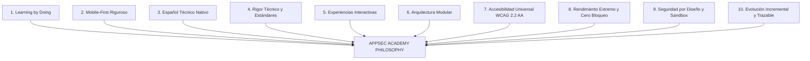
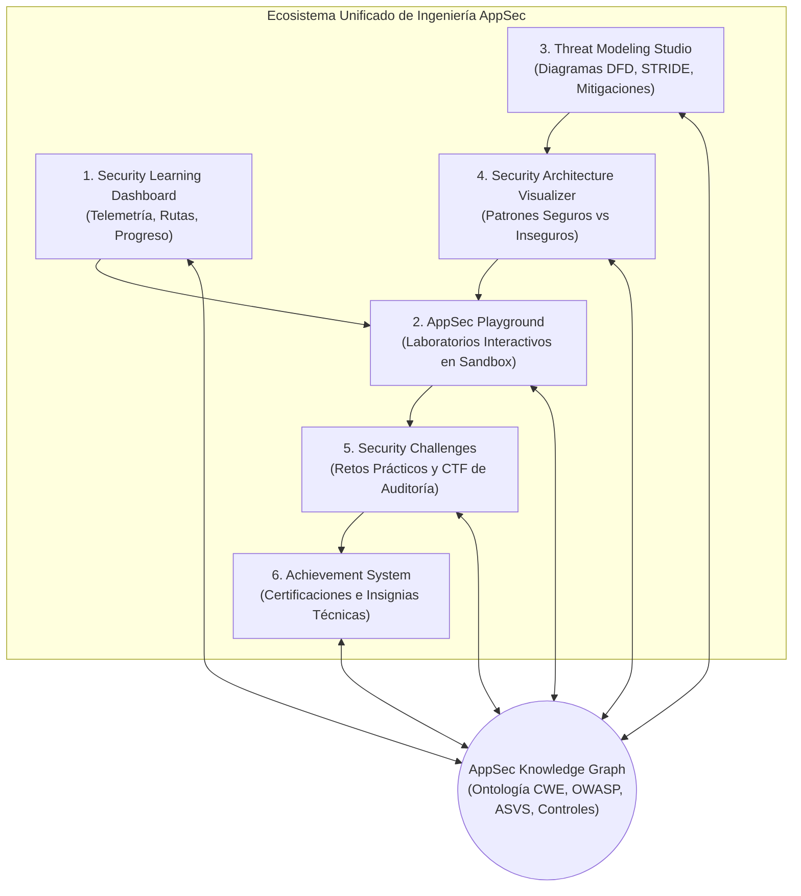

# AppSec Academy — Visión de Producto y Ecosistema de Ingeniería

## 1. Declaración de Visión

**AppSec Academy** es una plataforma educativa interactiva de grado ingeniería diseñada para transformar la manera en que los profesionales de tecnología aprenden, aplican y auditan la seguridad de aplicaciones (*Application Security* - AppSec).

A diferencia de los Sistemas de Gestión de Aprendizaje (LMS) tradicionales —basados en consumo pasivo de videos pregrabados y cuestionarios teóricos superficiales—, AppSec Academy opera como una **estación de trabajo de ingeniería (*Engineering Workstation*) y laboratorio interactivo**. En este entorno, el estudiante no solo memoriza definiciones; inspecciona código vulnerable en tiempo real, modela amenazas arquitectónicas, diagnostica vectores de explotación, aplica parches defensivos verificables y comprende la interconexión sistémica entre vulnerabilidades, estándares internacionales y controles de mitigación.

La plataforma está concebida como un **ecosistema estático de alto rendimiento (*static-first*)**, desplegable de forma nativa en **GitHub Pages**, completamente en **idioma español**, optimizado bajo una filosofía **mobile-first** rigurosa y con **cero dependencias de servidores backend en su núcleo operativo**.

---

## 2. Los Diez Principios Fundamentales

1. **Learning by doing**: Cada concepto teórico va acompañado de un artefacto ejecutable o interactivo. El aprendizaje se valida mediante resolución de problemas técnicos reales (inspección de código, configuración de cabeceras, tokens, diagramas de flujo de datos y simulaciones).
2. **Mobile first**: Ninguna pantalla o interacción se diseña únicamente para monitores ultra-anchos. Los ingenieros y estudiantes que acceden desde dispositivos móviles (pantallas desde 360px) disponen de visualizaciones completas, editores de código legibles y controles táctiles de al menos 44x44px sin *overflow* horizontal.
3. **Español técnico de alta calidad**: Traducción y adaptación rigurosa de la terminología de ciberseguridad, respetando los estándares de la industria (OWASP, NIST, MITRE CWE/CAPEC, CIS, ISO 27001) y evitando anglicismos innecesarios o traducciones automáticas inconsistentes.
4. **Contenido técnico riguroso**: Los contenidos se fundamentan en especificaciones formales, RFCs, publicaciones de investigación y casos de estudio reales, documentando versiones, vectores de ataque vigentes y mecanismos de defensa en profundidad.
5. **Experiencias interactivas**: La interfaz ofrece simuladores de payloads, editores de políticas, árboles de ataque interactivos y validadores de mitigación en el navegador del usuario.
6. **Arquitectura modular**: El contenido, los componentes visuales, el motor de evaluación y las herramientas de simulación están desacoplados mediante contratos TypeScript estrictos y esquemas declarativos.
7. **Accesibilidad WCAG 2.2 AA**: Contraste superior a 4.5:1 para texto normal y 3:1 para controles UI, navegación completa por teclado, etiquetas ARIA explícitas y compatibilidad nativa con lectores de pantalla.
8. **Rendimiento extremo y cero latencia de servidor**: Carga instantánea, bundles ligeros (LCP < 2.0s), *lazy loading* granular y persistencia local inmediata mediante Storage Web nativo.
9. **Seguridad por diseño y sandbox aislado**: Ningún laboratorio o ejercicio ejecuta ataques contra terceros ni expone servicios vulnerables a redes públicas. Todo análisis dinámico y simulación se ejecuta dentro de entornos aislados en el navegador del cliente (Web Workers, sandboxed Iframes, parsers seguros).
10. **Evolución incremental y trazable**: Cada versión del currículo, módulo o laboratorio mantiene trazabilidad total con respecto al catálogo de estándares y permite incorporar nuevas disciplinas sin reescritura arquitectónica.

---

## 3. Ecosistema de Ingeniería: Seis Capacidades Integradas

AppSec Academy unifica seis capacidades interactivas bajo un único modelo de dominio compartido:

### 3.1. Security Learning Dashboard
- **Propósito**: Centro de mando del estudiante. Ofrece telemetría en tiempo real sobre el avance curricular, el dominio por disciplina, las áreas de fortaleza y debilidad técnica, los laboratorios pendientes y la retención del conocimiento.
- **Límites**: No almacena datos en nubes externas en el MVP; consume el estado local del navegador (*LocalStorage* / *IndexedDB*) y permite exportar/importar snapshots criptográficamente verificables en JSON.

### 3.2. AppSec Playground
- **Propósito**: Laboratorio de inspección y experimentación práctica. Permite a los estudiantes interactuar con código vulnerable, probar vectores de ataque en un entorno seguro y aplicar parches defensivos que se validan automáticamente con pruebas unitarias o assertions en el cliente.
- **Límites**: No ejecuta contenedores backend en el MVP. Todas las simulaciones se ejecutan mediante Web Workers, motores de parsing en TypeScript, simuladores de APIs HTTP y sandboxes iframes restringidos con CSP estricta.

### 3.3. Threat Modeling Studio
- **Propósito**: Herramienta de diseño y análisis de amenazas basada en metodologías reconocidas (STRIDE, PASTA). Los usuarios pueden componer Diagramas de Flujo de Datos (DFDs), identificar límites de confianza (*Trust Boundaries*), generar matrices automáticas de amenazas y asociar mitigaciones formales.
- **Límites**: Enfocado en aprendizaje guiado y evaluación de arquitecturas de referencia en el MVP. Los modelos se exportan en formato estándar abierto (JSON/Markdown) para integración en repositorios Git.

### 3.4. Security Architecture Visualizer
- **Propósito**: Explorador interactivo de patrones arquitectónicos seguros vs. anti-patrones de seguridad. Permite alternar vistas de cómo fluyen los datos y credenciales en arquitecturas de microservicios, APIs, nubes y aplicaciones web, destacando los puntos de falla y los controles en profundidad.
- **Límites**: Visualizador declarativo interactivo basado en grafos SVG / Canvas accesibles, con estados preconfigurados y parámetros ajustables.

### 3.5. Security Challenges
- **Propósito**: Banco de desafíos y pruebas prácticas estructuradas (*Capture The Flag* defensivo y auditorías de código estático guiadas) con niveles progresivos de dificultad (Junior, Mid, Senior, Lead).
- **Límites**: Los desafíos se resuelven validando flags calculados criptográficamente en el cliente mediante funciones hash salteadas (SHA-256) sin exponer la respuesta en texto plano en el bundle.

### 3.6. Achievement System
- **Propósito**: Sistema de reconocimiento de habilidades basado en evidencia comprobable (*Proof of Skill*), no en gamificación superficial. Confiere insignias técnicas por hitos tangibles (ej. "Auditor JWT", "Defensor de Cadena de Suministro", "Arquitecto STRIDE").
- **Límites**: Las insignias se basan en la culminación exitosa de laboratorios y evaluaciones de código, generando un resumen técnico exportable y compartible.

---

## 4. Capacidad Transversal: AppSec Knowledge Graph

El **AppSec Knowledge Graph** es la columna vertebral ontológica que interconecta todas las entidades del sistema:

- **Debilidades y Vulnerabilidades**: Clasificaciones CWE (Common Weakness Enumeration), CVE y vectores CVSS v4.0/v3.1.
- **Estándares y Marcos**: OWASP Top 10 (2021/2025), OWASP API Security (2023), OWASP ASVS 4.0.3, OWASP SAMM 2.0.1, NIST SP 800-53 Rev. 5, SLSA v1.0.
- **Controles y Mitigaciones**: Reglas de codificación segura, cabeceras HTTP defensivas, políticas de autorización, cifrado y hashing.
- **Herramientas de Ecosistema**: Linters, escáneres SAST, DAST, SCA, firmas Sigstore, herramientas de Threat Modeling.

En la plataforma, el estudiante puede saltar directamente desde una lección de "Inyección SQL" hacia el nodo CWE-89 en el Knowledge Graph, ver las mitigaciones en ASVS V5, abrir el laboratorio del Playground correspondiente y modelar la amenaza en el Threat Modeling Studio.

---

## 5. Audiencia Objetivo y Propuesta de Valor

| Perfil | Retos Actuales | Propuesta de Valor de AppSec Academy |
| :--- | :--- | :--- |
| **Desarrolladores Software (Frontend, Backend, Mobile)** | Reciben reportes de seguridad que no comprenden o consideran bloqueos burocráticos. | Laboratorios con código real en sus lenguajes y frameworks habituales, enseñando cómo parchar eficazmente en su ciclo de desarrollo. |
| **Arquitectos de Software & Tech Leads** | Falta de visibilidad sobre cómo integrar controles preventivos en diseños tempranos. | Práctica con Threat Modeling Studio y Security Architecture Visualizer para validar decisiones antes de escribir código. |
| **Ingenieros DevOps / DevSecOps & SRE** | Dificultad para establecer controles automatizados en pipelines CI/CD sin romper despliegues. | Módulos especializados en CI/CD Security, Supply Chain (SBOM, SLSA), Container Security y Policy as Code. |
| **QA / Automation Engineers** | Pruebas funcionales no cubren escenarios de abuso o explotación de lógica de negocio. | Guías y retos prácticos de pruebas de seguridad para integrar assertions de seguridad en suites de pruebas automatizadas. |
| **Aspirantes a Ingenieros AppSec** | Cursos costosos, teóricos, en inglés y desconectados de las prácticas modernas de desarrollo. | Currículo integral y riguroso en español con trazabilidad a estándares de la industria y enfoque 100% práctico sin costo de suscripción. |

---

## 6. Restricciones Estratégicas y Filosofía Operativa

1. **Despliegue Estático en GitHub Pages**: No requiere aprovisionamiento de infraestructura en la nube, servidores Node.js, contenedores Kubernetes o bases de datos administradas para el MVP. Esto garantiza disponibilidad del 99.99%, costo cero de hospedaje y escalabilidad masiva.
2. **Soberanía y Privacidad de Datos del Usuario**: Ningún dato de progreso, código ingresado en laboratorios o resultado de evaluación se transmite a terceros. Todo permanece almacenado localmente en el dispositivo del usuario.
3. **Cero Secretos en el Frontend**: No se almacenan claves API, tokens de autenticación privilegiados o banderas en texto plano en el código cliente.
4. **Independencia de Red para Aprendizaje Offline**: La arquitectura del Service Worker y almacenamiento local permite que la plataforma pueda operar como una Progressive Web Application (PWA) instalable en el futuro.
