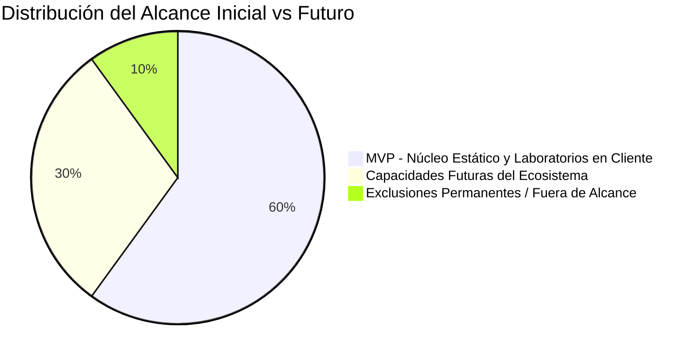

# AppSec Academy — Alcance del Proyecto (Scope Definition)

## 1. Desglose Estratégico de Alcance

Para garantizar una entrega ágil, con calidad de ingeniería y sin sobrecarga operativa, el alcance del producto se divide en tres categorías delimitadas: **MVP (Fase 1)**, **Capacidades Futuras (Fase 2 y 3)** y **Fuera de Alcance (Out of Scope)**.

---

## 2. Alcance del MVP (Mínimo Producto Viable)

El MVP se concibe como una plataforma 100% estática, libre de backend, auto-contenida y completamente funcional en GitHub Pages.

### 2.1. Funcionalidades Incluidas en el MVP
1. **Centro de Mando de Aprendizaje (Security Learning Dashboard)**:
   - Resumen del avance curricular global y por disciplina.
   - Puntuación acumulada de laboratorios y evaluaciones superadas.
   - Guardado automático y recuperación de estado en almacenamiento local del navegador (*LocalStorage* / *IndexedDB*).
   - Exportación e importación manual de snapshot de progreso en JSON.
2. **Explorador Curricular (Curriculum Explorer)**:
   - Visualización de la ruta de aprendizaje estructurada con 14 módulos troncales.
   - Filtros por nivel de dificultad, estándar (OWASP, CWE, ASVS, NIST) y categoría temática.
   - Trazabilidad y detalle de prerrequisitos entre lecciones.
3. **Espacio de Trabajo de Lección (Lesson Workspace)**:
   - Renderizado dinámico de las 9 secciones estandarizadas de cada lección técnica.
   - Bloques de código con sintaxis resaltada y selector de lenguaje interactivo cuando aplique.
   - Indicador de progreso de lectura y navegación rápida interna (*scroll-spy*).
4. **Laboratorio Interactivo en Sandbox (AppSec Playground - Nivel Cliente)**:
   - Entorno interactivo de inspección de código y validación de parches de seguridad en el navegador.
   - Aislamiento seguro mediante Web Workers y sandbox restringido para evaluar aserciones sin comprometer la ventana principal.
   - Verificación de remediación automatizada con tests en TypeScript/JavaScript en memoria.
   - Pistas progresivas (*hints*) graduadas.
5. **Motor de Evaluación (Knowledge Check)**:
   - Cuestionarios técnicos interactivos al final de cada lección con preguntas contextualizadas en escenarios de ingeniería.
   - Retroalimentación formativa inmediata con justificación teórica y referencias normativas.
   - Registro de puntaje con opción de recuperación de intentos.
6. **Grafo de Conocimiento AppSec (Knowledge Graph - Versión Explorador)**:
   - Modelo ontológico navegable que vincula vulnerabilidades, estándares (OWASP, CWE, ASVS), controles y lecciones asociadas.
   - Motor de búsqueda rápida (*fuzzy search*) para exploración cruzada.
7. **Threat Modeling & Architecture Visualizer (Modo Guiado y Declarativo)**:
   - Visualizadores de diagramas DFD e intercambios de tokens basados en SVG accesibles con estados preconfigurados por lección y cuestionarios STRIDE guiados (el diseñador de lienzo libre con drag-and-drop queda delimitado para la Fase 2).
8. **Sistema de Logros e Insignias Básicas**:
   - Emisión local de insignias técnicas basadas en la culminación verificable de módulos y laboratorios.
   - Credencial digital técnica en JSON con suma de verificación de integridad (hash SHA-256).
9. **Diseño Visual e Infraestructura Base**:
   - Tema *Dark-First* de ingeniería con paleta de alto contraste accesible (WCAG 2.2 AA).
   - Experiencia *mobile-first* impecable (360px a 1440px) sin desbordamiento horizontal.
   - Pipeline de integración y despliegue continuo (CI/CD) automatizado mediante GitHub Actions hacia GitHub Pages.

---

## 3. Capacidades Futuras (Post-MVP / Roadmap de Evolución)

Funcionalidades de alto valor para iteraciones subsecuentes una vez estabilizado el núcleo del MVP:

1. **Threat Modeling Studio Completo**:
   - Diseñador visual avanzado de diagramas DFD con exportación a formatos estándar abiertos (OTM - Open Threat Model).
   - Generación asistida de matrices STRIDE y reportes de mitigación ejecutables.
2. **Security Architecture Visualizer Dinámico**:
   - Simulador de flujos de autenticación e intercambio de tokens con animaciones paso a paso interactivas y escenarios de ataque dinámico (Man-in-the-Middle, token replay, key tampering).
3. **Banco de Retos Avanzados (Security Challenges / CTF Defensivo)**:
   - Desafíos de auditoría de pipelines CI/CD completos y repositorios simulados.
4. **Soporte PWA (Progressive Web App)**:
   - *Service Worker* con estrategia de caché `Stale-While-Revalidate` o `Cache-First` para lecciones ya visitadas, permitiendo el estudio 100% offline.
5. **Sincronización en la Nube Opcional**:
   - Capacidad voluntaria de sincronización entre dispositivos mediante almacenamiento personal o integración WebDAV / GitHub Gists privados, sin requerir base de datos centralizada.
6. **Entornos de Sandbox Aislados en Backend (Opcional bajo demanda)**:
   - Para laboratorios que requieran de forma obligatoria ejecución de binarios x86/ARM, exploits de kernel o compilación pesada de lenguajes compilados, integración opcional con entornos efímeros WebAssembly (Wasm) o contenedores WebContainer.

---

## 4. Fuera de Alcance (Strictly Out of Scope)

Las siguientes características y enfoques quedan explícitamente excluidos del diseño y desarrollo del sistema:

1. **Servidor Backend Tradicional o Base de Datos Centralizada para el Núcleo**:
   - No se implementarán APIs en Node.js, Spring Boot, Django, ni bases de datos Postgres, MySQL o MongoDB para gestionar cuentas de usuario obligatorias o guardar progreso en el MVP.
2. **Sistemas de Suscripción de Pago o Pasarelas Financieras**:
   - No se integrará Stripe, PayPal o esquemas de monetización que restrinjan el acceso al conocimiento abierto.
3. **Plataforma de Video Streaming Hospedada**:
   - No se alojarán archivos pesados de video en la infraestructura; la experiencia se basa en texto técnico enriquecido, código interactivo, simulaciones y diagramas.
4. **Ejecución de Ataques contra Redes o Sitios Externos**:
   - No se implementarán herramientas de escaneo de vulnerabilidades contra IPs públicas ni software de ataque ofensivo (*pentesting*) que pueda violar legislaciones de delitos informáticos.
5. **Rastreadores Comerciales y Telemetría Invasiva**:
   - Cero cookies de rastreo publicitario, píxeles de marketing o recolección de información personal identificable (PII).
6. **Traducción Multilingüe en el Lanzamiento**:
   - El sistema se enfocará exclusivamente en idioma español técnico con calidad nativa durante el MVP.
