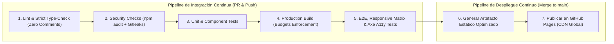

# AppSec Academy — Estrategia de CI/CD y Despliegue Continuo (CI/CD Strategy)

## 1. Visión y Flujo de Trabajo en GitHub Actions

La entrega continua de AppSec Academy se gestiona mediante un pipeline automatizado en **GitHub Actions**, concebido bajo los principios más estrictos de **CI/CD Security y DevSecOps**.



---

## 2. Hardening y Seguridad del Pipeline de CI/CD

El propio pipeline de AppSec Academy aplica las mejores prácticas aprendidas en los módulos M11 y M12:

1. **Principio de Menor Privilegio en Permisos**:
   - El workflow declara permisos mínimos explícitos en el bloque superior, desactivando permisos heredados de escritura en el repositorio:
     ```yaml
     permissions:
       contents: read
       pages: write
       id-token: write
     ```
2. **Fijación de Acciones por Hash Criptográfico (Pinning)**:
   - Para prevenir ataques de compromiso de acciones de terceros en el marketplace de GitHub, todas las acciones se referencian por su hash SHA de commit inmutable en lugar de tags mutables (`@v4`):
     ```yaml
     uses: actions/checkout@11bd71901bbe5b1630ceea73d27597364c9af683 # v4.2.2
     uses: actions/setup-node@39370e3970a6d050c480ffad4ff0ed4d3fdee5af # v4.1.0
     ```
3. **Cero Secretos en el Workflow**:
   - El despliegue en GitHub Pages utiliza la autenticación nativa basada en OIDC (`id-token: write`), prescindiendo de Personal Access Tokens (PATs) permanentes.

---

## 3. Especificación del Archivo de Workflow (`.github/workflows/deploy.yml`)

```yaml
name: AppSec Academy CI/CD Pipeline

on:
  push:
    branches: [main]
  pull_request:
    branches: [main]

concurrency:
  group: 'pages'
  cancel-in-progress: true

jobs:
  validate-and-test:
    name: Validar, Auditar y Probar
    runs-on: ubuntu-latest
    steps:
      - name: Checkout del Repositorio
        uses: actions/checkout@11bd71901bbe5b1630ceea73d27597364c9af683 # v4.2.2

      - name: Configurar Node.js (v24.x)
        uses: actions/setup-node@39370e3970a6d050c480ffad4ff0ed4d3fdee5af # v4.1.0
        with:
          node-version: '24'
          cache: 'npm'

      - name: Instalar Dependencias Congeladas
        run: npm ci

      - name: Auditoría de Seguridad de Dependencias (SCA)
        run: npm audit --audit-level=high

      - name: Verificación de Tipos Estrictos (TypeScript)
        run: npm run type-check

      - name: Verificación de Linting y Cero Comentarios
        run: npm run lint

      - name: Ejecutar Pruebas Unitarias y de Componentes
        run: npm run test:ci

      - name: Compilación de Producción con Budgets
        run: npx ng build --configuration=production --base-href=/app-sec-academy-io/

      - name: Instalar Navegadores de Playwright
        run: npx playwright install --with-deps chromium

      - name: Ejecutar Pruebas E2E, Responsive y Accesibilidad (Axe)
        run: npm run test:e2e

      - name: Cargar Artefacto de Despliegue
        if: github.ref == 'refs/heads/main'
        uses: actions/upload-pages-artifact@56afc609e74202658d3ffba0e8f6dda462b719fa # v3.0.1
        with:
          path: 'dist/app-sec-academy-io/browser'

  deploy-pages:
    name: Desplegar en GitHub Pages
    if: github.ref == 'refs/heads/main'
    needs: validate-and-test
    runs-on: ubuntu-latest
    environment:
      name: github-pages
      url: ${{ steps.deployment.outputs.page_url }}
    steps:
      - name: Desplegar Artefacto en GitHub Pages
        id: deployment
        uses: actions/deploy-pages@d6db90164ac5ed86f2b6aed7e0febac5b3c0c03e # v4.0.5
```
