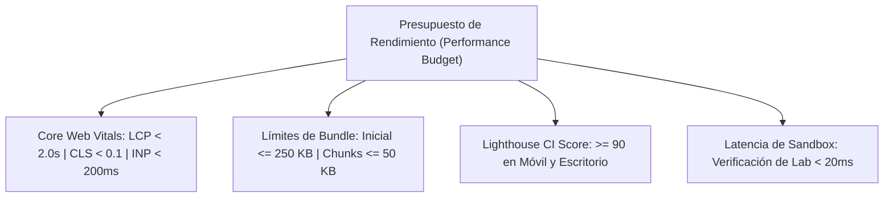

# AppSec Academy — Presupuesto de Rendimiento (Performance Budget)

## 1. Objetivos y Filosofía de Rendimiento

El rendimiento en AppSec Academy es una característica no negociable de la experiencia de usuario. Una plataforma educativa orientada a ingenieros debe sentirse instantánea, sin retrasos de carga, sin saltos de maquetación y sin consumir excesivos recursos de datos móviles ni memoria RAM.



---

## 2. Presupuestos Cuantitativos de Tamaño de Artefactos (Bundle Budgets)

Se configuran los siguientes límites estrictos en el compilador de Angular (`angular.json`):

| Tipo de Artefacto | Límite Máximo de Advertencia | Límite Máximo de Error (Fallo de Build) |
| :--- | :---: | :---: |
| **Bundle Inicial de Scripts (`main.js` + polyfills)** | $\le 200\text{ KB}$ | **$\le 250\text{ KB}$** (Comprimido Brotli/Gzip) |
| **Hojas de Estilos Iniciales (`styles.css`)** | $\le 25\text{ KB}$ | **$\le 35\text{ KB}$** |
| **Chunks de Características (`features/*`)** | $\le 40\text{ KB}$ | **$\le 60\text{ KB}$** por chunk |
| **Chunks de Datos de Lecciones (`data/lessons/*`)** | $\le 20\text{ KB}$ | **$\le 30\text{ KB}$** por lección |
| **Carga Total en Primera Visita (Cold Start)** | $\le 350\text{ KB}$ | **$\le 500\text{ KB}$** |

### 2.1. Configuración de Budgets en `angular.json`:
```json
{
  "configurations": {
    "production": {
      "budgets": [
        {
          "type": "initial",
          "maximumWarning": "200kB",
          "maximumError": "250kB"
        },
        {
          "type": "anyComponentStyle",
          "maximumWarning": "4kB",
          "maximumError": "8kB"
        }
      ]
    }
  }
}
```

---

## 3. Presupuestos de Core Web Vitals (CWV)

Auditados automáticamente en emulación móvil de media gama (Fast 4G, 4x CPU Throttling):

| Métrica | Umbral Aceptable | Umbral Óptimo | Impacto en la Experiencia |
| :--- | :---: | :---: | :--- |
| **Largest Contentful Paint (LCP)** | $< 2.5\text{ s}$ | **$< 1.8\text{ s}$** | El contenido principal de la lección aparece de inmediato. |
| **Cumulative Layout Shift (CLS)** | $< 0.1$ | **$< 0.02$** | Cero movimiento visual al cargar fuentes o diagramas. |
| **Interaction to Next Paint (INP)** | $< 200\text{ ms}$ | **$< 80\text{ ms}$** | Respuesta instantánea al hacer clic en filtros o botones. |
| **Time to First Byte (TTFB)** | $< 600\text{ ms}$ | **$< 250\text{ ms}$** | Entrega rápida desde la CDN perimetral de GitHub Pages. |

---

## 4. Técnicas de Optimización Implementadas

1. **Tree-Shaking Agresivo**: Al usar componentes Standalone e inyección por función `inject()`, las partes no utilizadas de Angular y librerías son purgadas en el empaquetado.
2. **Fuentes Auto-Alojadas con Subsetting**: Las fuentes Inter y JetBrains Mono se distribuyen en formato WOFF2 optimizado y auto-alojadas, eliminando consultas lentas hacia Google Fonts.
3. **Carga Diferida de Mermaid y Diagramadores**: Las librerías de diagramación pesadas solo se cargan si la lección actual contiene diagramas de arquitectura.
4. **Imágenes y Gráficos en SVG Vectorial**: Todos los iconos e ilustraciones técnicas son SVGs puros incrustados en línea o cargados bajo demanda, garantizando nitidez perfecta en cualquier resolución con tamaños inferiores a 2 KB por icono.
