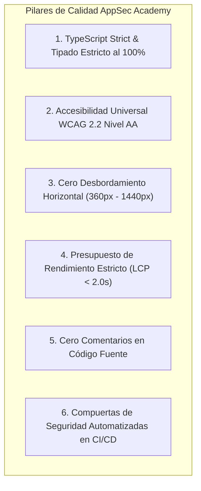

# AppSec Academy — Estrategia Integral de Calidad (Quality Strategy)

## 1. Visión y Pilares de Calidad de Software

En AppSec Academy, la calidad del software no es una fase tardía; está integrada en cada decisión de diseño, compilación y entrega. La plataforma adopta el estándar de excelencia de la ingeniería de software moderna para entregar una experiencia rápida, accesible, robusta y libre de defectos.

---

## 2. Compuertas de Calidad Técnicas (Quality Gates)

Cada cambio propuesto mediante Pull Request debe superar sin excepciones las siguientes compuertas automáticas antes de autorizarse su fusión a la rama principal:

| Compuerta | Herramienta | Umbral Obligatorio | Acción ante Incumplimiento |
| :--- | :--- | :--- | :--- |
| **Tipado Estricto** | TypeScript `tsc --noEmit` | Cero errores de tipos (`strict: true`). | Falla el pipeline de CI. |
| **Linting y Estilo** | ESLint / Angular ESLint | Cero errores, cero advertencias de tipo `no-any` o `no-unused-vars`. | Falla el pipeline de CI. |
| **Cero Comentarios** | ESLint rule `spaced-comment: off` / linter check | Cero comentarios en el código fuente de componentes y servicios. | Falla el pipeline de CI. |
| **Pruebas Unitarias** | Vitest / Karma / Jasmine | $100\%$ de pruebas pasando, cobertura de líneas $\ge 80\%$. | Falla el pipeline de CI. |
| **Auditoría de Accesibilidad** | Axe-Core / Lighthouse CI | Cero violaciones críticas o serias (WCAG 2.2 AA). | Falla el pipeline de CI. |
| **Presupuesto de Bundle** | Angular CLI Build Budgets | Bundle inicial $\le 250\text{ KB}$, Chunks individuales $\le 50\text{ KB}$. | Falla la compilación de producción. |
| **Seguridad de Dependencias** | `npm audit` | Cero vulnerabilidades críticas o altas. | Falla el pipeline de CI. |

---

## 3. Estándar de Código Limpio y Cero Comentarios

En cumplimiento de las directrices del proyecto:
- **Cero Comentarios en Código Fuente**: El código debe ser auto-documentado. La intención se expresa mediante nombres de variables expresivos, firmas de funciones descriptivas, tipos estrictos y arquitectura modular limpia.
- **Documentación Centralizada en Markdown**: Todo el contexto técnico, decisiones arquitectónicas, requerimientos y justificaciones de negocio residen en el directorio `docs/`, no dispersos en comentarios dentro del código TypeScript o HTML.
