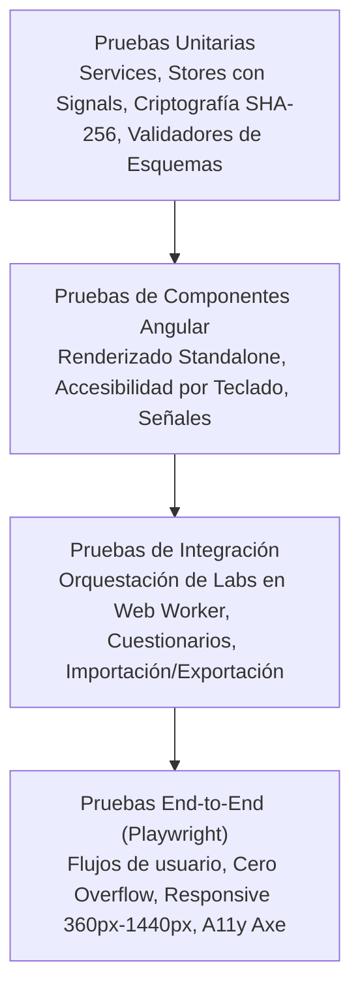

# AppSec Academy — Estrategia de Pruebas Automatizadas (Testing Strategy)

## 1. Pirámide de Pruebas y Cobertura

La estrategia de pruebas de AppSec Academy asegura la estabilidad funcional, la ergonomía responsive, la accesibilidad universal y la robustez del sandbox en el cliente mediante cuatro niveles complementarios:



---

## 2. Niveles de Pruebas Automatizadas

### 2.1. Pruebas Unitarias (Unit Testing)
- **Alcance**: Servicios puros, tiendas de estado (`ProgressStore`), funciones de cifrado y cálculo de hashes con Web Crypto API, analizadores de esquemas JSON y cálculo de porcentajes curriculares.
- **Tecnología**: Vitest o Angular Test Runner integrado con Node.js 24.
- **Criterio de Éxito**: 100% de aserciones exitosas con tiempos de ejecución inferiores a 10 segundos para toda la suite unitaria.

### 2.2. Pruebas de Componentes (Component Testing)
- **Alcance**: Componentes visuales standalone (`LessonWorkspaceComponent`, `QuizRunnerComponent`, `CodeEditorComponent`, `BadgePillComponent`).
- **Validaciones Clave**:
  - Renderizado fiel de las 9 secciones estandarizadas.
  - Enlace reactivo a las Signals del Store.
  - Manejo de eventos de teclado (`Enter`, `Space`, `ArrowKeys`, `Escape`).

### 2.3. Pruebas de Integración del Sandbox
- **Alcance**: Ciclo de vida completo del laboratorio (`SandboxService` $\leftrightarrow$ `WebWorker` $\leftrightarrow$ `WatchdogTimer`).
- **Casos Obligatorios**:
  - Verificación de que una suite de pruebas válida retorna el reporte de aserciones correcto.
  - Comprobación de que bucles infinitos disparan la terminación forzosa a los 2,000 ms sin colgar el ejecutor de pruebas.
  - Verificación de que peticiones de red hacia URLs externas lanzan `SecurityViolationError`.

### 2.4. Pruebas End-to-End (E2E) con Playwright
- **Herramienta**: Playwright con navegadores Chromium, Firefox y WebKit en modo headless.
- **Flujos Críticos Auditados**:
  1. *Flujo Completo de Aprendizaje*: Apertura de Landing Page $\rightarrow$ Navegación a Módulo 01 $\rightarrow$ Ejecución y aprobación de Lab $\rightarrow$ Resolución de Quiz $\rightarrow$ Verificación de actualización en Dashboard.
  2. *Flujo de Portabilidad*: Exportación de snapshot JSON $\rightarrow$ Limpieza de datos $\rightarrow$ Importación del archivo $\rightarrow$ Verificación de restauración idéntica.

---

## 3. Matriz de Pruebas Responsive y Verificación de Cero Overflow

El sistema se prueba automáticamente en los siguientes perfiles de pantalla en Playwright:

| Perfil de Dispositivo | Ancho de Viewport | Alto de Viewport | Dispositivo de Referencia | Criterio de Aceptación |
| :--- | :---: | :---: | :--- | :--- |
| **Móvil Compacto** | `360px` | `640px` | Galaxy S8 / Android pequeño | `document.documentElement.scrollWidth <= 360` (Cero overflow) |
| **Móvil Estándar** | `390px` | `844px` | iPhone 14 / Pixel 7 | `document.documentElement.scrollWidth <= 390` (Cero overflow) |
| **Tableta Vertical** | `768px` | `1024px` | iPad Mini / Galaxy Tab | `document.documentElement.scrollWidth <= 768` (Cero overflow) |
| **Escritorio Estándar** | `1024px` | `768px` | Laptop compacta | `document.documentElement.scrollWidth <= 1024` (Cero overflow) |
| **Escritorio Alta Res** | `1440px` | `900px` | Monitor de ingeniería | `document.documentElement.scrollWidth <= 1440` (Cero overflow) |

### 3.1. Test Automatizado de Cero Overflow Horizontal (Ejemplo Playwright):
```typescript
test('Verificar ausencia total de desbordamiento horizontal en todas las rutas', async ({ page }) => {
  const routes = ['/#/', '/#/dashboard', '/#/curriculum', '/#/leccion/m01-broken-access-control', '/#/playground/lab-bac-01'];
  
  for (const route of routes) {
    await page.goto(route);
    await page.waitForLoadState('networkidle');
    
    const hasHorizontalOverflow = await page.evaluate(() => {
      return document.documentElement.scrollWidth > window.innerWidth;
    });
    
    expect(hasHorizontalOverflow).toBe(false);
  }
});
```

---

## 4. Auditoría Automatizada de Accesibilidad (Axe-Core)

Integrado en las pruebas E2E de Playwright mediante `@axe-core/playwright`:
- Cada pantalla principal se somete al escáner de reglas WCAG 2.2 Nivel AA.
- Se auditan automáticamente: relaciones de contraste de texto, atributos `aria-*`, nombres accesibles en botones, estructura jerárquica de encabezados (`h1` a `h6`) e indicadores de foco visibles.
- Umbral de parada: **0 violaciones de impacto crítico o serio**.
