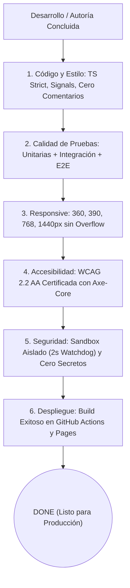

# AppSec Academy — Definición de Terminado (Definition of Done - DoD)

## 1. Principio de Excelencia Operativa

En AppSec Academy, ninguna historia de usuario, tarea técnica o lección curricular se considera **Terminada (Done)** si no cumple de manera verificable con la totalidad de los criterios establecidos en este documento.

---

## 2. Criterios de Aceptación Transversales (Checklist Obligatorio)

### 2.1. Calidad de Código y Arquitectura (Code Quality)
- [ ] Implementado exclusivamente con **Angular Standalone Components** e inyección por función `inject()`.
- [ ] Estado reactivo gestionado mediante **Angular Signals (`signal`, `computed`, `effect`)** sin librerías de estado superfluas.
- [ ] Compilación limpia con **TypeScript en modo estricto (`strict: true`)**, sin uso de `any` ni directivas `@ts-ignore`.
- [ ] **Cero comentarios en el código fuente de componentes y servicios**. Toda la documentación técnica reside en `docs/`.
- [ ] Formato y linting aprobados por ESLint sin advertencias ni errores.

### 2.2. Pruebas Automatizadas y Cobertura (Testing)
- [ ] Pruebas unitarias escritas y pasando al 100% para toda nueva función de lógica o servicio.
- [ ] Pruebas de integración de sandbox verificando el aislamiento del Web Worker y el temporizador Watchdog.
- [ ] Pruebas E2E de Playwright ejecutadas exitosamente en navegadores Chromium, Firefox y WebKit en modo headless.

### 2.3. Usabilidad Móvil y Cero Desbordamiento (Responsive)
- [ ] Inspección visual y automatizada en resoluciones de **360px, 390px, 768px, 1024px y 1440px**.
- [ ] Verificación programática de **cero overflow horizontal** (`document.documentElement.scrollWidth <= window.innerWidth`).
- [ ] Elementos interactivos con área de contacto táctil (*touch targets*) de al menos **44x44 píxeles** en móviles.

### 2.4. Accesibilidad Universal (A11y)
- [ ] Cumplimiento certificado con las pautas **WCAG 2.2 Nivel AA**.
- [ ] Cero violaciones críticas o serias en la auditoría automatizada con `@axe-core/playwright`.
- [ ] Razón de contraste de color $\ge 4.5:1$ en texto estándar y $\ge 3:1$ en elementos gráficos e interactivos.
- [ ] Navegación 100% operable mediante teclado (`Tab`, `Shift+Tab`, `Enter`, `Space`) con anillos de foco visibles (`outline-offset: 2px`).
- [ ] Respeto a las preferencias del usuario para reducción de movimiento (`prefers-reduced-motion`).

### 2.5. Rigor Curricular y Pedagógico
- [ ] La lección contiene de forma obligatoria las **9 secciones estandarizadas** completas.
- [ ] Los ejemplos técnicos presentan contraste explícito entre código vulnerable y código remediado (*Secure by Design*).
- [ ] Todas las referencias citan **estándares oficiales reconocidos** (OWASP, NIST, CWE, IETF, SLSA) con número de versión y fecha formal, sin enlaces inventados ni recursos ficticios.
- [ ] El cuestionario de evaluación incluye justificación formativa tanto para respuestas correctas como incorrectas.

### 2.6. Seguridad de la Plataforma
- [ ] Cumplimiento estricto con la Política de Seguridad de Contenido (CSP).
- [ ] El laboratorio se ejecuta en un Web Worker o iframe con origen nulo (`null origin`) sin acceso a cookies, DOM ni LocalStorage del host.
- [ ] El temporizador Watchdog de 2,000 ms está activo y probado contra bucles infinitos.
- [ ] **Cero secretos, credenciales o claves API** en el código fuente o en los artefactos compilados.
- [ ] Auditoría de dependencias (`npm audit`) limpia de vulnerabilidades de severidad alta o crítica.

### 2.7. Despliegue en GitHub Pages
- [ ] Compilación exitosa en modo producción con presupuestos de rendimiento respetados (bundle inicial $\le 250\text{ KB}$).
- [ ] Despliegue automático completado mediante GitHub Actions hacia GitHub Pages.
- [ ] Navegación y recarga de página (F5) verificadas en el subdirectorio `/app-sec-academy-io/` sin generar errores 404.
