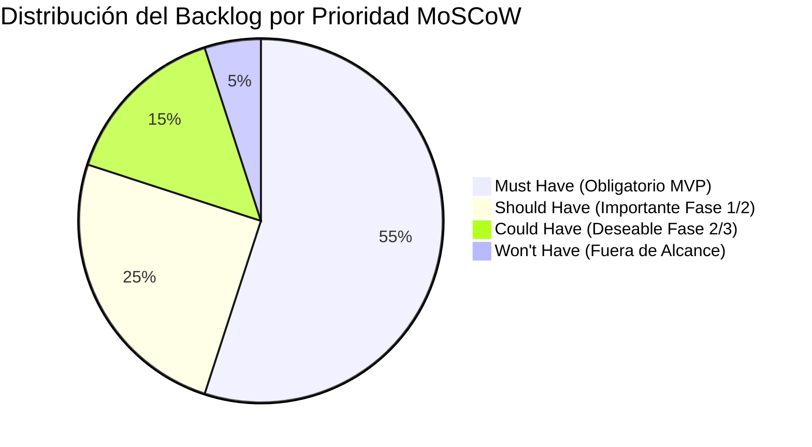

# AppSec Academy — Backlog General del Producto (Product Backlog & MoSCoW)

## 1. Metodología de Priorización (MoSCoW)

El Product Backlog se estructura en diez épicas técnicas y se prioriza mediante la matriz **MoSCoW**:
- **Must Have (M)**: Indispensables para que la plataforma opere como estación de aprendizaje funcional y estática.
- **Should Have (S)**: Capacidades de alto impacto que complementan la experiencia del estudiante.
- **Could Have (C)**: Características enriquecedoras programadas para fases posteriores del ecosistema.
- **Won't Have (W)**: Excluidas explícitamente del alcance actual (ej. backend en nube, pasarelas de pago).

---

## 2. Inventario de Épicas e Historias de Usuario

### Épica 1: Plataforma Base y Shell de Ingeniería (Engineering Shell)
- **US-01.1 [M]**: Como usuario, quiero una interfaz SPA estática basada en Angular Standalone para navegar sin recargas de página. *(5 SP)*
- **US-01.2 [M]**: Como usuario, quiero acceder mediante rutas con hash (`/#/`) para refrescar la página en GitHub Pages sin recibir error 404. *(3 SP)*
- **US-01.3 [M]**: Como usuario móvil, quiero una barra de navegación inferior ergonómica para saltar entre las vistas clave con una sola mano. *(3 SP)*

### Épica 2: Sistema de Diseño UI y Accesibilidad WCAG 2.2 AA
- **US-02.1 [M]**: Como estudiante con baja visión o navegación por teclado, quiero contrastes certificados $\ge 4.5:1$ y anillos de foco visibles para usar toda la plataforma sin ratón. *(5 SP)*
- **US-02.2 [M]**: Como usuario en smartphone (360px a 390px), quiero visualizar todos los componentes y código sin desbordamiento horizontal. *(5 SP)*
- **US-02.3 [S]**: Como usuario sensible al movimiento, quiero que la interfaz respete mi preferencia `prefers-reduced-motion`. *(2 SP)*

### Épica 3: Motor de Estado y Persistencia Soberana en Cliente
- **US-03.1 [M]**: Como estudiante, quiero que mi progreso, XP e insignias se guarden automáticamente en mi navegador sin crear una cuenta. *(5 SP)*
- **US-03.2 [M]**: Como estudiante, quiero exportar mi progreso a un archivo JSON firmado para transferirlo a otra máquina. *(3 SP)*
- **US-03.3 [M]**: Como estudiante, quiero importar un archivo JSON de progreso con validación de integridad para restaurar mi estado. *(3 SP)*

### Épica 4: Motor de Contenido y Espacio de Trabajo de Lección
- **US-04.1 [M]**: Como estudiante, quiero que cada lección renderice estrictamente las 9 secciones estandarizadas para tener predictibilidad formativa. *(8 SP)*
- **US-04.2 [M]**: Como estudiante, quiero ver ejemplos en pestañas comparativas de código vulnerable frente a código remediado. *(5 SP)*
- **US-04.3 [S]**: Como estudiante, quiero diagramas arquitectónicos interactivos en Mermaid que ilustren los flujos de amenaza. *(5 SP)*

### Épica 5: AppSec Playground (Sandbox de Laboratorios en Cliente)
- **US-05.1 [M]**: Como estudiante, quiero editar código vulnerable en un editor con syntax highlighting y ejecutar aserciones en un Web Worker aislado. *(8 SP)*
- **US-05.2 [M]**: Como estudiante, quiero recibir retroalimentación en menos de 20ms indicando si mi parche neutralizó el ataque y conservó la funcionalidad. *(5 SP)*
- **US-05.3 [M]**: Como estudiante atascado, quiero solicitar pistas progresivas que descuenten puntos moderadamente sin bloquear mi avance. *(3 SP)*
- **US-05.4 [M]**: Como plataforma, quiero un Watchdog Timer de 2,000ms que termine cualquier script que caiga en bucles infinitos. *(3 SP)*

### Épica 6: Motor de Evaluaciones Formativas (Knowledge Checks)
- **US-06.1 [M]**: Como estudiante, quiero responder un cuestionario técnico al final de cada lección con retroalimentación inmediata sobre mis respuestas. *(5 SP)*
- **US-06.2 [M]**: Como estudiante que reprobó un cuestionario, quiero reintentarlo con preguntas y distractores barajados aleatoriamente. *(3 SP)*

### Épica 7: Currículo Troncal de Seguridad (14 Módulos)
- **US-07.1 [M]**: Módulo 01: Fundamentos OWASP (4 lecciones, labs y quizzes). *(8 SP)*
- **US-07.2 [M]**: Módulo 02: Secure Coding (SQLi, XSS, Memory). *(8 SP)*
- **US-07.3 [M]**: Módulo 03: API Security (BOLA, BFLA, SSRF). *(8 SP)*
- **US-07.4 [M]**: Módulo 04: Vulnerability Management (CVSS v4.0). *(5 SP)*
- **US-07.5 [M]**: Módulo 05: Software Supply Chain (SBOM, SLSA). *(8 SP)*
- **US-07.6 [M]**: Módulo 06: Cloud Security (IAM, IMDSv2). *(5 SP)*
- **US-07.7 [M]**: Módulo 07: Container Security (Docker hardening). *(5 SP)*
- **US-07.8 [M]**: Módulo 08: Identidad, OAuth 2.1 y JWT. *(8 SP)*
- **US-07.9 [M]**: Módulo 09: Threat Modeling (STRIDE). *(8 SP)*
- **US-07.10 [M]**: Módulo 10: Criptografía Aplicada (AES-GCM, Argon2id). *(5 SP)*
- **US-07.11 [M]**: Módulo 11: DevSecOps y Policy as Code (OPA/Rego). *(5 SP)*
- **US-07.12 [M]**: Módulo 12: CI/CD Pipeline Security. *(5 SP)*
- **US-07.13 [M]**: Módulo 13: AppSec Testing (SAST/DAST). *(5 SP)*
- **US-07.14 [M]**: Módulo 14: AI & LLM Security. *(8 SP)*

### Épica 8: AppSec Knowledge Graph
- **US-08.1 [S]**: Como arquitecto, quiero explorar un grafo interactivo de relaciones entre vulnerabilidades CWE, estándares ASVS y lecciones. *(8 SP)*
- **US-08.2 [S]**: Como usuario, quiero buscar en tiempo real cualquier término de seguridad en el grafo. *(3 SP)*

### Épica 9: Threat Modeling Studio (Ecosistema)
- **US-09.1 [S]**: Como arquitecto, quiero dibujar diagramas DFD simples con límites de confianza en el navegador. *(8 SP)*
- **US-09.2 [C]**: Como diseñador, quiero generar automáticamente la matriz STRIDE asociada a los elementos del DFD. *(8 SP)*

### Épica 10: Calidad, CI/CD y Despliegue en GitHub Pages
- **US-010.1 [M]**: Pipeline de GitHub Actions que ejecute linting, type-check, tests unitarios y auditoría de accesibilidad. *(5 SP)*
- **US-010.2 [M]**: Despliegue automatizado en GitHub Pages ante push en la rama `main`. *(3 SP)*
- **US-010.3 [M]**: Pruebas E2E de Playwright verificando cero overflow horizontal en viewports de 360px a 1440px. *(5 SP)*
