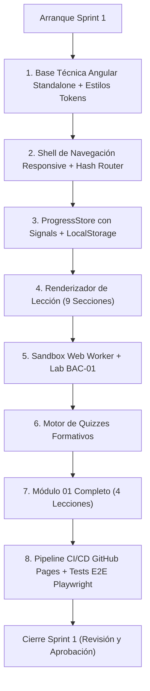

# AppSec Academy — Plan de Ejecución del Sprint 1 (Sprint 1 Plan)

## 1. Meta del Sprint 1 (Sprint Goal)

> **"Construir la base técnica y de diseño de AppSec Academy en Angular Standalone con Signals, desplegarla en GitHub Pages mediante GitHub Actions, e implementar el Módulo 01 (Fundamentos OWASP) completo con sus 4 lecciones, motor de cuestionarios y el primer laboratorio interactivo en Web Worker."**

- **Duración Estimada**: 2 semanas (10 días hábiles de ingeniería).
- **Capacidad del Equipo**: ~70 horas de desarrollo, diseño y QA.
- **Objetivo Tangible**: Al concluir el Sprint 1, cualquier usuario podrá ingresar a `https://<usuario>.github.io/app-sec-academy-io/`, ver el Dashboard con su progreso real, explorar el currículo, estudiar el Módulo 01 con sus 9 secciones estandarizadas, editar y verificar en tiempo real el parche de Broken Access Control en el sandbox de Web Worker, responder el cuestionario interactivo y observar su insignia "OWASP Defender" desbloqueada localmente.

---

## 2. Historias de Usuario Seleccionadas para el Sprint 1

| Identificador | Historia de Usuario | Prioridad MoSCoW | Esfuerzo (SP) |
| :--- | :--- | :---: | :---: |
| **US-01.1 & 01.2** | Shell de aplicación Angular Standalone con Hash Routing y soporte de subdirectorio GitHub Pages. | **Must Have** | 5 SP |
| **US-02.1 & 02.2** | Sistema de diseño UI Dark-First implementado con tokens CSS, contraste WCAG 2.2 AA y cero overflow en 360px-1440px. | **Must Have** | 5 SP |
| **US-03.1** | `ProgressStore` con Angular Signals y persistencia local en `LocalStorage`. | **Must Have** | 5 SP |
| **US-04.1 & 04.2** | `LessonWorkspaceComponent` con renderizado de las 9 secciones estandarizadas y selector de código. | **Must Have** | 8 SP |
| **US-05.1 & 05.4** | Orquestador de Sandbox en Web Worker con Watchdog Timer (2s) y suite de aserciones en memoria. | **Must Have** | 8 SP |
| **US-06.1 & 06.2** | `QuizRunnerComponent` con feedback explicativo inmediato y reintentos barajados. | **Must Have** | 5 SP |
| **US-07.1** | Módulo 01: Fundamentos OWASP (4 lecciones completas + Lab BAC-01 interactivo + Quizzes). | **Must Have** | 8 SP |
| **US-010.1 & 010.2** | Pipeline de CI/CD en GitHub Actions con pruebas automáticas y despliegue a GitHub Pages. | **Must Have** | 5 SP |
| **Total Sprint 1** | **8 Historias de Usuario Críticas (Walking Skeleton Integral)** | | **44 SP** |

---

## 3. Desglose de Tareas Técnicas del Sprint 1

### Bloque A: Inicialización y Arquitectura Base (Días 1 y 2)
1. **TASK-101**: Inicializar proyecto Angular (versión 22.1.2) en modo standalone, con `strict: true` en `tsconfig.json` y sin `NgModules`. *(3 hrs)*
2. **TASK-102**: Configurar reglas ESLint para tipado estricto y regla para prohibir comentarios en código fuente (`spaced-comment: off` / linter). *(2 hrs)*
3. **TASK-103**: Crear archivo `src/styles/tokens.css` con la paleta Dark-First, espaciados, tipografías (Inter y JetBrains Mono) y variables accesibles. *(4 hrs)*
4. **TASK-104**: Configurar `app.config.ts` con `provideRouter(APP_ROUTES, withHashLocation(), withComponentInputBinding())` y base href relativa. *(2 hrs)*

### Bloque B: Shell de Interfaz y Estado Reactivo (Días 3 y 4)
5. **TASK-105**: Implementar `AppComponent` con `HeaderComponent`, `SidebarComponent` (escritorio) y `MobileBottomNavComponent` (móvil 360px). *(6 hrs)*
6. **TASK-106**: Crear `StorageService` para lectura/escritura en `localStorage` con validación básica de esquema. *(3 hrs)*
7. **TASK-107**: Implementar `ProgressStore` utilizando Angular Signals (`signal`, `computed`, `effect`) para reactividad de avance, XP e insignias. *(5 hrs)*
8. **TASK-108**: Construir vista `DashboardComponent` que consuma `ProgressStore` y muestre métricas de avance y tarjeta de lección recomendada. *(5 hrs)*

### Bloque C: Motor de Contenido y Espacio de Lección (Días 5 y 6)
9. **TASK-109**: Definir interfaces `LessonDetail` y `ModuleMetadata` en `src/app/core/models/`. *(2 hrs)*
10. **TASK-110**: Crear `LessonWorkspaceComponent` con maquetación responsive de 9 secciones (panel dual en desktop, pestañas táctiles en móvil). *(8 hrs)*
11. **TASK-111**: Desarrollar `CodeViewerComponent` con números de línea y resaltado sintáctico accesible. *(4 hrs)*
12. **TASK-112**: Desarrollar `QuizRunnerComponent` con evaluación en cliente, justificaciones formativas y barajado de opciones. *(5 hrs)*

### Bloque D: Motor de Sandbox en Cliente y Laboratorio 01 (Días 7 y 8)
13. **TASK-113**: Implementar `SandboxService` y crear el script del Web Worker (`lab-runner.worker.ts`) con intercepción de red y watchdog timer de 2s. *(6 hrs)*
14. **TASK-114**: Construir `CodeEditorComponent` interactivo con botones "Verificar Mitigación", "Pistas" y consola de salida de aserciones. *(6 hrs)*
15. **TASK-115**: Implementar datos y suite de pruebas para `LAB-BAC-01` (Broken Access Control en API REST). *(4 hrs)*
16. **TASK-116**: Redactar y estructurar el contenido de las 4 lecciones del Módulo 01 en TypeScript/JSON (`m01-lesson-1.1.data.ts` a `1.4.data.ts`). *(6 hrs)*

### Bloque E: QA, CI/CD y Verificación en GitHub Pages (Días 9 y 10)
17. **TASK-117**: Escribir pruebas unitarias de `ProgressStore`, `StorageService` y `SandboxService`. *(4 hrs)*
18. **TASK-118**: Escribir pruebas E2E con Playwright validando el flujo de lección y la prueba de cero overflow horizontal en 360, 390, 768 y 1440px. *(5 hrs)*
19. **TASK-119**: Crear el flujo `.github/workflows/deploy.yml` con permisos restringidos y compuertas de parada automática. *(3 hrs)*
20. **TASK-120**: Despliegue de prueba y verificación en vivo sobre GitHub Pages. *(2 hrs)*
