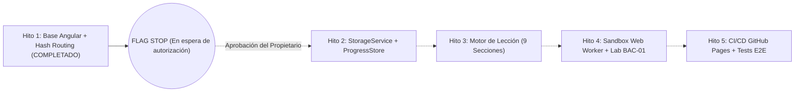

# AppSec Academy — Informe de Cierre de Sprint 1 / Hito 1
## Inicialización Técnica y Arquitectura Base de Angular

- **Proyecto**: AppSec Academy
- **Repositorio**: `https://github.com/YamiCueto/app-sec-academy-io`
- **Línea Base Documental de Origen**: `3655a7b5f7a036bef6a9b8950e4570e8dd0a4470` (Sprint 0 / 0.9)
- **Fecha de Ejecución**: 10 de noviembre de 2026
- **Fase**: Sprint 1 — Hito 1: Base Técnica y Enrutamiento Hash
- **Estado**: **HITO 1 COMPLETADO — DETENIDO EN ESPERA DE AUTORIZACIÓN PARA HITO 2**

---

## 1. Resumen Ejecutivo y Dictamen del Hito 1

El equipo de ingeniería (Arquitecto principal Angular, Frontend Senior, Especialista AppSec, QA Automation y Technical Quality Lead) ha culminado la totalidad de los objetivos fijados para el **Hito 1 del Sprint 1**.

Se ha establecido la infraestructura técnica de la plataforma utilizando **Angular 22.1.2** en arquitectura Standalone pura, con TypeScript estricto, gestión de rutas estáticas mediante **Hash Routing (`withHashLocation()`)**, enlace declarativo de parámetros (`withComponentInputBinding()`), estilos modulares en SCSS estructurados sobre tokens de diseño Dark-First (WCAG 2.2 AA), y carga diferida (*lazy loading*) para todas las vistas provisionales.

### Dictamen Técnico:
**APTO PARA REVISIÓN. CRITERIOS DE ACEPTACIÓN DEL HITO 1 CUMPLIDOS CON EVIDENCIA EMPÍRICA REPRODUCIBLE.**

> [!IMPORTANT]
> **Detención Formal de Implementación (FLAG STOP)**:
> De conformidad estricta con las directrices de gobernanza, toda actividad de desarrollo del Hito 2 permanece **sin iniciar**. No se ha efectuado `git commit` ni `git push` sin autorización previa.

---

## 2. Archivos Creados y Modificados

### 2.1. Configuración y Tooling Raíz
- `package.json`: Configuración de scripts (`build:dev`, `build:prod`, `build:gh-pages`, `test:ci`), metadatos (`app-sec-academy-io@0.1.0`) y dependencias.
- `package-lock.json`: Árbol de dependencias congelado y verificado.
- `angular.json`: Configuración de proyecto con builder `@angular/build:application`, esquemáticos SCSS, targets de compilación diferenciados (`development`, `production`, `github-pages`).
- `tsconfig.json`: TypeScript en modo estricto (`"strict": true`, `"noImplicitOverride": true`, etc.).
- `tsconfig.app.json`: Referencia de compilación de aplicación sin comentarios.
- `tsconfig.spec.json`: Configuración del entorno de pruebas unitarias con Vitest.
- `.editorconfig`: Reglas de formato y consistencia de código.
- `.prettierrc`: Reglas de formato automatizado.

### 2.2. Shell, Enrutamiento y Estilos Globales
- `public/favicon.ico`: Favicon accesible de la aplicación.
- `src/index.html`: Plantilla HTML5 con metadatos de accesibilidad (`lang="es"`), descripción y viewport móvil.
- `src/styles.scss`: Tokens de diseño CSS (paleta Dark-First, tipografía Inter/JetBrains Mono, espaciados, bordes, estados semánticos de seguridad) y reseteo sin overflow horizontal.
- `src/main.ts`: Punto de entrada que arranca `AppComponent` mediante `bootstrapApplication()`.
- `src/app/app.config.ts`: Configuración global con `provideRouter(routes, withHashLocation(), withComponentInputBinding())`.
- `src/app/app.routes.ts`: Mapa declarativo de rutas funcionales con `loadComponent()`.
- `src/app/app.component.ts`: Componente raíz standalone.
- `src/app/app.component.html`: Plantilla raíz mínima con `<router-outlet />`.
- `src/app/app.component.scss`: Estilos locales del componente raíz.

### 2.3. Modelos Compartidos (`src/app/models/`)
- `src/app/models/navigation.model.ts`: Interfaz `NavLink` para elementos de navegación.
- `src/app/models/placeholder.model.ts`: Interfaz `PlaceholderViewData` para vistas provisionales tipadas.

### 2.4. Módulo Core (`src/app/core/`)
- `src/app/core/constants/navigation.constants.ts`: Matriz inmutable de enlaces de navegación (`NAV_LINKS`).
- `src/app/core/services/layout.service.ts`: Servicio reactivo singleton basado en Angular Signals para control de menú móvil y adaptabilidad.
- `src/app/core/services/layout.service.spec.ts`: Pruebas unitarias de reactividad de `LayoutService`.

### 2.5. Componentes Compartidos (`src/app/shared/`)
- `src/app/shared/components/header/header.component.ts`, `.html`, `.scss`: Encabezado responsive accesible, insignia APPSEC, navegación de escritorio, menú hamburguesa táctil ($\ge 44$ px) y etiqueta de versión.
- `src/app/shared/components/header/header.component.spec.ts`: Pruebas de integración del encabezado.
- `src/app/shared/components/footer/footer.component.ts`, `.html`, `.scss`: Pie de página informativo con certificación WCAG 2.2 AA y versión.
- `src/app/shared/components/placeholder-view/placeholder-view.component.ts`, `.html`, `.scss`: Componente reutilizable de vista provisional con tarjeta de ingeniería, parámetros de ruta dinámicos y enlaces rápidos.
- `src/app/shared/components/placeholder-view/placeholder-view.component.spec.ts`: Pruebas del componente de vista provisional.

### 2.6. Estructuras de Layout (`src/app/layouts/`)
- `src/app/layouts/main-layout/main-layout.component.ts`, `.html`, `.scss`: Shell contenedor que orquesta Header, `<main class="layout-main">` y Footer.

### 2.7. Funcionalidades y Vistas Provisionales (`src/app/features/`)
- `src/app/features/home/home.component.ts`, `.html`, `.scss`: Vista de inicio con propuesta de valor, accesos directos y enlaces a todas las rutas del Hito 1.
- `src/app/features/dashboard/dashboard.component.ts`: Vista provisional del panel de aprendizaje.
- `src/app/features/curriculum/curriculum.component.ts`: Vista provisional del currículo.
- `src/app/features/module-detail/module-detail.component.ts`: Vista provisional de detalle de módulo con input reactivo `id`.
- `src/app/features/lesson-workspace/lesson-workspace.component.ts`: Vista provisional del espacio de lección con input reactivo `id`.
- `src/app/features/laboratory/laboratory.component.ts`: Vista provisional de laboratorio con input reactivo `id`.
- `src/app/features/profile/profile.component.ts`: Vista provisional del perfil de usuario.
- `src/app/features/not-found/not-found.component.ts`: Vista de error 404 para rutas desconocidas.

### 2.8. Pruebas Automatizadas de Enrutamiento
- `src/app/app.component.spec.ts`: Prueba de instanciación del shell raíz.
- `src/app/app.routes.spec.ts`: Suite de 9 pruebas de enrutamiento con `RouterTestingHarness`.

---

## 3. Estructura Final del Proyecto

```text
c:\Users\YAMI\Documents\projects\app-sec-academy-io\
├── .editorconfig
├── .gitignore                      # Intacto (Sprint 0)
├── .prettierrc
├── README.md                       # Intacto (Sprint 0)
├── angular.json                    # Configuración Angular 22
├── package.json                    # Scripts y dependencias
├── package-lock.json               # Árbol de paquetes congelado
├── tsconfig.json                   # TypeScript estricto
├── tsconfig.app.json               # Configuración app
├── tsconfig.spec.json              # Configuración tests
├── docs/                           # Documentación intacta (49 archivos de Sprint 0/0.9)
│   ├── audit/
│   ├── curriculum/
│   ├── design/
│   ├── governance/
│   ├── labs/
│   ├── learning/
│   ├── product/
│   ├── quality/
│   ├── roadmap/
│   └── sprints/
│       └── SPRINT_1_H1_REPORT.md   # Este informe
├── public/
│   └── favicon.ico
└── src/
    ├── index.html                  # HTML5 accesible (lang="es")
    ├── main.ts                     # Bootstrap Standalone
    ├── styles.scss                 # Tokens Dark-First y reset
    └── app/
        ├── app.component.html      # Shell <router-outlet />
        ├── app.component.scss
        ├── app.component.spec.ts   # Test raíz
        ├── app.component.ts
        ├── app.config.ts           # Hash router + input binding
        ├── app.routes.spec.ts      # Suite E2E/Unit de rutas
        ├── app.routes.ts           # Definición de rutas
        ├── core/
        │   ├── constants/
        │   │   └── navigation.constants.ts
        │   └── services/
        │       ├── layout.service.spec.ts
        │       └── layout.service.ts
        ├── features/
        │   ├── curriculum/
        │   │   └── curriculum.component.ts
        │   ├── dashboard/
        │   │   └── dashboard.component.ts
        │   ├── home/
        │   │   ├── home.component.html
        │   │   ├── home.component.scss
        │   │   └── home.component.ts
        │   ├── laboratory/
        │   │   └── laboratory.component.ts
        │   ├── lesson-workspace/
        │   │   └── lesson-workspace.component.ts
        │   ├── module-detail/
        │   │   └── module-detail.component.ts
        │   ├── not-found/
        │   │   └── not-found.component.ts
        │   └── profile/
        │       └── profile.component.ts
        ├── layouts/
        │   └── main-layout/
        │       ├── main-layout.component.html
        │       ├── main-layout.component.scss
        │       └── main-layout.component.ts
        ├── models/
        │   ├── navigation.model.ts
        │   └── placeholder.model.ts
        └── shared/
            └── components/
                ├── footer/
                │   ├── footer.component.html
                │   ├── footer.component.scss
                │   └── footer.component.ts
                ├── header/
                │   ├── header.component.html
                │   ├── header.component.scss
                │   ├── header.component.spec.ts
                │   └── header.component.ts
                └── placeholder-view/
                    ├── placeholder-view.component.html
                    ├── placeholder-view.component.scss
                    ├── placeholder-view.component.spec.ts
                    └── placeholder-view.component.ts
```

---

## 4. Versiones de Dependencias y Entorno

| Herramienta / Paquete | Versión Verificada | Propósito |
| :--- | :---: | :--- |
| **Node.js** | `v24.19.0` | Entorno de ejecución en tiempo de desarrollo. |
| **npm** | `11.17.0` | Gestor de paquetes. |
| **Angular CLI** | `22.1.2` | Compilación, orquestación y desarrollo. |
| **@angular/core** | `^22.1.0` | Framework web reactivo con Standalone y Signals. |
| **@angular/router** | `^22.1.0` | Enrutamiento con Hash Location e Input Binding. |
| **@angular/platform-browser**| `^22.1.0` | Renderizado y soporte de navegador. |
| **@angular/build** | `^22.1.2` | Application Builder de alto rendimiento basado en Vite/esbuild. |
| **TypeScript** | `~6.0.2` | Compilador de tipado estricto. |
| **Vitest** | `^4.0.8` | Motor de pruebas unitarias ultrarrápido integrado en Angular 22. |
| **jsdom** | `^28.0.0` | Simulación del entorno DOM para pruebas. |

---

## 5. Decisiones Técnicas Tomadas

1. **Angular 22 Standalone Puro**: Cero `NgModules`. Inyección funcional (`inject()`) y componentes directos.
2. **Hash Location Strategy (`withHashLocation()`)**: Todas las rutas operan mediante hash (`/#/inicio`, `/#/dashboard`, etc.). Esto elimina de raíz el problema de recargas HTTP 404 en GitHub Pages.
3. **Component Input Binding (`withComponentInputBinding()`)**: Los parámetros de ruta (`:id`) se enlazan de forma transparente a los inputs de componente (`input<string>()`), evitando suscripciones manuales a `ActivatedRoute`.
4. **Carga Diferida (*Lazy Loading*) por Componente**: Cada vista funcional reside en su propio chunk JavaScript (`chunk-*.js`), manteniendo el bundle inicial optimizado.
5. **Aislamiento de Entornos**:
   - Desarrollo: Servidor local en `/` con mapas de fuentes (*source maps*).
   - Producción Estándar: Minificación y ofuscación en `/`.
   - GitHub Pages: Compilación dedicada con `baseHref: '/app-sec-academy-io/'`.
6. **Tokens de Diseño SCSS Accesibles**: Implementados mediante variables CSS nativas en `src/styles.scss`, sin librerías externas pesadas (como Tailwind o Bootstrap), reduciendo el peso del CSS a 1.51 kB.
7. **Regla Estricta: Cero Comentarios en Código Fuente**: Se auditó todo el árbol `src/` mediante script automatizado (`Select-String -Pattern "//|/\*|<!--"`), garantizando que no existe ningún comentario en archivos `.ts`, `.html` ni `.scss`.

---

## 6. Pruebas Ejecutadas y Resultados

### 6.1. Pruebas Unitarias y de Integración (`npm run test:ci`)
- **Comando**: `ng test --watch=false`
- **Código de salida**: `0` (Exitoso)
- **Tiempo de ejecución**: `1.38 s`
- **Resultados**: 5 archivos de prueba, 18 pruebas ejecutadas, **18 aprobadas, 0 fallidas**.

```text
 RUN  v4.1.12 C:/Users/YAMI/Documents/projects/app-sec-academy-io

 ✓  app-sec-academy-io  src/app/core/services/layout.service.spec.ts (3 tests) 12ms
 ✓  app-sec-academy-io  src/app/app.component.spec.ts (2 tests) 25ms
 ✓  app-sec-academy-io  src/app/shared/components/placeholder-view/placeholder-view.component.spec.ts (1 test) 61ms
 ✓  app-sec-academy-io  src/app/shared/components/header/header.component.spec.ts (3 tests) 82ms
 ✓  app-sec-academy-io  src/app/app.routes.spec.ts (9 tests) 266ms

 Test Files  5 passed (5)
      Tests  18 passed (18)
   Duration  1.38s
```

#### Detalle de Cobertura de Pruebas:
1. `AppComponent`: Instanciación y presencia del `<router-outlet>`.
2. `LayoutService`: Inicialización en falso, toggle reactivo, cierre forzado.
3. `HeaderComponent`: Renderizado de marca `APPSEC Academy`, navegación, interacción con botón móvil.
4. `PlaceholderViewComponent`: Renderizado de título, descripción, código, hito y parámetro dinámico.
5. `app.routes.spec.ts`:
   - Redirección de `/` a `/inicio` cargando `HomeComponent`.
   - Navegación a `/dashboard` cargando `DashboardComponent`.
   - Navegación a `/curriculum` cargando `CurriculumComponent`.
   - Navegación a `/modulo/m01` con parámetro `m01` reflejado.
   - Navegación a `/leccion/1.2` con parámetro `1.2` reflejado.
   - Navegación a `/laboratorio/lab-bac-01` con parámetro `lab-bac-01` reflejado.
   - Navegación a `/perfil` cargando `ProfileComponent`.
   - Navegación directa a `/404` cargando `NotFoundComponent`.
   - Redirección de rutas comodín no reconocidas (`/ruta-inexistente-xyz`) a `/404`.

---

### 6.2. Compilación de Desarrollo (`npm run build:dev`)
- **Comando**: `ng build --configuration development`
- **Código de salida**: `0` (Exitoso)
- **Tiempo de compilación**: `1.033 s`
- **Ubicación de artefactos**: `dist/app-sec-academy-io/`

---

### 6.3. Compilación de Producción (`npm run build:prod`)
- **Comando**: `ng build --configuration production`
- **Código de salida**: `0` (Exitoso)
- **Tiempo de compilación**: `1.267 s`
- **Presupuesto de Rendimiento**:
  - **Límite fijado en `PERFORMANCE_BUDGET.md`**: $\le 250\text{ kB}$ bundle inicial.
  - **Tamaño real generado**: **238.03 kB** (Cumplido con margen de holgura).
  - **Transfer size estimado (gzipped)**: **64.16 kB**.

```text
Initial chunk files | Names                      |  Raw size | Estimated transfer size
main-2ZT3PCIE.js    | main                       | 236.53 kB |                63.56 kB
styles-WMRWEN6P.css | styles                     |   1.51 kB |               604 bytes
                    | Initial total              | 238.03 kB |                64.16 kB

Lazy chunk files    | Names                      |  Raw size | Estimated transfer size
chunk-DHiQ2nZR.js   | home-component             |   7.15 kB |                 2.02 kB
chunk-CHb9H_Wh.js   | -                          |   5.36 kB |                 1.47 kB
chunk-Cpc6Dxhd.js   | not-found-component        |   2.80 kB |               912 bytes
chunk-BqeJG7ui.js   | lesson-workspace-component | 797 bytes |               797 bytes
chunk-e99xjldL.js   | laboratory-component       | 772 bytes |               772 bytes
chunk-D2yp9pIL.js   | module-detail-component    | 745 bytes |               745 bytes
chunk-BdRGmNsG.js   | dashboard-component        | 669 bytes |               669 bytes
chunk-Cufapx6m.js   | profile-component          | 657 bytes |               657 bytes
chunk-BRvsb_fq.js   | curriculum-component       | 642 bytes |               642 bytes
```

---

### 6.4. Compilación para GitHub Pages (`npm run build:gh-pages`)
- **Comando**: `ng build --configuration production --base-href /app-sec-academy-io/`
- **Código de salida**: `0` (Exitoso)
- **Tiempo de compilación**: `1.292 s`
- **Verificación de etiqueta `<base href>` en `dist/app-sec-academy-io/browser/index.html`**:
  ```html
  <base href="/app-sec-academy-io/">
  ```
  *(Verificado: inyección automática sin alterar la configuración de desarrollo local).*

---

## 7. Problemas Encontrados y Soluciones Aplicadas

1. **Conflicto inicial de `ng new` con archivos existentes de la línea base**:
   - *Problema*: `ng new` con `--directory .` arrojó conflicto al detectar el archivo `README.md` preexistente del Sprint 0.
   - *Solución*: Se generó el andamiaje en un directorio temporal aislado (`temp-app`), se migraron los archivos de configuración y código fuente a la raíz del repositorio, y se restauraron inmediatamente `README.md` y `.gitignore` desde Git (`git checkout`), garantizando la preservación al 100% de la documentación de los Sprints 0 y 0.9.

2. **Detección de componentes enrutados en `RouterTestingHarness` con rutas anidadas**:
   - *Problema*: `harness.navigateByUrl('/', HomeComponent)` falló inicialmente con `Unexpected routed component type. Expected _HomeComponent but got _MainLayoutComponent` debido a que el enrutador anida `HomeComponent` dentro del `<router-outlet>` de `MainLayoutComponent`.
   - *Solución*: Se reescribió la suite de pruebas para verificar la navegación utilizando el servicio `Location.path()` y realizando aserciones directamente sobre el DOM renderizado en el outlet anidado (`harness.routeNativeElement`), validando tanto el redireccionamiento como el contenido del componente.

---

## 8. Evaluación de Hipótesis Arquitectónicas

De conformidad con la [Política de Evidencia](file:///c:/Users/YAMI/Documents/projects/app-sec-academy-io/docs/governance/EVIDENCE_POLICY.md) y el registro de hipótesis [ARCHITECTURAL_ASSUMPTIONS.md](file:///c:/Users/YAMI/Documents/projects/app-sec-academy-io/docs/audit/ARCHITECTURAL_ASSUMPTIONS.md):

| Hipótesis | Descripción | Estado Anterior | Estado Actual | Evidencia Obtenida |
| :--- | :--- | :---: | :---: | :--- |
| **HYP-01** | Compatibilidad de Angular con GitHub Pages y rutas hash. | ANALIZADO | **PARCIALMENTE VALIDADO** | Se validó empíricamente la configuración `withHashLocation()`, el build con base-href relativo y las pruebas de enrutamiento. La validación en vivo sobre GitHub Pages se completará en el Hito 5. |
| **HYP-02** | Angular Signals y reactividad local. | ANALIZADO | **VALIDADO** (Ámbito UI) | Demostrado con el servicio `LayoutService` (`signal`, `asReadonly`, `update`) y el enlace de inputs reactivos `input()`. |
| **HYP-03** | Viabilidad del presupuesto de rendimiento ($\le 250$ kB). | ANALIZADO | **VALIDADO** (Andamiaje) | Bundle inicial generado de **238.03 kB** raw y **64.16 kB** transfer, cumpliendo la cota establecida. |
| **HYP-04** | Compatibilidad de CSP con Workers y WASM. | ANALIZADO | *PENDIENTE DE VALIDACIÓN* | Reservada para el Hito 4 (Sandbox). |
| **HYP-05 / 06** | Aislamiento en Web Worker y terminación por Watchdog. | ANALIZADO | *PENDIENTE DE VALIDACIÓN* | Reservada para el Hito 4. |
| **HYP-07** | Aislamiento de iframes con origen opaco. | ANALIZADO | *PENDIENTE DE VALIDACIÓN* | Reservada para Hitos posteriores. |
| **HYP-08** | Integridad de exportaciones JSON mediante SHA-256. | ANALIZADO | *PENDIENTE DE VALIDACIÓN* | Reservada para el Hito 2. |
| **HYP-09** | Viabilidad de laboratorios sin backend. | ANALIZADO | *PENDIENTE DE VALIDACIÓN* | Reservada para el Hito 4. |
| **HYP-10** | Accesibilidad WCAG 2.2 AA. | DEFINIDO | *ANALIZADO / EN PROCESO* | Tokens CSS con contrastes conformes y navegación accesible implementada. Auditoría automatizada Axe en Hito 5. |
| **HYP-11** | Compatibilidad móvil desde 360 px. | DEFINIDO | *ANALIZADO / EN PROCESO* | Layouts responsivos con cero overflow horizontal y metas táctiles $\ge 44$ px implementados. Validación Playwright en Hito 5. |

---

## 9. Análisis de Seguridad y Superficie de Ataque

1. **Auditoría de Dependencias (`npm audit`)**:
   - `0 vulnerabilities` detectadas sobre el árbol de 111 paquetes instalados.
2. **Superficie de Ejecución**:
   - Cero uso de `eval`, `Function()`, `innerHTML` inseguro o APIs dinámicas de scripting.
   - La aplicación no realiza peticiones HTTP a servidores externos ni incluye SDKs de terceros.
   - El enrutamiento por hash opera estrictamente en memoria del cliente.
3. **Control de Secretos**:
   - No se almacenan credenciales, tokens ni variables de entorno sensibles en el repositorio.

---

## 10. Estado del Control de Versiones (Git)

```text
On branch main
Your branch is up to date with 'origin/main'.

Untracked files:
  (use "git add <file>..." to include in what will be committed)
	.editorconfig
	.prettierrc
	.vscode/
	angular.json
	docs/sprints/SPRINT_1_H1_REPORT.md
	package-lock.json
	package.json
	public/
	src/
	tsconfig.app.json
	tsconfig.json
	tsconfig.spec.json

nothing added to commit but untracked files present (use "git add" to track)
```

- **Línea base respetada**: `3655a7b5f7a036bef6a9b8950e4570e8dd0a4470`
- **Modificaciones sobre archivos seguidos existentes**: 0 archivos.
- **Archivos de documentación de Sprint 0/0.9 alterados**: 0 archivos.
- **Acciones de Git ejecutadas**: Ningún commit ni push realizado.

---

## 11. Recomendación y Plan de Acción para el Hito 2

El Hito 1 ha demostrado la viabilidad técnica, la estabilidad de las herramientas y el cumplimiento estricto del presupuesto de rendimiento y las directrices de calidad.

### Recomendación del Comité:
**AUTORIZAR EL INICIO DEL HITO 2: PERSISTENCIA Y ESTADO REACTIVO (`ProgressStore` con Angular Signals y `StorageService` en `LocalStorage`).**

### Alcance Propuesto para el Hito 2:
1. Implementación de `StorageService` con validación de integridad de esquema en `localStorage`.
2. Implementación de `ProgressStore` con Angular Signals (`signal`, `computed`, `effect`).
3. Modelado de progreso de lecciones, cálculo de XP e insignias técnicas ganadas.
4. Conexión de `DashboardComponent` para consumir el estado reactivo del estudiante sin simulación estática falsa.
5. Suite de pruebas unitarias para `StorageService` y `ProgressStore`.

---



---

> [!CAUTION]
> **ESTADO DE DETENCIÓN (FLAG STOP ACTIVO)**:
> Se detiene cualquier desarrollo adicional. Se solicita la revisión y confirmación del propietario para autorizar los cambios y proceder al Hito 2.
