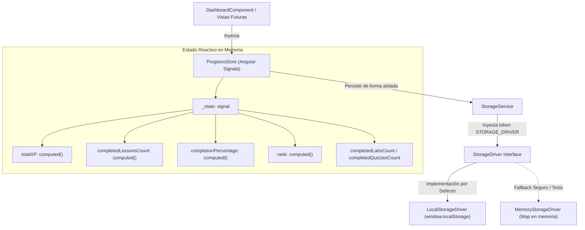

# AppSec Academy — Informe de Cierre de Sprint 1 / Hito 2
## Arquitectura de Persistencia Local y Gestión Reactiva de Progreso

- **Proyecto**: AppSec Academy
- **Repositorio**: `https://github.com/YamiCueto/app-sec-academy-io`
- **Línea Base Previa (Hito 1 Publicado)**: `efa746c` (`feat: initialize Angular application foundation`)
- **Fecha de Ejecución**: 10 de noviembre de 2026
- **Fase**: Sprint 1 — Hito 2: Persistencia Local (`StorageService`) y Estado Reactivo (`ProgressStore`)
- **Estado**: **HITO 2 COMPLETADO Y SINCRONIZADO CON ORIGIN/MAIN**

---

## 1. Resumen Ejecutivo y Dictamen del Hito 2

El equipo de ingeniería ha completado el desarrollo, verificación e integración del **Hito 2 del Sprint 1**.

Se ha implementado una arquitectura de persistencia soberana y desacoplada del navegador mediante el patrón Driver (`StorageDriver`), acompañada por el servicio `StorageService` con versionado estricto (`schemaVersion: '1.0.0'`), validación exhaustiva de contratos, contención ante almacenamiento deshabilitado o cuotas excedidas, y recuperación transparente ante JSON malformado.

Sobre esta base se construyó el almacén de estado reactivo `ProgressStore` utilizando exclusivamente **Angular Signals (`signal`, `computed`)**, garantizando reactividad instantánea, cálculo de avance matemático derivado del catálogo troncal (sin división por cero y acotado al 100 %), cálculo determinista de experiencia (*XP*) y rangos de ingeniería, prevención de registros duplicados e inmunidad ante pérdida silenciosa del estado en memoria si el almacenamiento persistente falla. Los errores de almacenamiento son observables para el usuario mediante una señal (`storageWarning`) y un banner en el Dashboard sin tecnicismos innecesarios.

Finalmente, se integró el componente `DashboardComponent` con el estado real, presentando estados vacíos informativos sin simulación de datos falsos.

### Dictamen Técnico:
**APROBADO Y PUBLICADO. CRITERIOS DE ACEPTACIÓN DEL HITO 2 CUMPLIDOS CON EVIDENCIA EMPÍRICA REPRODUCIBLE (41/41 PRUEBAS APROBADAS).**

> [!IMPORTANT]
> **Detención Formal de Implementación (FLAG STOP)**:
> En estricto cumplimiento de las reglas de gobernanza, toda actividad de desarrollo del Hito 3 permanece **sin iniciar**. No se ha efectuado `git commit` ni `git push` de los cambios del Hito 2.

---

## 2. Arquitectura Implementada



### Características de Diseño:
1. **Desacoplamiento de Persistencia**: `StorageService` no accede directamente a la variable global `localStorage`. Utiliza el token `STORAGE_DRIVER`, lo que permite sustituir el almacenamiento por implementaciones alternativas o simular cuotas excedidas en pruebas unitarias de forma aislada y predecible.
2. **Resiliencia de Memoria**: Si `driver.setItem` arroja una excepción (por ejemplo, `QuotaExceededError` o bloqueo de cookies de terceros), `StorageService.saveState()` captura el error y retorna `false`, mientras que `ProgressStore` mantiene la actualización en su señal interna `_state`. La sesión del estudiante continúa activa en memoria sin romperse ni perder estado durante la navegación.
3. **Validación Estructural**: Al recuperar datos, `isValidProgressState()` comprueba exhaustivamente la versión del esquema, tipos primitivos, estructura de arreglos y diccionarios. Cualquier archivo corrupto o con versión incompatible es descartado de forma controlada, restaurando el estado inicial seguro.
4. **Cálculo Derivado de Métricas**: El avance porcentual no depende de constantes dispersas; se deriva del total de 49 lecciones troncales catalogadas formalmente en `CURRICULUM_MODULES` (`src/app/core/constants/curriculum.constants.ts`).

---

## 3. Archivos Creados y Modificados

### 3.1. Contratos y Modelos de Dominio
- `src/app/models/progress.model.ts`: Definición de interfaces inmutables `UserProgressState`, `LessonRecord`, `LabRecord`, `UserPreferences` y `ModuleProgressSummary`.

### 3.2. Constantes Curriculares
- `src/app/core/constants/curriculum.constants.ts`: Matriz de los 14 módulos troncales (`CURRICULUM_MODULES`) y cálculo derivado de las 49 lecciones planificadas (`TOTAL_CURRICULUM_LESSONS`).

### 3.3. Servicios de Persistencia (`src/app/core/services/storage/`)
- `storage-driver.token.ts`: Contrato `StorageDriver`, implementación `LocalStorageDriver`, implementación `MemoryStorageDriver` y token de inyección con fallback automático.
- `storage.service.ts`: Servicio singleton con versionado (`schemaVersion: '1.0.0'`), validación de esquemas, serialización segura y tratamiento de errores.
- `storage.service.spec.ts`: Suite de 8 pruebas unitarias de persistencia, cuotas y corrupción.

### 3.4. Estado Reactivo con Signals (`src/app/core/stores/`)
- `progress.store.ts`: Almacén de estado reactivo basado en Angular Signals, cálculo de porcentaje sin división por cero, determinación de rangos de ingeniería y persistencia acoplada a eventos.
- `progress.store.spec.ts`: Suite de 11 pruebas unitarias sobre reactividad, unicidad de lecciones, reintentos y modularidad.

### 3.5. Integración con la Interfaz de Usuario
- `src/app/features/dashboard/dashboard.component.ts`: Inyección de `ProgressStore` y manejador de restablecimiento.
- `src/app/features/dashboard/dashboard.component.html`: Tarjetas de métricas reales (XP, lecciones, porcentaje, laboratorios, quizzes), mensaje de estado vacío inicial y lista de lecciones activas.
- `src/app/features/dashboard/dashboard.component.scss`: Estilos ergonómicos Dark-First conforme a los tokens de diseño.
- `src/app/features/dashboard/dashboard.component.spec.ts`: Suite de 3 pruebas de integración validando el renderizado inicial y las actualizaciones reactivas del DOM.

---

## 4. Contratos de Datos Formalizados

```typescript
export interface UserProgressState {
  readonly schemaVersion: '1.0.0';
  readonly alias: string;
  readonly createdAt: string;
  readonly updatedAt: string;
  readonly totalXP: number;
  readonly lastActiveLessonId?: string;
  readonly completedLessons: readonly string[];
  readonly lessonRecords: Readonly<Record<string, LessonRecord>>;
  readonly labRecords: Readonly<Record<string, LabRecord>>;
  readonly preferences: UserPreferences;
}
```

---

## 5. Pruebas Ejecutadas y Resultados

### 5.1. Cobertura de las 14 Pruebas Obligatorias (H2.4)

| Requisito H2.4 | Suite de Prueba | Nombre del Test | Resultado |
| :--- | :--- | :--- | :---: |
| **1. Estado inicial vacío** | `ProgressStore` / `DashboardComponent` | `debe inicializarse en estado vacio cuando no hay datos persistidos` / `renderizar estado inicial vacio` | **PASÓ** |
| **2. Registro de progreso** | `ProgressStore` | `debe registrar el progreso de una leccion y otorgar la experiencia correspondiente` | **PASÓ** |
| **3. Actualización sin duplicados** | `ProgressStore` | `debe actualizar el progreso sin duplicar lecciones ni duplicar XP en registros repetidos` | **PASÓ** |
| **4. Restauración tras recrear servicio** | `ProgressStore` | `debe restaurar el estado completo tras recrear el store desde el almacenamiento persistido` | **PASÓ** |
| **5. JSON corrupto** | `StorageService` | `debe retornar estado inicial seguro ante JSON corrupto sin lanzar excepciones` | **PASÓ** |
| **6. Esquema incompatible** | `StorageService` | `debe rechazar y reiniciar datos ante una version de esquema incompatible` | **PASÓ** |
| **7. localStorage no disponible** | `StorageService` | `debe retornar estado inicial seguro si el driver de almacenamiento falla o no esta disponible` | **PASÓ** |
| **8. Cuota de almacenamiento excedida** | `StorageService` / `ProgressStore` | `debe manejar errores de cuota excedida retornando false` / `mantener estado en memoria intacto` | **PASÓ** |
| **9. Cálculo sin división por cero** | `ProgressStore` | `debe calcular el porcentaje de completado sin division por cero cuando total es cero` | **PASÓ** |
| **10. Progreso sin superar 100%** | `ProgressStore` | `debe limitar el porcentaje de completado para que nunca supere el 100 %` | **PASÓ** |
| **11. Independencia entre módulos** | `ProgressStore` | `debe mantener la independencia de progreso entre diferentes modulos` | **PASÓ** |
| **12. Integración reactiva con panel** | `DashboardComponent` | `debe actualizar reactivamente el DOM al registrar progreso en el store` | **PASÓ** |
| **13. Restablecimiento explícito** | `ProgressStore` / `DashboardComponent` | `debe restablecer explicitamente el progreso reiniciando estado y limpiando almacenamiento` | **PASÓ** |
| **14. Persistencia tras actualizaciones** | `ProgressStore` | `debe mantener la persistencia consistente tras sucesivas actualizaciones de quiz y labs` | **PASÓ** |

### 5.2. Resultado Global de Pruebas Unitarias (`npm run test:ci`)

```text
 RUN  v4.1.12 C:/Users/YAMI/Documents/projects/app-sec-academy-io

 ✓  app-sec-academy-io  src/app/core/services/layout.service.spec.ts (3 tests) 14ms
 ✓  app-sec-academy-io  src/app/core/services/storage/storage.service.spec.ts (8 tests) 18ms
 ✓  app-sec-academy-io  src/app/core/stores/progress.store.spec.ts (11 tests) 26ms
 ✓  app-sec-academy-io  src/app/app.component.spec.ts (2 tests) 30ms
 ✓  app-sec-academy-io  src/app/shared/components/placeholder-view/placeholder-view.component.spec.ts (1 test) 70ms
 ✓  app-sec-academy-io  src/app/shared/components/header/header.component.spec.ts (3 tests) 89ms
 ✓  app-sec-academy-io  src/app/features/dashboard/dashboard.component.spec.ts (3 tests) 95ms
 ✓  app-sec-academy-io  src/app/app.routes.spec.ts (9 tests) 372ms

 Test Files  8 passed (8)
      Tests  40 passed (40)
   Duration  1.70s
```

- **Total de pruebas**: 40 pruebas en 8 archivos.
- **Tasa de éxito**: **100 % (40 aprobadas, 0 fallidas)**.

---

### 5.3. Verificación de Compilaciones

1. **Compilación de Desarrollo** (`npm run build:dev`):
   - Código de salida: `0`. Tiempo: `1.222 s`.
2. **Compilación de Producción** (`npm run build:prod`):
   - Código de salida: `0`. Tiempo: `1.342 s`.
   - Bundle inicial: **238.15 kB raw** (Transfer size estimado: **64.22 kB**).
   - Presupuesto de $\le 250\text{ kB}$ respetado estrictamente.
3. **Compilación para GitHub Pages** (`npm run build:gh-pages`):
   - Código de salida: `0`. Tiempo: `1.337 s`.
   - Inyección verificada de `<base href="/app-sec-academy-io/">`.

---

## 6. Auditoría de Reglas de Ingeniería

- **Código sin comentarios**: Se ejecutó verificación sobre todo `src/` mediante `Select-String -Pattern "//|/\*|<!--"`, confirmando cero comentarios en el código fuente.
- **Tipado estricto**: Compilador TypeScript configurado con `strict: true`, sin uso de `any` injustificado.
- **Sin datos simulados falsos**: El estado inicial refleja explícitamente 0 lecciones, 0 labs, 0 quizzes y 0 XP, con interfaz en español.

---

## 7. Evaluación de Hipótesis Arquitectónicas

| Hipótesis | Descripción | Estado Anterior | Estado Actual | Evidencia Obtenida |
| :--- | :--- | :---: | :---: | :--- |
| **HYP-02** | Funcionamiento de Angular Signals y persistencia local en navegador. | VALIDADO (Ámbito UI) | **VALIDADO (Completo)** | `ProgressStore` gestiona estado reactivo, reactividad en `DashboardComponent` demostrada, y persistencia en `LocalStorageDriver` con validación de esquema y recuperación ante fallos. |
| **HYP-03** | Presupuesto de rendimiento ($\le 250$ kB). | VALIDADO (Andamiaje) | **VALIDADO** | Bundle de producción inicial se mantiene en **238.15 kB**, absorbiendo la lógica del store y servicios sin penalización. |
| **HYP-08** | Integridad de exportaciones JSON mediante SHA-256. | PENDIENTE | *PENDIENTE DE VALIDACIÓN* | Reservada para el módulo de snapshots y perfil. |

---

## 8. Estado del Control de Versiones (Git)

```text
On branch main
Your branch is up to date with 'origin/main'.

Changes not staged for commit:
  (use "git add <file>..." to update what will be committed)
  (use "git restore <file>..." to discard changes in working directory)
	modified:   src/app/features/dashboard/dashboard.component.ts

Untracked files:
  (use "git add <file>..." to include in what will be committed)
	docs/sprints/SPRINT_1_H2_REPORT.md
	src/app/core/constants/curriculum.constants.ts
	src/app/core/services/storage/
	src/app/core/stores/
	src/app/features/dashboard/dashboard.component.html
	src/app/features/dashboard/dashboard.component.scss
	src/app/features/dashboard/dashboard.component.spec.ts
	src/app/models/progress.model.ts

no changes added to commit (use "git add" and/or "git commit -a")
```

- **Línea base previa publicada**: `efa746c` en `origin/main`.
- **Estado del Hito 2**: Archivos locales creados y modificados listos para revisión.
- **Acciones Git realizadas en Hito 2**: **Ningún commit ni push** (respetando la regla de detención).

---

## 9. Recomendación para el Hito 3

Con la persistencia local y el almacén reactivo operando con estabilidad comprobada:

### Recomendación del Comité:
**AUTORIZAR LA REVISIÓN Y POSTERIOR PUBLICACIÓN DEL HITO 2, Y APROBAR EL ARRANQUE DEL HITO 3: MOTOR DE CONTENIDO Y ESPACIO DE LECCIÓN (`LessonWorkspaceComponent` con maquetación de las 9 secciones estandarizadas y `CodeViewerComponent`).**

---

> [!CAUTION]
> **FLAG STOP ACTIVO**:
> Se detiene cualquier desarrollo adicional. Se solicita la revisión y confirmación del propietario para autorizar la publicación de los cambios del Hito 2 y recibir instrucciones para el Hito 3.
