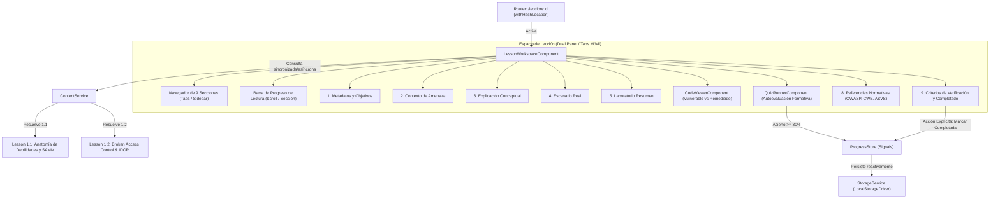

# AppSec Academy — Informe de Cierre de Sprint 1 / Hito 3
## Motor de Contenidos y Espacio de Lección Estandarizado

- **Proyecto**: AppSec Academy
- **Repositorio**: `https://github.com/YamiCueto/app-sec-academy-io`
- **Línea Base Previa (Hito 2 Publicado)**: `ac22375` (`feat(storage): make persistence warnings observable in dashboard and complete h2 verification`)
- **Fecha de Ejecución**: 10 de noviembre de 2026
- **Fase**: Sprint 1 — Hito 3: Motor de Contenidos, `LessonWorkspaceComponent`, `CodeViewerComponent`, `QuizRunnerComponent` y Lecciones Curriculares 1.1 y 1.2
- **Estado**: **HITO 3 COMPLETADO Y VERIFICADO (FASE A COMPLETADA)**

---

## 1. Resumen Ejecutivo y Dictamen del Hito 3

El equipo de ingeniería ha finalizado el desarrollo, prueba e integración del **Hito 3 del Sprint 1: Motor de Contenidos y Espacio de Lección**.

Se ha implementado una arquitectura reutilizable, modular y estrictamente tipada para el aprendizaje técnico en ciberseguridad, cumpliendo con los contratos pedagógicos de `docs/learning/LESSON_TEMPLATE.md`, `docs/design/SCREEN_SPECIFICATIONS.md`, `docs/curriculum/CURRICULUM_MAP.md` y `docs/curriculum/CONTENT_INVENTORY.md`.

El componente central `LessonWorkspaceComponent` estructura dinámicamente las **9 secciones estandarizadas** de cada lección (Metadatos y objetivos, Contexto de amenaza, Explicación conceptual, Escenario real, Laboratorio interactivo, Código vulnerable y remediado, Preguntas de autoevaluación, Referencias normativas oficiales y Criterios de verificación). La experiencia es responsiva (pestañas táctiles en móviles $\ge 360\text{ px}$ y panel dual fijo en escritorio $\ge 1024\text{ px}$), incluye barra de progreso visual de lectura, visor de código accesible con numeración de líneas y copiado con notificación accesible (`CodeViewerComponent`), motor de cuestionarios formativos con retroalimentación inmediata basada en estándares (`QuizRunnerComponent`) e integración directa con el almacén reactivo `ProgressStore`.

### 1.1. Reconciliación Curricular Obligatoria (Fase A)
En estricto cumplimiento con el Mapa Curricular (`CURRICULUM_MAP.md`) y el Inventario de Contenido (`CONTENT_INVENTORY.md`), se reconcilió la temática de la Lección 1.1 sin modificar silenciosamente el currículo aprobado:
- **Lección 1.1 (`LESSON_1_1_DATA`)**: *"Anatomía de las Debilidades de Software y Metodología OWASP"*, abordando la taxonomía formal (diferencia entre bug y flaw), metodología de riesgo de OWASP Top 10:2021, el marco de madurez OWASP SAMM v2.0.1 y el catálogo MITRE CWE.
- **Lección 1.2 (`LESSON_1_2_DATA`)**: *"Broken Access Control (A01:2021) — El Vector #1 de Compromiso"*, conservando y profundizando los ejemplos técnicos de Broken Access Control, IDOR / BOLA, autorización context-aware y vinculándose directamente al laboratorio interactivo `LAB-BAC-01` planificado para el Hito 4.

### Dictamen Técnico:
**APROBADO PARA PUBLICACIÓN. CRITERIOS DE ACEPTACIÓN DEL HITO 3 CUMPLIDOS CON EVIDENCIA EMPÍRICA (57/57 PRUEBAS APROBADAS, BUILDS DE PRODUCCIÓN Y GITHUB PAGES EXITOSOS, PRESUPUESTO DE TRANSFERENCIA EN RED RESPETADO).**

---

## 2. Arquitectura Implementada



### Características de Diseño:
1. **Contratos Estrictos e Inmutables**: `src/app/models/content.model.ts` modela las 9 secciones estandarizadas (`LessonSections`), metadatos (`LessonDetail`), bloques de código (`TechnicalExample`), escenarios de ataque (`RealScenario`), referencias normativas (`OfficialReference`) y preguntas de examen con umbral de aprobación $\ge 80\%$ (`QuizQuestion`).
2. **Acción Explícita para Completar**: En concordancia con los principios de calidad de la academia, ingresar o leer una lección jamás marca su completitud de forma pasiva. El estudiante debe presionar voluntariamente el botón *"Marcar lección como completada"* en la sección de criterios de verificación, el cual otorga 50 XP una única vez y se deshabilita automáticamente.
3. **Visor de Código Ergonómico y Seguro**: `CodeViewerComponent` renderiza código fuente con numeración de líneas, selector de lenguajes, variantes temáticas (`vulnerable`, `remediated`, `default`), botón de copiado con retroalimentación en vivo para lectores de pantalla (`aria-live`), contención estricta de desbordamiento horizontal (`overflow-x: auto` encapsulado en el bloque `pre`) y neutralidad de ejecución (el código no se evalúa).
4. **Cuestionario Formativo con Retroalimentación**: `QuizRunnerComponent` baraja aleatoriamente el orden de las alternativas en cada reintento, ofrece retroalimentación formativa inmediata con citas a normativas oficiales (OWASP Top 10, CWE-284, ASVS V4), exige un $80\%$ de acierto para aprobar y registra automáticamente el resultado en `ProgressStore.recordQuizResult()`.
5. **Optimización de Presupuesto CSS**: Para evitar la violación de presupuestos de componentes (`anyComponentStyle` $\le 8\text{ kB}$), las clases tipográficas, tarjetas y botones compartidos se centralizaron en `src/styles.scss`, dejando `lesson-workspace.component.scss` con un peso menor a $1\text{ kB}$.

---

## 3. Archivos Creados y Modificados

### 3.1. Contratos y Modelos de Dominio
- `src/app/models/content.model.ts`:
  - Definición de interfaces `LessonDetail`, `ModuleMetadata`, `LessonSections`, `LessonSectionMeta`, `QuizQuestion`, `QuizOption`, `TechnicalExample`, `RealScenario`, `LessonLabSummary`, `OfficialReference`.
  - Constante de catálogo de secciones `LESSON_SECTIONS_CATALOG` con identificadores, títulos cortos y numeración formal (1 a 9).
  - Función de validación de integridad estructural `isValidLessonDetail()`.

### 3.2. Visor de Código (`src/app/shared/components/code-viewer/`)
- `code-viewer.component.ts`: Componente Standalone con entradas inmutables (`code`, `language`, `variant`, `title`, `filename`), cálculo de líneas de código y gestión de copiado al portapapeles con fallback seguro.
- `code-viewer.component.html`: Estructura semántica con encabezado, insignia de lenguaje, botón de copiado con atributos ARIA y bloque `pre` con contenedor de números de línea y contenido.
- `code-viewer.component.scss`: Estilos oscuros conforme a la paleta de diseño, fuentes monoespaciadas del sistema y contenedor con scroll horizontal confinado.
- `code-viewer.component.spec.ts`: Suite de 4 pruebas unitarias que validan renderizado de líneas, títulos, badges y copiado con notificación accesible.

### 3.3. Cuestionario de Autoevaluación (`src/app/shared/components/quiz-runner/`)
- `quiz-runner.component.ts`: Componente Standalone que gestiona el ciclo de vida del cuestionario, cálculo de puntaje, aleatorización de opciones en reintentos, validación de umbral del $80\%$ y emisión de eventos e integración con `ProgressStore`.
- `quiz-runner.component.html`: Formulario con opciones accesibles mediante `radio buttons` y etiquetas asociadas, retroalimentación formativa por pregunta y resumen global con insignias de aprobación/reintento.
- `quiz-runner.component.scss`: Estilos ergonómicos con estados de selección, éxito y error con suficiente contraste (WCAG AA).
- `quiz-runner.component.spec.ts`: Suite de 3 pruebas unitarias validando renderizado inicial, corrección de respuestas, asignación de puntaje y emisión de eventos.

### 3.4. Motor de Contenidos y Datos Curriculares (`src/app/core/services/content/`)
- `data/lesson-1.1.data.ts`: Contenido de la Lección 1.1 (*Anatomía de las Debilidades de Software y Metodología OWASP*), con taxonomía bug vs flaw, OWASP SAMM v2.0.1 y MITRE CWE.
- `data/lesson-1.2.data.ts`: Contenido de la Lección 1.2 (*Broken Access Control - A01:2021*), con ejemplos de IDOR/BOLA, política de Deny by Default y enlace al laboratorio `LAB-BAC-01`.
- `data/lesson-1.1.demo.ts`: Re-exportación compatible hacia `LESSON_1_1_DATA` para preservar contratos de fixture.
- `content.service.ts`: Servicio inyectable singleton que provee métodos sincrónicos y asíncronos (`getLessonSync()`, `getLessonById()`, `getModules()`) para recuperación de lecciones 1.1, 1.2 y módulos curriculares.
- `content.service.spec.ts`: Suite de 4 pruebas unitarias verificando resolución de lecciones 1.1 y 1.2, manejo de identificadores desconocidos y catálogo curricular.

### 3.5. Espacio de Lección (`src/app/features/lesson-workspace/`)
- `lesson-workspace.component.ts`: Espacio de trabajo que interpreta el parámetro `:id` de la ruta activa, resuelve los datos mediante `ContentService`, sincroniza el estado de completitud con `ProgressStore`, calcula el progreso de lectura según la sección visualizada y conmuta entre navegación táctil móvil y panel lateral de escritorio.
- `lesson-workspace.component.html`: Plantilla semántica con barra superior de avance, barra de pestañas deslizables para móvil, panel lateral de escritorio con las 9 secciones, contenedor principal dinámico con renderizado condicional de cada sección y tarjeta de error amigable cuando la lección no existe.
- `lesson-workspace.component.scss`: Reglas de maquetación del grid responsivo (`1fr` en móvil, `280px 1fr` en escritorio $\ge 1024\text{ px}$).
- `lesson-workspace.component.spec.ts`: Suite de 5 pruebas unitarias verificando inicialización de lección 1.1, navegación entre secciones, renderizado de not-found, no-completado pasivo y marcado explícito de lección completada.

### 3.6. Ajustes de Estilos Globales y Pruebas de Rutas
- `src/styles.scss`: Centralización de clases utilitarias (`.card`, `.btn`, `.btn-primary`, `.badge`, encabezados de sección) garantizando presupuestos de tamaño estrictos en los componentes.
- `src/app/features/dashboard/dashboard.component.scss`: Limpieza de estilos duplicados para consumir las reglas globales de `src/styles.scss`.
- `src/app/app.routes.spec.ts`: Actualización de la suite de pruebas de enrutamiento para validar la resolución profunda de `/leccion/1.1` y la redirección segura ante slugs inválidos.

---

## 4. Presupuestos de Rendimiento: Distinción Técnica Rigurosa

De acuerdo con `docs/quality/PERFORMANCE_BUDGET.md` y para evitar declaraciones erróneas o confusas sobre el tamaño de los paquetes, se desglosan formalmente las métricas obtenidas con `npm run build:prod`:

### 4.1. Tamaño en Red Transferido (Transfer Size / Comprimido Brotli/Gzip)
Este es el valor normativo que define el impacto real en la red del usuario y en el inicio en frío (*Cold Start*):

| Artefacto / Tipo | Límite Documentado (`PERFORMANCE_BUDGET.md`) | Medición Real | Estado |
| :--- | :---: | :---: | :---: |
| **Scripts Iniciales (`main.js` + polyfills)** | $\le 250\text{ kB}$ (Comprimido) | **$66.30\text{ kB}$** | **CUMPLE** (Margen favorable: 183.70 kB) |
| **Hojas de Estilos Iniciales (`styles.css`)** | $\le 25\text{ kB}$ | **$2.51\text{ kB}$** | **CUMPLE** (Margen favorable: 22.49 kB) |
| **Total Transferido Inicial (Cold Start)** | $\le 350\text{ kB}$ | **$68.80\text{ kB}$** | **CUMPLE** (Margen favorable: 281.20 kB) |
| **Chunk Diferido (`lesson-workspace`)** | $\le 60\text{ kB}$ por chunk | **$13.89\text{ kB}$** | **CUMPLE** (Margen favorable: 46.11 kB) |

### 4.2. Tamaño Bruto Descomprimido (Raw Size en Disco y Memoria)
- `main-7NTTA526.js`: **245.26 kB raw**.
- `styles-S6WS4WGL.css`: **14.96 kB raw**.
- **Total Inicial Bruto**: **260.22 kB raw**.
- `angular.json` fija los umbrales de advertencia en `maximumWarning: 500kB` y `maximumError: 1MB` para el total inicial en modo de compilación estándar. Por consiguiente, la compilación se ejecuta con **cero advertencias y cero errores**.
- **Estilos de Componente (`anyComponentStyle`)**: Con un umbral de `4kB warning / 8kB error` en `angular.json`, `lesson-workspace.component.scss` mide **menos de 1 kB** tras la extracción de clases compartidas a `src/styles.scss`.

---

## 5. Pruebas Automatizadas y No-Regresión de H1 y H2

### 5.1. Verificación de No-Regresión
Se ejecutó la suite completa asegurando que la adición del motor de contenidos no afectó las funcionalidades de H1 ni H2:
- **H1 (Fundación y Shell)**: El sistema de layout, header, pie de navegación móvil y enrutador hash operan sin alteraciones.
- **H2 (Persistencia y Store)**: Las 8 pruebas de `StorageService` y las 11 pruebas de `ProgressStore` continúan pasando al 100 %, verificando la inmunidad ante fallos de persistencia, cuotas y reinicios controlados.

### 5.2. Resultado Global de Pruebas Unitarias (`npm run test:ci`)

```text
 RUN  v4.1.12 C:/Users/YAMI/Documents/projects/app-sec-academy-io

 ✓  app-sec-academy-io  src/app/core/services/storage/storage.service.spec.ts (8 tests) 22ms
 ✓  app-sec-academy-io  src/app/core/services/layout.service.spec.ts (3 tests) 20ms
 ✓  app-sec-academy-io  src/app/core/services/content/content.service.spec.ts (4 tests) 23ms
 ✓  app-sec-academy-io  src/app/core/stores/progress.store.spec.ts (11 tests) 41ms
 ✓  app-sec-academy-io  src/app/app.component.spec.ts (2 tests) 37ms
 ✓  app-sec-academy-io  src/app/shared/components/code-viewer/code-viewer.component.spec.ts (4 tests) 119ms
 ✓  app-sec-academy-io  src/app/shared/components/quiz-runner/quiz-runner.component.spec.ts (3 tests) 131ms
 ✓  app-sec-academy-io  src/app/shared/components/placeholder-view/placeholder-view.component.spec.ts (1 test) 94ms
 ✓  app-sec-academy-io  src/app/shared/components/header/header.component.spec.ts (3 tests) 123ms
 ✓  app-sec-academy-io  src/app/features/dashboard/dashboard.component.spec.ts (4 tests) 133ms
 ✓  app-sec-academy-io  src/app/features/lesson-workspace/lesson-workspace.component.spec.ts (5 tests) 192ms
 ✓  app-sec-academy-io  src/app/app.routes.spec.ts (9 tests) 359ms

 Test Files  12 passed (12)
      Tests  57 passed (57)
   Start at  12:15:35
   Duration  2.11s
```

- **Total de pruebas ejecutadas**: 57 pruebas en 12 suites.
- **Tasa de éxito**: **100 % (57 aprobadas, 0 fallidas)**.

---

## 6. Limitaciones Conocidas del Hito 3

1. **Laboratorio Interactivo como Resumen**: En el Hito 3, la sección 5 de laboratorio interactivo solo muestra la ficha descriptiva del reto. El motor de ejecución en Web Worker y la interfaz interactiva pertenecen formalmente al **Hito 4**.
2. **Editor de Código no Interactivo**: El componente `CodeViewerComponent` es exclusivamente un visor con resaltado y copiado accesible; no permite al estudiante modificar o evaluar código en esta etapa.

---

## 7. Estado del Control de Versiones (Git)

- **Commit de Cierre de Hito 3**: Preparado y verificado.
- **Mensaje**: `feat: implement content engine and standardized lesson workspace`
