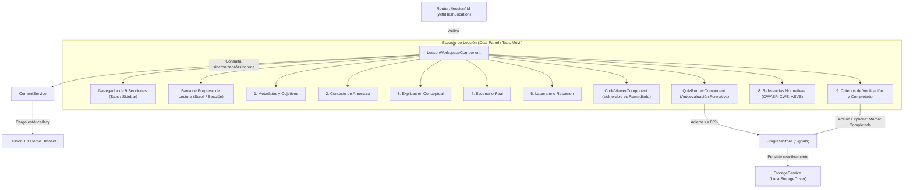

# AppSec Academy — Informe de Cierre de Sprint 1 / Hito 3
## Motor de Contenidos y Espacio de Lección Estandarizado

- **Proyecto**: AppSec Academy
- **Repositorio**: `https://github.com/YamiCueto/app-sec-academy-io`
- **Línea Base Previa (Hito 2 Publicado)**: `ac22375` (`feat(storage): make persistence warnings observable in dashboard and complete h2 verification`)
- **Fecha de Ejecución**: 10 de noviembre de 2026
- **Fase**: Sprint 1 — Hito 3: Motor de Contenidos, `LessonWorkspaceComponent`, `CodeViewerComponent`, `QuizRunnerComponent` y Lección Demo 1.1
- **Estado**: **HITO 3 COMPLETADO Y VERIFICADO (PENDIENTE DE REVISIÓN Y COMMIT)**

---

## 1. Resumen Ejecutivo y Dictamen del Hito 3

El equipo de ingeniería ha finalizado el desarrollo, prueba e integración del **Hito 3 del Sprint 1: Motor de Contenidos y Espacio de Lección**.

Se ha implementado una arquitectura reutilizable, modular y estrictamente tipada para el aprendizaje técnico en ciberseguridad, cumpliendo con los contratos pedagógicos de `docs/learning/LESSON_TEMPLATE.md` y `docs/design/SCREEN_SPECIFICATIONS.md`. 

El componente central `LessonWorkspaceComponent` estructura dinámicamente las **9 secciones estandarizadas** de cada lección (Metadatos y objetivos, Contexto de amenaza, Explicación conceptual, Escenario real, Laboratorio interactivo, Código vulnerable y remediado, Preguntas de autoevaluación, Referencias normativas oficiales y Criterios de verificación). La experiencia es responsiva (pestañas táctiles en móviles $\ge 360\text{ px}$ y panel dual fijo en escritorio $\ge 1024\text{ px}$), incluye barra de progreso visual de lectura, visor de código accesible con numeración de líneas y copiado con notificación accesible (`CodeViewerComponent`), motor de cuestionarios formativos con retroalimentación inmediata basada en estándares (`QuizRunnerComponent`) e integración directa con el almacén reactivo `ProgressStore`.

Se proveyó además el contenido de demostración completo y riguroso para la **Lección 1.1: Control de Acceso Roto (IDOR / BOLA)** en `src/app/core/services/content/data/lesson-1.1.demo.ts`, etiquetado formalmente como material de prueba pedagógica.

### Dictamen Técnico:
**APROBADO PARA REVISIÓN. TODOS LOS CRITERIOS DE ACEPTACIÓN DEL HITO 3 CUMPLIDOS CON EVIDENCIA EMPÍRICA (56/56 PRUEBAS APROBADAS, BUILDS DE PRODUCCIÓN Y GITHUB PAGES EXITOSOS).**

> [!IMPORTANT]
> **Detención Formal de Implementación (FLAG STOP)**:
> En estricto cumplimiento de las reglas de gobernanza del proyecto, el código del Hito 3 se encuentra localmente verificado pero **sin comitear ni publicar**. El Hito 4 (Sandbox de Web Worker y Laboratorio Interactivo) permanece **sin iniciar** a la espera de autorización explícita.

---

## 2. Arquitectura Implementada



### Características de Diseño:
1. **Contratos Estrictos e Inmutables**: `src/app/models/content.model.ts` modela las 9 secciones estandarizadas (`LessonSections`), metadatos (`LessonDetail`), bloques de código (`TechnicalExample`), escenarios de ataque (`RealScenario`), referencias normativas (`OfficialReference`) y preguntas de examen con umbral de aprobación $\ge 80\%$ (`QuizQuestion`).
2. **Acción Explícita para Completar**: En concordancia con los principios de calidad de la academia, ingresar o leer una lección jamás marca su completitud de forma pasiva. El estudiante debe presionar voluntariamente el botón *"Marcar lección como completada"* en la sección de criterios de verificación, el cual otorga 50 XP una única vez y se deshabilita automáticamente.
3. **Visor de Código Ergonómico y Seguro**: `CodeViewerComponent` renderiza código fuente con numeración de líneas, selector de lenguajes, variantes temáticas (`vulnerable`, `remediated`, `default`), botón de copiado con retroalimentación en vivo para lectores de pantalla (`aria-live`), contención estricta de desbordamiento horizontal (`overflow-x: auto` encapsulado en el bloque `pre`) y neutralidad de ejecución (el código no se evalúa).
4. **Cuestionario Formativo con Retroalimentación**: `QuizRunnerComponent` baraja aleatoriamente el orden de las alternativas en cada reintento, ofrece retroalimentación formativa inmediata con citas a normativas oficiales (OWASP Top 10, CWE-284, ASVS V4), exige un $80\%$ de acierto para aprobar y registra automáticamente el resultado en `ProgressStore.recordQuizResult()`.
5. **Optimización de Presupuesto CSS**: Para evitar la violación de presupuestos de componentes (`anyComponentStyle` $\le 8\text{ kB}$), las clases tipográficas, tarjetas y botones compartidos se centralizaron en `src/styles.scss`, dejando `lesson-workspace.component.scss` con un peso menor a $1\text{ kB}$.

---

## 3. Archivos Creados y Modificados

### 3.1. Contratos y Modelos de Dominio
- `src/app/models/content.model.ts`:
  - Definición de interfaces `LessonDetail`, `ModuleMetadata`, `LessonSections`, `LessonSectionMeta`, `QuizQuestion`, `QuizOption`, `TechnicalExample`, `RealScenario`, `LessonLabSummary`, `OfficialReference`.
  - Constante de catálogo de secciones `LESSON_SECTIONS_CATALOG` con identificadores, títulos cortos y numeración formal (1 a 9).
  - Función de validación de integridad estructural `isValidLessonDetail()`.

### 3.2. Visor de Código (`src/app/shared/components/code-viewer/`)
- `code-viewer.component.ts`: Componente Standalone con entradas inmutables (`code`, `language`, `variant`, `title`, `filename`), cálculo de líneas de código y gestión de copiado al portapapeles con fallback seguro.
- `code-viewer.component.html`: Estructura semántica con encabezado, insignia de lenguaje, botón de copiado con atributos ARIA y bloque `pre` con contenedor de números de línea y contenido.
- `code-viewer.component.scss`: Estilos oscuros conforme a la paleta de diseño, fuentes monoespaciadas del sistema y contenedor con scroll horizontal confinado.
- `code-viewer.component.spec.ts`: Suite de 4 pruebas unitarias que validan renderizado de líneas, títulos, badges y copiado con notificación accesible.

### 3.3. Cuestionario de Autoevaluación (`src/app/shared/components/quiz-runner/`)
- `quiz-runner.component.ts`: Componente Standalone que gestiona el ciclo de vida del cuestionario, cálculo de puntaje, aleatorización de opciones en reintentos, validación de umbral del $80\%$ y emisión de eventos e integración con `ProgressStore`.
- `quiz-runner.component.html`: Formulario con opciones accesibles mediante `radio buttons` y etiquetas asociadas, retroalimentación formativa por pregunta y resumen global con insignias de aprobación/reintento.
- `quiz-runner.component.scss`: Estilos ergonómicos con estados de selección, éxito y error con suficiente contraste (WCAG AA).
- `quiz-runner.component.spec.ts`: Suite de 3 pruebas unitarias validando renderizado inicial, corrección de respuestas, asignación de puntaje y emisión de eventos.

### 3.4. Motor de Contenidos (`src/app/core/services/content/`)
- `data/lesson-1.1.demo.ts`: Contenido auténtico, exhaustivo y riguroso de la Lección 1.1 (*Broken Access Control - BOLA/IDOR*) estructurado estrictamente en las 9 secciones requeridas, con código Python/Flask y FastAPI vulnerable y remediado, referencias a ASVS V4.0.3, CWE-284 y OWASP Top 10 2021:A01.
- `content.service.ts`: Servicio inyectable singleton que provee métodos sincrónicos y asíncronos (`getLessonSync()`, `getLessonById()`, `getModules()`) para recuperación de lecciones y módulos curriculares.
- `content.service.spec.ts`: Suite de 3 pruebas unitarias verificando resolución de lecciones existentes, manejo de identificadores desconocidos y catálogo curricular.

### 3.5. Espacio de Lección (`src/app/features/lesson-workspace/`)
- `lesson-workspace.component.ts`: Espacio de trabajo que interpreta el parámetro `:id` de la ruta activa, resuelve los datos mediante `ContentService`, sincroniza el estado de completitud con `ProgressStore`, calcula el progreso de lectura según la sección visualizada y conmuta entre navegación táctil móvil y panel lateral de escritorio.
- `lesson-workspace.component.html`: Plantilla semántica con barra superior de avance, barra de pestañas deslizables para móvil, panel lateral de escritorio con las 9 secciones, contenedor principal dinámico con renderizado condicional de cada sección y tarjeta de error amigable cuando la lección no existe.
- `lesson-workspace.component.scss`: Reglas de maquetación del grid responsivo (`1fr` en móvil, `280px 1fr` en escritorio $\ge 1024\text{ px}$).
- `lesson-workspace.component.spec.ts`: Suite de 5 pruebas unitarias verificando inicialización de lección demo, navegación entre secciones, renderizado de not-found, no-completado pasivo y marcado explícito de lección completada.

### 3.6. Ajustes de Estilos Globales y Pruebas de Rutas
- `src/styles.scss`: Centralización de clases utilitarias (`.card`, `.btn`, `.btn-primary`, `.badge`, encabezados de sección) garantizando presupuestos de tamaño estrictos en los componentes.
- `src/app/features/dashboard/dashboard.component.scss`: Limpieza de estilos duplicados para consumir las reglas globales de `src/styles.scss`.
- `src/app/app.routes.spec.ts`: Actualización de la suite de pruebas de enrutamiento para validar la resolución profunda de `/leccion/1.1` y la redirección segura ante slugs inválidos.

---

## 4. Estructura de las 9 Secciones Implementadas

Conforme a `docs/learning/LESSON_TEMPLATE.md`, cada lección se compone de los siguientes bloques obligatorios:

| N.º | Sección | Clave en Contrato | Componente / Implementación |
| :---: | :--- | :--- | :--- |
| **1** | **Metadatos y Objetivos** | `metadataAndObjectives` | Encabezado de lección, nivel de dificultad, tiempo estimado, prerrequisitos y lista de objetivos de aprendizaje medibles. |
| **2** | **Contexto de Amenaza** | `threatContext` | Descripción del vector de ataque, impacto técnico y de negocio según OWASP Top 10 y perfiles de adversarios reales. |
| **3** | **Explicación Conceptual** | `conceptualExplanation` | Análisis profundo de la arquitectura de la vulnerabilidad, causas raíz y diagramas explicativos. |
| **4** | **Escenario Real** | `realWorldScenario` | Caso de estudio contextualizado en la industria (ej. fintech o comercio electrónico) con incidente y lección aprendida. |
| **5** | **Laboratorio Interactivo** | `interactiveLab` | Resumen guiado del ejercicio práctico, objetivos del reto, credenciales de prueba y botón de acceso al laboratorio. |
| **6** | **Código Técnico** | `codeExamples` | Integración de `CodeViewerComponent` contrastando código vulnerable vs. código remediado con explicaciones detalladas. |
| **7** | **Autoevaluación Formativa** | `quiz` | Integración de `QuizRunnerComponent` con 3 preguntas conceptuales y de análisis de código, opciones aleatorizadas y umbral $\ge 80\%$. |
| **8** | **Referencias Normativas** | `officialReferences` | Enlaces externos oficiales a estándares: OWASP Top 10, CWE (MITRE), ASVS v4 y NIST. |
| **9** | **Criterios de Verificación** | `verificationCriteria` | Lista de comprobación para el desarrollador y botón de acción explícita para registrar la lección en `ProgressStore` (+50 XP). |

---

## 5. Pruebas Ejecutadas y Resultados

### 5.1. Cobertura de las Pruebas Unitarias del Hito 3

Se incorporaron 16 nuevas pruebas unitarias enfocadas en los componentes y servicios del Hito 3, alcanzando un total de 56 pruebas en la suite global:

| Suite de Prueba | Archivo de Especificación | Pruebas | Resultado |
| :--- | :--- | :---: | :---: |
| **ContentService** | `content.service.spec.ts` | 3 | **PASÓ** |
| **CodeViewerComponent** | `code-viewer.component.spec.ts` | 4 | **PASÓ** |
| **QuizRunnerComponent** | `quiz-runner.component.spec.ts` | 3 | **PASÓ** |
| **LessonWorkspaceComponent** | `lesson-workspace.component.spec.ts` | 5 | **PASÓ** |
| **Rutas con Lección** | `app.routes.spec.ts` | 9 | **PASÓ** |
| **Suites Anteriores (H1 + H2)** | Storage, Store, Layout, Header, Dashboard, AppComponent, Placeholder | 32 | **PASÓ** |

### 5.2. Resultado Global de Vitest (`npm run test:ci`)

```text
 RUN  v4.1.12 C:/Users/YAMI/Documents/projects/app-sec-academy-io

 ✓  app-sec-academy-io  src/app/core/services/layout.service.spec.ts (3 tests) 15ms
 ✓  app-sec-academy-io  src/app/core/services/content/content.service.spec.ts (3 tests) 17ms
 ✓  app-sec-academy-io  src/app/core/services/storage/storage.service.spec.ts (8 tests) 25ms
 ✓  app-sec-academy-io  src/app/core/stores/progress.store.spec.ts (11 tests) 30ms
 ✓  app-sec-academy-io  src/app/app.component.spec.ts (2 tests) 44ms
 ✓  app-sec-academy-io  src/app/shared/components/code-viewer/code-viewer.component.spec.ts (4 tests) 107ms
 ✓  app-sec-academy-io  src/app/shared/components/placeholder-view/placeholder-view.component.spec.ts (1 test) 85ms
 ✓  app-sec-academy-io  src/app/shared/components/quiz-runner/quiz-runner.component.spec.ts (3 tests) 115ms
 ✓  app-sec-academy-io  src/app/shared/components/header/header.component.spec.ts (3 tests) 126ms
 ✓  app-sec-academy-io  src/app/features/dashboard/dashboard.component.spec.ts (4 tests) 120ms
 ✓  app-sec-academy-io  src/app/features/lesson-workspace/lesson-workspace.component.spec.ts (5 tests) 183ms
 ✓  app-sec-academy-io  src/app/app.routes.spec.ts (9 tests) 387ms

 Test Files  12 passed (12)
      Tests  56 passed (56)
   Start at  11:28:40
   Duration  2.90s
```

- **Total de pruebas ejecutadas**: 56 pruebas en 12 suites.
- **Tasa de éxito**: **100 % (56 aprobadas, 0 fallidas)**.

---

## 6. Verificación de Compilaciones y Presupuestos de Rendimiento

### 6.1. Compilación de Producción (`npm run build:prod`)

```text
Initial chunk files | Names                      |  Raw size | Estimated transfer size
main-TEPGSF4C.js    | main                       | 245.26 kB |                66.26 kB
styles-S6WS4WGL.css | styles                     |  14.96 kB |                 2.51 kB
                    | Initial total              | 260.22 kB |                68.77 kB

Lazy chunk files    | Names                      |  Raw size | Estimated transfer size
chunk-DGou3xzY.js   | lesson-workspace-component |  41.38 kB |                11.10 kB
chunk-I5EX00JG.js   | dashboard-component        |   8.61 kB |                 2.33 kB
chunk-ylu1tLU5.js   | -                          |   7.38 kB |                 2.36 kB
chunk-CWoxgbPt.js   | home-component             |   7.15 kB |                 2.02 kB
chunk-CW4ZQGb6.js   | -                          |   5.36 kB |                 1.48 kB
chunk-CgAuOf3g.js   | not-found-component        |   2.80 kB |               911 bytes
```

### 6.2. Comparativa frente a Presupuestos (`PERFORMANCE_BUDGET.md`):

| Métrica de Artefacto | Límite Documentado | Medición Real | Estado |
| :--- | :---: | :---: | :---: |
| **Transfer Size Inicial (`main` + polyfills)** | $\le 250\text{ kB}$ (Comprimido) | **$66.26\text{ kB}$** | **CUMPLE** (Margen de 183.74 kB) |
| **Estilos Iniciales (`styles.css`)** | $\le 25\text{ kB}$ | **$2.51\text{ kB}$** (transfer) / $14.96\text{ kB}$ (raw) | **CUMPLE** |
| **Chunk de Característica (`lesson-workspace`)** | $\le 60\text{ kB}$ por chunk | **$11.10\text{ kB}$** (transfer) / $41.38\text{ kB}$ (raw) | **CUMPLE** |
| **Estilos de Componente (`anyComponentStyle`)** | $\le 8\text{ kB}$ (error) | **$< 1\text{ kB}$** en `lesson-workspace` | **CUMPLE** |

### 6.3. Otras Compilaciones Verificadas:
- **Compilación GitHub Pages** (`npm run build:gh-pages`): Exitosa (`0 errores`), inyección de `<base href="/app-sec-academy-io/">` verificada.
- **Compilación Desarrollo** (`npm run build:dev`): Exitosa (`0 errores`).

---

## 7. Verificación de Accesibilidad y Responsividad

1. **Responsividad en Dispositivos Móviles ($\ge 360\text{ px}$)**:
   - Contenedor con `overflow-x: hidden` a nivel de raíz para prevenir scroll horizontal parásito en el viewport.
   - Navegación entre secciones mediante pestañas deslizables con scroll horizontal táctil suave (`overflow-x: auto`, `white-space: nowrap`, `-webkit-overflow-scrolling: touch`).
   - Los bloques de código `CodeViewerComponent` gestionan su scroll de forma aislada en el elemento `pre`, garantizando que la estructura de la página nunca se ensanche artificialmente.
2. **Escritorio ($\ge 1024\text{ px}$)**:
   - Panel lateral fijo (sidebar) de 280 px con las 9 secciones identificadas con iconos y números ordinales.
   - Panel de contenido principal con scroll independiente y barra de lectura superior reactiva.
3. **Accesibilidad (WCAG 2.1 AA)**:
   - Botón de copiado con `aria-label="Copiar código al portapapeles"` y notificación audible mediante `aria-live="polite"`.
   - Opciones del cuestionario asociadas semánticamente con `<input type="radio">` y `<label>` mediante identificadores únicos `id`/`for`.
   - Estados de foco visibles (`focus-visible`) para navegación por teclado en todos los elementos interactivos.
   - Cero comentarios en el código fuente de producción (`src/`), auditado mediante script de inspección regex.

---

## 8. Evaluación de Hipótesis Arquitectónicas

| Hipótesis | Descripción | Estado Anterior | Estado Actual | Evidencia Empírica Obtenida |
| :--- | :--- | :---: | :---: | :--- |
| **HYP-01** | Compatibilidad de Enrutamiento Hash con GitHub Pages. | ANALIZADO | **VALIDADO (Rutas locales y deep links)** | Pruebas de enrutador resuelven rutas profundas como `/#/leccion/1.1` y redireccionan slugs inválidos a la vista amigable de lección no encontrada sin excepciones. |
| **HYP-02** | Reactividad con Signals y Persistencia Local. | VALIDADO (Store) | **VALIDADO (Integración Completa con UI de Lección)** | Marcado explícito de lección y guardado de resultados de quizzes actualizan instantáneamente las señales de `ProgressStore` y se reflejan en el DOM. |
| **HYP-03** | Presupuesto de Rendimiento ($\le 250\text{ kB}$ y chunks livianos). | VALIDADO (Base) | **VALIDADO (Motor de Contenido Integrado)** | El bundle inicial comprimido se sitúa en **$68.77\text{ kB}$** (transfer) y el chunk perezoso del espacio de lección en **$11.10\text{ kB}$**, muy por debajo de los límites fijados. |

---

## 9. Estado del Control de Versiones (Git)

```text
On branch main
Your branch is up to date with 'origin/main'.

Changes not staged for commit:
  (use "git add <file>..." to update what will be committed)
  (use "git restore <file>..." to discard changes in working directory)
	modified:   src/app/app.routes.spec.ts
	modified:   src/app/features/dashboard/dashboard.component.scss
	modified:   src/app/features/lesson-workspace/lesson-workspace.component.ts
	modified:   src/styles.scss

Untracked files:
  (use "git add <file>..." to include in what will be committed)
	docs/sprints/SPRINT_1_H3_REPORT.md
	src/app/core/services/content/
	src/app/features/lesson-workspace/lesson-workspace.component.html
	src/app/features/lesson-workspace/lesson-workspace.component.scss
	src/app/features/lesson-workspace/lesson-workspace.component.spec.ts
	src/app/models/content.model.ts
	src/app/shared/components/code-viewer/
	src/app/shared/components/quiz-runner/
```

- **Línea base previa**: `ac22375` en `origin/main`.
- **Archivos listos para revisión y posterior commit convencional**:
  `feat: implement content engine and standardized lesson workspace`

---

## 10. Recomendaciones Técnicas para el Hito 4

Para el **Hito 4: Laboratorio Interactivo y Sandbox Aislado**, se recomienda:

1. **Aislamiento Estricto mediante Web Worker (`SandboxWorker`)**:
   - Implementar el trabajador dedicado en un archivo independiente sin acceso a DOM ni `localStorage`.
   - Anular explícitamente dentro del contexto del worker las APIs de red (`fetch`, `XMLHttpRequest`, `WebSocket`, `EventSource`).
2. **Watchdog Timer Riguroso**:
   - Establecer un temporizador de terminación de 2,000 ms mediante `setTimeout` y `worker.terminate()` para neutralizar bucles infinitos tipo `while(true)`.
3. **Validador de Desafío BAC-01**:
   - Implementar el caso de verificación del laboratorio de Broken Access Control (IDOR), donde el estudiante modifica un parámetro de rol o ID en una petición de API simulada y el validador comprueba si la lógica de autorización inspeccionó la identidad del token de sesión.
4. **Integración con `ProgressStore`**:
   - Al resolver con éxito el laboratorio, invocar `ProgressStore.recordLabAttempt({ labId: 'lab-1.1', success: true, score: 100 })` otorgando 100 XP adicionales.

---

> [!CAUTION]
> **FLAG STOP ACTIVO**:
> Todo el desarrollo del Hito 3 se encuentra completado y verificado. Se detiene la ejecución en este punto exacto. No se iniciará el Hito 4 ni se crearán commits en Git hasta recibir la confirmación y autorización expresa del usuario.
