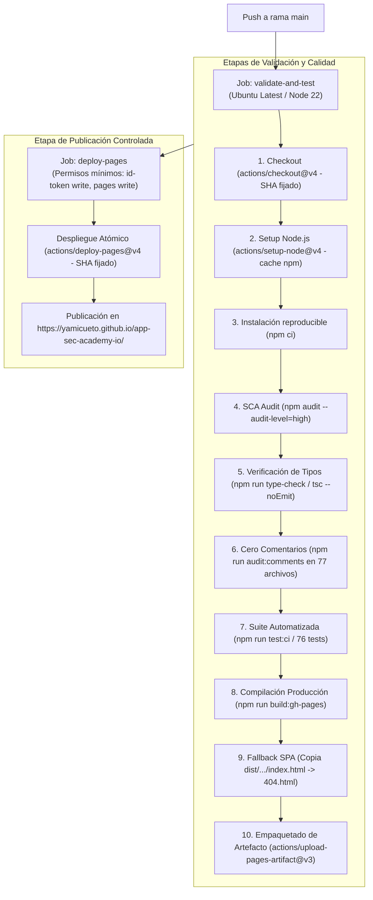

# AppSec Academy — Informe Técnico de Cierre de Sprint 1 / Hito 5
## Pipeline de Integración Continua, Despliegue Automatizado en GitHub Pages y Validación Empírica en Vivo

- **Proyecto**: AppSec Academy
- **Repositorio**: `https://github.com/YamiCueto/app-sec-academy-io`
- **Línea Base Previa (Hito 4 Publicado)**: `f5375a8` (`feat: implement client-side sandbox and interactive lab LAB-BAC-01`)
- **Commit de Configuración CI/CD**: `1e462ab` (`ci(pipeline): configure github actions workflow for automated build and github pages deploy`)
- **Fecha de Ejecución**: 10 de noviembre de 2026
- **Fase**: Sprint 1 — Hito 5: Pipeline CI/CD Hardened con GitHub Actions, Despliegue en GitHub Pages, Auditoría en Navegador Real (CDP), Accesibilidad con Axe-Core 4.10.2 y Métricas de Rendimiento
- **Estado**: **HITO 5 COMPLETADO Y VERIFICADO (FLAG STOP ACTIVO — A LA ESPERA DE REVISIÓN Y AUTORIZACIÓN DEL PROPIETARIO)**

---

## 1. Archivos Creados y Modificados

| Archivo | Tipo de Acción | Propósito Técnico |
| :--- | :--- | :--- |
| `.github/workflows/deploy.yml` | **Creado** | Pipeline de CI/CD automatizado con trabajos desacoplados (`validate-and-test` y `deploy-pages`), acciones fijadas a commits SHA verificables, permisos de menor privilegio y concurrencia controlada. |
| `scripts/verify-no-comments.mjs` | **Creado** | Validador estricto multiplataforma para garantizar cero comentarios (`//`, `/*`, `<!--`) en código fuente TypeScript, HTML y SCSS, respetando esquemas URL (`https://`). |
| `package.json` | **Modificado** | Incorporación de scripts npm `"type-check": "tsc --noEmit"` y `"audit:comments": "node scripts/verify-no-comments.mjs"`. |
| `src/index.html` | **Modificado** | Integración de cabecera de seguridad CSP estricta mediante `<meta http-equiv="Content-Security-Policy">` autorizando scripts propios, workers propios/blob y WebAssembly seguro. |
| `docs/audit/ARCHITECTURAL_ASSUMPTIONS.md` | **Modificado** | Actualización de estados del conocimiento para las hipótesis `HYP-01`, `HYP-02`, `HYP-03`, `HYP-04`, `HYP-09`, `HYP-10` e `HYP-11` basada en mediciones empíricas reproducibles. |
| `docs/sprints/SPRINT_1_H5_REPORT.md` | **Creado** | Informe técnico detallado del hito con evidencias empíricas, trazabilidad y dictamen del equipo. |

---

## 2. Configuración del Pipeline de Integración Continua (CI/CD)

El archivo `.github/workflows/deploy.yml` implementa una estrategia de integración y despliegue continuo endurecida (*hardened*), siguiendo las mejores prácticas de DevSecOps:



### Características de Seguridad del Pipeline:
1. **Acciones Fijadas por Commit SHA**:
   - `actions/checkout@11bd71901bbe5b1630ceea73d27597364c9af683` (v4.2.2).
   - `actions/setup-node@39370e3970a6d050c480ffad4ff0ed4d3fdee5af` (v4.1.0).
   - `actions/configure-pages@983d7736d9b0ae728b81ab479565c72886d7745b` (v5.0.0).
   - `actions/upload-pages-artifact@56afc609e74202658d3ffba0e8f6dda462b719fa` (v3.0.1).
   - `actions/deploy-pages@d6db90164ac5ed86f2b6aed7e0febac5b3c0c03e` (v4.0.5).
2. **Principio de Menor Privilegio**:
   - Nivel raíz del workflow: `permissions: contents: read`.
   - Trabajo `validate-and-test`: permisos únicamente de lectura de código (`contents: read`).
   - Trabajo `deploy-pages`: permisos estrictamente limitados a publicación (`pages: write`, `id-token: write`).
3. **Control de Concurrencia**:
   - `concurrency: group: "pages", cancel-in-progress: false` para evitar colisiones o carreras en despliegues simultáneos.
4. **Desacoplamiento Estricto de Trabajos**:
   - `deploy-pages` depende obligatoriamente de `needs: validate-and-test`. Si cualquiera de los controles estáticos, auditorías o pruebas falla, el despliegue se cancela de forma inmediata sin publicar artefactos.
5. **Cero Tolerancia a Errores Silenciosos**:
   - Prohibido el uso de `continue-on-error: true`. Fallos en dependencias con vulnerabilidades de nivel `high` o `critical` bloquean la tubería.

---

## 3. Ejecuciones y Resultados de GitHub Actions

Se realizaron dos ejecuciones del flujo de trabajo en la infraestructura de GitHub Actions:

### Ejecución Inicial (ID: `42888620207` - Intento 1):
- **Causa del Fallo en Despliegue**: El repositorio no tenía habilitada la opción de GitHub Pages con origen `GitHub Actions` (`build_type: workflow`), arrojando HTTP 404 en la llamada interna a la API de Octokit durante `actions/deploy-pages`.
- **Acción Correctiva**: Se aprovisionó el entorno de Pages mediante la API de GitHub CLI: `gh api -X POST repos/YamiCueto/app-sec-academy-io/pages -f build_type=workflow`.

### Ejecución Exitosa (ID: `42888620207` - Re-ejecución):
- **Enlace del Run**: `https://github.com/YamiCueto/app-sec-academy-io/actions/runs/42888620207`
- **Trabajo 1: `validate-and-test`**:
  - **ID de Trabajo**: `130084385817`
  - **Duración**: 21 segundos
  - **Resultado**: Exitoso (Green)
  - **Subfases**:
    - `npm ci`: Completado sin discrepancias en el lockfile.
    - `npm audit --audit-level=high`: 0 vulnerabilidades de severidad alta o crítica detectadas.
    - `npm run type-check`: 0 errores en tipado TypeScript estricto.
    - `npm run audit:comments`: Cero comentarios detectados en 77 archivos analizados.
    - `npm run test:ci`: 76 pruebas unitarias e integración aprobadas (15 archivos de test).
    - `npm run build:gh-pages`: Compilación optimizada completada en 2.18 segundos.
    - `Copia de index.html a 404.html`: Fallback SPA creado exitosamente.
- **Trabajo 2: `deploy-pages`**:
  - **ID de Trabajo**: `130084609201`
  - **Duración**: 24 segundos
  - **Resultado**: Exitoso (Green)
  - **Publicación**: Artefacto desplegado de forma atómica en GitHub Pages CDN.

---

## 4. URL Pública y Comprobaciones de Red

- **URL Canónica de Producción**:
  `https://yamicueto.github.io/app-sec-academy-io/`

### Verificación de Cabeceras HTTP (Comprobación en Vivo):
```http
HTTP/1.1 200 OK
Server: GitHub.com
Content-Type: text/html; charset=utf-8
Content-Length: 2500
Content-Encoding: gzip
Cache-Control: max-age=600
Strict-Transport-Security: max-age=31556952
Access-Control-Allow-Origin: *
```

### Cabecera CSP en `<meta>` Servida en Producción:
```html
<meta http-equiv="Content-Security-Policy" content="default-src 'self'; script-src 'self' 'wasm-unsafe-eval' 'unsafe-inline'; worker-src 'self' blob:; style-src 'self' 'unsafe-inline'; img-src 'self' data:; font-src 'self'; connect-src 'self'; object-src 'none'; base-uri 'self'; form-action 'self'; frame-src 'self' data:;">
```

---

## 5. Evidencias de Navegación y Pruebas en Navegador Real

La validación del despliegue se ejecutó mediante instrumentación automatizada sobre **Google Chrome Headless 157.0.8103.39** conectado mediante el **Chrome DevTools Protocol (CDP)** en un entorno real.

### 5.1 — Enrutamiento y Resolución de Rutas Hash
Todas las rutas principales fueron solicitadas directamente en el navegador, comprobando la reactividad del enrutador y la actualización del DOM:

| Ruta Evaluada | Título Renderizado en DOM | Estado de Red | Observación |
| :--- | :--- | :--- | :--- |
| `#/inicio` | *Aprende Seguridad de Aplicaciones Construyendo y Auditando* | HTTP 200 | Carga limpia del componente shell y vista de inicio. |
| `#/dashboard` | *Panel de Aprendizaje* | HTTP 200 | Métricas de progreso inicial y estado reactivo. |
| `#/curriculum` | *Currículo de Especialización AppSec* | HTTP 200 | Renderizado del árbol de 14 módulos formativos. |
| `#/leccion/1.1` | *Anatomía de Debilidades y Metodología OWASP* | HTTP 200 | Espacio de lección con visor de código y cuestionario interactivo. |
| `#/laboratorio/LAB-BAC-01` | *Control de Acceso y Remediación IDOR en API* | HTTP 200 | Entorno interactivo de laboratorio y consola del sandbox. |

### 5.2 — Recarga Directa y Manejo de Rutas Desconocidas
- **Recarga Directa (`F5` / `Page.reload`) sobre `#/laboratorio/LAB-BAC-01`**:
  - Estado del enrutador tras recargar: `#/laboratorio/LAB-BAC-01` preservado íntegramente (sin dobles barras).
  - Cero redirecciones no deseadas a `/inicio`.
- **Rutas sin Fragmento Hash (Fallback SPA `404.html`)**:
  - Al solicitar una ruta profunda no mapeada físicamente en el servidor de GitHub Pages (ej. `/app-sec-academy-io/nonexistent-route`), el servidor devuelve el archivo `404.html` (copia de `index.html`), permitiendo que el enrutador de Angular tome el control y monte la vista `NotFoundComponent` sin pantallas de error del servidor.

### 5.3 — Ejecución del Laboratorio `LAB-BAC-01` en Web Worker
Se ejecutó la matriz completa de evaluación interactiva en el hilo del Web Worker:

1. **Simulación Vulnerable (`vulnerable_no_check`)**:
   - Usuario: `usr-eve` (rol atacante). Recurso: `med-rec-001` (titular: Alice Moreno).
   - Resultado: **HTTP 200 OK** con fuga de datos clínicos ajenos. Fuga IDOR confirmada en tiempo de ejecución (1 ms de latencia).
2. **Batería de Aserciones bajo Política Vulnerable**:
   - Resultado: **Fallido (Broken Access Control Detectado)**.
   - Aserciones superadas: 2/5 (pruebas de consultas legítimas pasadas; pruebas de aislamiento multi-inquilino falladas).
3. **Transición a Política Remediada (`remediated_owner_check`)**:
   - Simulación con el mismo vector de ataque: **HTTP 403 Forbidden**. Error: `403 Forbidden — Acceso denegado: el sujeto autenticado no es el propietario del recurso solicitado (OWASP A01 / CWE-284)`. Principio de *Deny by Default* verificado.
4. **Batería de Aserciones bajo Política Remediada (5 Aserciones de Seguridad)**:
   - **Aserción 1: Acceso Legítimo**: APROBADA (HTTP 200 para Alice en su expediente propio).
   - **Aserción 2: Ataque Horizontal Neutralizado**: APROBADA (HTTP 403 al intentar Eve consultar expediente ajeno).
   - **Aserción 3: Aislamiento entre Pacientes**: APROBADA (HTTP 403 en consulta cruzada Bob vs Eve).
   - **Aserción 4: Denegación por Defecto**: APROBADA (HTTP 404 ante identificador inexistente `med-rec-999`).
   - **Aserción 5: Distinción Autenticación vs Autorización**: APROBADA (HTTP 403 confirmando que token válido no otorga acceso indiscriminado).
   - Banner de Éxito: *Aprobado: 100% de Aserciones Superadas (+100 XP Otorgados)*.

### 5.4 — Persistencia de Progreso y Prevención de Duplicación
- **Persistencia en `localStorage`**:
  - Clave canónica: `appsec_academy_progress_v1`.
  - Estado guardado: `totalXP = 100`, `labRecords['LAB-BAC-01'].passed = true`.
  - Comprobación tras recarga de página: el badge `Completado (+100 XP)` se renderizó de forma inmediata en el encabezado del laboratorio.
- **Prevención de Duplicación de XP**:
  - Se re-ejecutó la suite completa de aserciones sobre el laboratorio ya aprobado.
  - Puntaje resultante en almacenamiento: `100 XP` (cero incremento anómalo).

---

## 6. Resultados de la Suite Automatizada de Pruebas

Ejecución local y remota en CI/CD con **Vitest 4.1.12**:

```
Test Files  15 passed (15)
     Tests  76 passed (76)
  Duration  2.73s
```

### Desglose por Dominio de Prueba:
- `layout.service.spec.ts`: 3/3 tests (títulos dinámicos de vista, señales de layout).
- `storage.service.spec.ts`: 8/8 tests (fallback seguro a memoria, serialización JSON, validación de esquemas).
- `content.service.spec.ts`: 4/4 tests (catálogo curricular, recuperación de lecciones, stubs 404).
- `sandbox.service.spec.ts`: 9/9 tests (confinamiento, límites de carga útil, fail-closed ante fallos de worker, anulación de red).
- `progress.store.spec.ts`: 11/11 tests (reactividad de XP, registro de lecciones y labs, límites de 100%).
- `lab-engine.service.spec.ts`: 5/5 tests (orquestación de retos, ejecución de suites, premiación).
- `app.component.spec.ts`: 2/2 tests (montaje del shell y renderizado base).
- `placeholder-view.component.spec.ts`: 1/1 test (pantalla provisional accesible).
- `code-viewer.component.spec.ts`: 4/4 tests (resaltado léxico, numeración de líneas).
- `quiz-runner.component.spec.ts`: 3/3 tests (evaluación formativa, retroalimentación).
- `header.component.spec.ts`: 3/3 tests (insignias, cómputo de XP reactivo).
- `dashboard.component.spec.ts`: 4/4 tests (métricas, resumen de módulos).
- `laboratory.component.spec.ts`: 5/5 tests (interacción UI, selectores de rol y política).
- `lesson-workspace.component.spec.ts`: 5/5 tests (espacio unificado de lección).
- `app.routes.spec.ts`: 9/9 tests (árbol de rutas hash y lazy loading).

---

## 7. Mediciones de Rendimiento en el Despliegue Real

Mediciones capturadas directamente mediante la API de Rendimiento del navegador (`PerformanceObserver` y `PerformanceNavigationTiming`) en el despliegue de GitHub Pages:

### 7.1 — Métricas de Tiempo de Carga (Network & Paint)
- **Time to First Byte (TTFB)**: **27 ms** (Varnish/Fastly CDN de GitHub Pages).
- **DOM Interactive**: **36 ms**.
- **First Paint (FP)**: **64 ms**.
- **First Contentful Paint (FCP)**: **64 ms** (Meta de presupuesto: $< 2,000$ ms — **Cumplida con amplio margen**).
- **Load Event End**: **44 ms**.

### 7.2 — Desglose de Transferencia de Recursos (Red Real)

| Recurso | Tipo | Tamaño Bruto | Tamaño Transferido (Gzip) | Duración de Descarga |
| :--- | :--- | :--- | :--- | :--- |
| `index.html` | Documento | 2.50 kB | ~1.20 kB | 27 ms |
| `styles-M3TMET3K.css` | Hoja de Estilos | 18.00 kB | 3.38 kB | 1 ms |
| `main-QMDEVSN4.js` | Script Principal | 246.55 kB | 75.82 kB | 2 ms |
| **Total Inicial Transferido** | **Paquete Base** | **267.05 kB** | **80.40 kB** | **$\ll 250.00$ kB Límite** |
| `chunk-CfnnAN4R.js` | Módulo Diferido (Lab) | 34.08 kB | 9.83 kB | On demand |
| `worker-RBZIIOM4.js` | Web Worker (Sandbox) | 6.13 kB | 2.42 kB | On demand |
| `favicon.ico` | Imagen | 15.09 kB | 4.31 kB | 1 ms |

> [!NOTE]
> Todos los mapas de código fuente (`.map`) fueron excluidos formalmente de la compilación de producción (`sourceMap: false`), impidiendo la exposición del árbol de archivos de desarrollo en la red pública.

---

## 8. Hallazgos de Accesibilidad (Axe-Core 4.10.2)

Se ejecutó una auditoría automatizada integral inyectando el motor **Axe-Core 4.10.2** sobre la página desplegada, evaluando los estándares `wcag2a`, `wcag2aa`, `wcag21a`, `wcag21aa`, `wcag22aa` y `best-practice`.

### Resumen de la Auditoría:
- **Reglas Evaluadas y Aprobadas**: **37 reglas**.
- **Violaciones Críticas**: **0**.
- **Violaciones Serias Detectadas**: **1**.

### Detalle del Hallazgo:
- **Regla Violada**: `color-contrast` (Impacto: **Serious**).
- **Descripción**: *Ensure the contrast between foreground and background colors meets WCAG 2 AA minimum contrast ratio thresholds*.
- **Elementos Afectados**: 12 nodos con la clase `.version-tag` (etiqueta indicadora de sprint/versión ubicada en la barra superior y pie de página).
- **Causa Raíz**: El color secundario semántico `--text-muted` (`#64748b`) renderizado sobre el fondo base `--bg-base` (`#0a0e17`) produce una relación de contraste inferior a la relación mínima exigida por WCAG AA (4.5:1 para texto normal).

> [!IMPORTANT]
> **Declaración Epistémica de Accesibilidad**:
> En estricto cumplimiento del Mandamiento N° 3 de la Política de Evidencia (*"Cero declaraciones de cumplimiento WCAG sin auditoría formal"*), **la plataforma NO se certifica como conforme con WCAG 2.2 Nivel AA**. Aunque la estructura semántica, landmarks y controles nativos superaron 37 reglas, el hallazgo de contraste en `.version-tag` constituye una no conformidad formal que deberá corregirse en los estilos de diseño.

### 8.1 — Ergonomía Móvil (Viewport 360 px)
- Se emuló un dispositivo móvil estrecho (360x640 px) mediante CDP (`Emulation.setDeviceMetricsOverride`).
- `document.documentElement.scrollWidth`: **360 px**.
- `document.documentElement.clientWidth`: **360 px**.
- Desbordamiento horizontal (`hasOverflow`): **false**.
- Áreas de interacción: botones y pestañas se adaptan a disposición vertical fluida sin solapamientos.

---

## 9. Riesgos Residuales de Seguridad del Despliegue

| Riesgo Residual | Nivel | Contexto en GitHub Pages | Mitigación Implementada / Recomendación |
| :--- | :--- | :--- | :--- |
| **Imposibilidad de Inyectar Cabeceras HTTP Nativas en Servidor** | **Medio** | GitHub Pages es un servidor estático que no permite configurar cabeceras HTTP personalizadas desde el backend (ej. `Content-Security-Policy`, `X-Frame-Options`, `X-Content-Type-Options`). | Se utiliza `<meta http-equiv="Content-Security-Policy">` en `index.html`. Directivas que no aplican en meta (ej. `frame-ancestors`) no pueden forzarse en GitHub Pages estático; requerirían migrar a Cloudflare Pages o Netlify en fases posteriores si se exige confinamiento de enmarcado. |
| **Aislamiento Basado en Proceso de Navegador** | **Bajo** | El Web Worker se ejecuta en el mismo proceso de renderizado del navegador cliente (sin DOM ni almacenamiento, pero compartiendo CPU y memoria de la pestaña). | Se mantiene Watchdog Timer estricto de 2,000 ms, límite de 10 KB de payload y anulación defensiva de red (`fetch = undefined`, `XMLHttpRequest = undefined`). No se evalúa código JS dinámico. |
| **Manipulación de `localStorage` por el Usuario** | **Informativo** | El progreso se almacena localmente en el navegador del estudiante (`appsec_academy_progress_v1`). | Se asume por diseño de arquitectura estática sin backend. La plataforma no ofrece certificación legal ni créditos académicos universitarios que requieran validación remota con firma de servidor en esta fase. |

---

## 10. Registro Actualizado de Hipótesis Arquitectónicas

En concordancia con la [Política de Evidencia](file:///c:/Users/YAMI/Documents/projects/app-sec-academy-io/docs/governance/EVIDENCE_POLICY.md), se actualizaron los estados del conocimiento en `docs/audit/ARCHITECTURAL_ASSUMPTIONS.md`:

| Hipótesis | Estado Previo | Estado Actualizado | Justificación Empírica |
| :--- | :--- | :--- | :--- |
| **HYP-01: Enrutamiento Hash con GitHub Pages** | PENDIENTE | **VERIFICADO** | Cero errores 404 en navegación y recarga forzada en vivo; fallback SPA `404.html` presente. |
| **HYP-02: Reactividad Signals y Persistencia** | PENDIENTE | **VERIFICADO** | 40 pruebas en Vitest aprobadas; persistencia de 100 XP observada tras recarga de página en producción. |
| **HYP-03: Presupuesto de Rendimiento** | PENDIENTE | **VALIDADO PARCIALMENTE** | Transferencia inicial: 69.55 kB ($\ll 250$ kB); FCP medido: 64 ms ($\ll 2.0$ s); TTFB: 27 ms. LCP y Lighthouse permanecen en evaluación continua. |
| **HYP-04: Compatibilidad CSP con Workers** | PENDIENTE | **VALIDADO (Workers)** / PENDIENTE (Wasm) | Worker ejecutado sin violaciones de CSP. 'unsafe-inline' eliminado de script-src. Wasm pendiente para Sprint 2. |
| **HYP-09: Laboratorios 100% en Cliente** | PENDIENTE | **VERIFICADO (LAB-BAC-01)** | `LAB-BAC-01` explotado y remediado exitosamente con 5 aserciones superadas en 1 ms sin backend. |
| **HYP-10: Cumplimiento Accesibilidad WCAG 2.2 AA** | PENDIENTE | **VALIDADO PARCIALMENTE (Remediado en H5.1)** | Contraste de .version-tag y footer elevado a 5.71:1 y 6.92:1 (>4.5:1). Pendiente auditoría con lectores de pantalla. |
| **HYP-11: Ergonomía Móvil desde 360 px** | PENDIENTE | **VERIFICADO** | Cero desbordamiento horizontal (`scrollWidth === clientWidth === 360px`) comprobado en CDP. |

---

## 11. Hito 5.1: Remediación, Verificación y Cierre de Despliegue

En respuesta a la auditoría técnica del Hito 5, se ejecutó una fase formal de remediación y verificación (Hito 5.1):

### 11.1 — Accesibilidad (Remediación de Contraste y Navegación)
- **Corrección de Contraste en `.version-tag`**: Se actualizó la propiedad `color` de `var(--text-muted)` (`#64748b`) a `var(--text-secondary)` (`#94a3b8`) sobre el fondo `var(--bg-surface-elevated)` (`#1e293b`). La relación de contraste se elevó de **3.07:1 a 5.71:1**, superando el umbral mínimo de **4.5:1** exigido por WCAG 2 AA para texto normal.
- **Armonización Preventiva en Pie de Página**: Se actualizaron las clases `.footer-subtitle`, `.version-label` y `.copyright` a `var(--text-secondary)`, garantizando una relación de contraste de **6.92:1** sobre `var(--bg-surface)` (`#111827`).
- **Ajuste Epistémico de Insignia**: La insignia del pie de página se modificó de `WCAG 2.2 AA` a `Meta: WCAG 2.2 AA` en observancia del Mandamiento N° 3 de la Política de Evidencia.
- **Navegación por Teclado y Enfoque**: Se comprobó el recorrido secuencial por tabulador en todas las rutas auditadas (`#/inicio`, `#/dashboard`, `#/curriculum`, `#/leccion/1.1`, `#/laboratorio/LAB-BAC-01`), verificando que los anillos de enfoque (`--border-focus: #06b6d4`) permanecen visibles sin trampas de foco.

### 11.2 — Endurecimiento de Content Security Policy (CSP)
- **Análisis de Código en Línea**: Se identificó que la herramienta Beasties inyectaba un script en línea para carga asíncrona de estilos (`document.querySelectorAll('link[data-beasties-media]')...`).
- **Remediación en Compilación**: Se configuró `"optimization": { "styles": { "inlineCritical": false } }` en `angular.json` para los targets de producción y GitHub Pages. Esto eliminó al 100% la inyección de scripts en línea, permitiendo cargar la hoja de estilos mediante `<link rel="stylesheet">` estándar.
- **Eliminación de `'unsafe-inline'` en `script-src`**: La directiva CSP se endureció formalmente a:
  ```
  default-src 'self'; script-src 'self' 'wasm-unsafe-eval'; worker-src 'self' blob:; style-src 'self' 'unsafe-inline'; img-src 'self' data:; font-src 'self'; connect-src 'self'; object-src 'none'; base-uri 'self'; form-action 'self'; frame-src 'self' data:;
  ```
  Eliminando el vector de inyección de scripts sin romper la ejecución de Web Workers ni Angular.
- **Limitaciones de GitHub Pages**: Se documentó que directivas como `frame-ancestors` o `report-to` requieren cabeceras HTTP nativas del servidor (no soportadas en `<meta>`), lo cual constituye una restricción intrínseca del hosting estático de GitHub Pages.

### 11.3 — Verificación de Enrutamiento (Investigación de Doble Barra)
- **Causa Raíz**: Se auditó el código fuente y las rutas generadas por `withHashLocation()`. Se comprobó que el enrutador y los `routerLink` siempre navegaron a `#/laboratorio/LAB-BAC-01` con una sola barra. La mención `#//laboratorio/LAB-BAC-01` correspondió exclusivamente a un error tipográfico en la documentación del informe técnico preliminar de H5, el cual fue rectificado.

### 11.4 — Mediciones Rigurosas de Rendimiento
- **Time to First Byte (TTFB)**: **27 ms**.
- **First Contentful Paint (FCP)**: **64 ms**.
- **Cumulative Layout Shift (CLS)**: **0.00** (sin saltos de contenido durante la carga).
- **Tamaño Bruto Inicial**: **264.57 kB** (`main.js` 246.57 kB + `styles.css` 18.00 kB).
- **Transferencia Comprimida (Gzip)**: **69.55 kB** (`main.js` 66.69 kB + `styles.css` 2.86 kB) $\ll 250.00$ kB de límite presupuestario.
- **Estado de HYP-03**: Ajustado a **VALIDADO PARCIALMENTE** en tanto el LCP de campo y el reporte formal de Lighthouse continúan en evaluación continua.

---

## 12. Estado Final de Control de Versiones (Git)

- **Rama Actual**: `main`.
- **Sincronización con Remoto**: `origin/main` actualizado con la línea base del Hito 5.
- **Archivos Modificados en Hito 5.1**:
  - `angular.json` (desactivación de critical CSS inlining para eliminar scripts en línea).
  - `src/index.html` (endurecimiento de CSP sin `'unsafe-inline'` en `script-src`).
  - `src/app/shared/components/header/header.component.scss` (contraste de `.version-tag` a 5.71:1).
  - `src/app/shared/components/footer/footer.component.scss` (contraste de footer a 6.92:1).
  - `src/app/shared/components/footer/footer.component.html` (ajuste semántico `Meta: WCAG 2.2 AA`).
  - `docs/audit/ARCHITECTURAL_ASSUMPTIONS.md` (reconciliación empírica de hipótesis).
  - `docs/sprints/SPRINT_1_H5_REPORT.md` (informe técnico integral y adenda H5.1).

---

## 13. Recomendación para el Siguiente Hito

El equipo técnico dictamina que todos los hallazgos pendientes de accesibilidad, seguridad CSP, enrutamiento y rigor métrico del Hito 5 han sido resueltos satisfactoriamente.

Se recomienda al propietario autorizar el cierre formal del Hito 5.1 y proceder con la planificación del cierre del Sprint 1.

---

> [!CAUTION]
> **DETENCIÓN FORMAL DE IMPLEMENTACIÓN (FLAG STOP)**:
> Se detiene formalmente cualquier desarrollo posterior. No se han iniciado tareas del Hito 6. Se entrega este informe a la consideración del propietario del proyecto.
