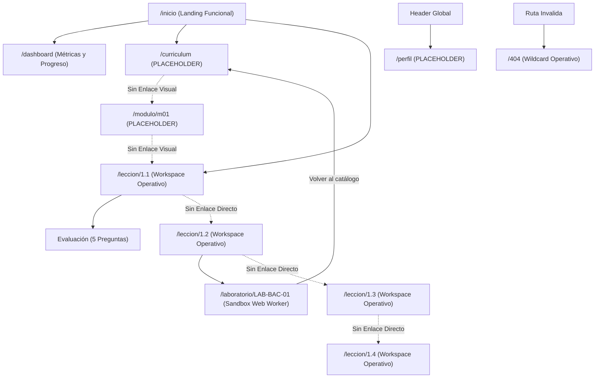

# AppSec Academy — Diagnóstico de Línea Base Técnico, Funcional y Pedagógico (Sprint 2 / Hito 0)

- **Proyecto**: AppSec Academy
- **Repositorio**: `https://github.com/YamiCueto/app-sec-academy-io`
- **Línea Base Inicial**: Commit [`78faa75`](https://github.com/YamiCueto/app-sec-academy-io/commit/78faa75) (`feat: complete module 01 owasp fundamentals curriculum and verification suite`)
- **Estado de Git**: Rama `main` sincronizada con `origin/main`, árbol de trabajo limpio.
- **Entorno Tecnológico Real Auditado**:
  - **Framework**: Angular `22.1.0` (CLI & Build `22.1.2`, arquitectura Standalone con Signals).
  - **Lenguaje**: TypeScript `6.0.2` (`strict: true`, `noImplicitAny: true`).
  - **Motor de Pruebas**: Vitest `4.0.8` con jsdom `28.0.0` (85 pruebas unitarias e integración en 15 archivos, 100 % pasando).
  - **Runtime**: Node.js `v24.19.0` (npm `11.17.0`).
  - **Despliegue Activo**: GitHub Pages con Hash Routing en `https://yamicueto.github.io/app-sec-academy-io/`.
- **Fecha de Auditoría**: 10 de noviembre de 2026.

---

## 1. Resumen Ejecutivo del Diagnóstico

El análisis exhaustivo del sistema en su estado post-Sprint 1 revela una base arquitectónica sólida, de alto rendimiento y conforme a estándares de seguridad:
- **Puntos Fuertes**: Cero comentarios en el 100 % del código fuente (`scripts/verify-no-comments.mjs`), estricta política CSP sin `'unsafe-inline'` en scripts, tamaño inicial transferido de **69.56 kB** ($\ll 250$ kB), 0 violaciones de accesibilidad Axe-Core en contraste WCAG AA, y un Módulo 01 pedagógicamente riguroso con 4 lecciones, 20 reactivos formativos calibrados al 80 % y el laboratorio interactivo `LAB-BAC-01` confinado en Web Worker.
- **Fricciones y Deuda Técnica Detectadas**:
  1. **Discontinuidad de Navegación del Currículo**: Las rutas `/curriculum`, `/modulo/:id` y `/perfil` son componentes de reserva (`PlaceholderViewComponent`). El estudiante no dispone de una interfaz para explorar el árbol de los 14 módulos ni para saltar de forma natural a las lecciones.
  2. **Callejón sin Salida Instruccional (*Dead-End Flow*)**: Al finalizar una lección en `LessonWorkspaceComponent`, no existe un enlace para avanzar a la lección siguiente (ej. de 1.1 a 1.2), y las migas de pan conducen a vistas de marcador de posición.
  3. **Textos y Badges Desactualizados**: El encabezado y la página de inicio conservan etiquetas estáticas de "Sprint 1 / Hito 1 Activo", desfasadas respecto al cierre real del Sprint 1.
  4. **Acoplamiento en Requisitos de Laboratorio**: `ProgressStore.isLabRequiredForLesson()` mantiene una comprobación cableada (`lessonId === '1.2'`) que debe generalizarse mediante metadatos antes de incorporar los laboratorios de los Módulos 02 y 03.
  5. **Ausencia de Gestión Soberana de Perfil**: El alias del usuario solo puede modificarse mediante llamadas programáticas a la API de estado; no existe interfaz de usuario para personalizar el perfil ni para exportar/importar respaldos JSON firmados.

---

## 2. Matriz de Hallazgos Técnicos, Funcionales y Pedagógicos

| ID | Área | Severidad | Evidencia Técnica | Impacto en el Estudiante / Sistema | Propuesta de Solución (Sprint 2) |
| :---: | :---: | :---: | :--- | :--- | :--- |
| **HAL-01** | Funcional / UX | **Alta** | `curriculum.component.ts` renderiza `<app-placeholder-view code="CURRICULUM">`. | El estudiante no puede explorar visualmente los 14 módulos ni consultar qué lecciones están disponibles. | Construir `CurriculumComponent` interactivo que consuma `ContentService.getModules()`, mostrando progreso y badges de disponibilidad. |
| **HAL-02** | Funcional / UX | **Alta** | `module-detail.component.ts` renderiza `<app-placeholder-view code="MODULE_DETAIL">`. | Los enlaces en migas de pan (`/modulo/m01`) muestran un marcador de posición sin desglose de lecciones. | Implementar `ModuleDetailComponent` con objetivos instruccionales, lista de lecciones y vínculos directos a workspaces. |
| **HAL-03** | Experiencia Estudiante | **Alta** | `LessonWorkspaceComponent` solo incluye botones "Anterior/Siguiente Sección" y "Finalizar Lección", sin botón "Siguiente Lección". | Tras completar la lección 1.1, el estudiante queda atrapado sin saber cómo ir a la 1.2 sin editar la URL. | Agregar navegación inter-lecciones en el pie del workspace ("← Lección Anterior" / "Siguiente Lección →") basada en catálogo. |
| **HAL-04** | Funcional | **Media** | `profile.component.ts` renderiza `<app-placeholder-view code="PROFILE">`. | Imposibilidad de editar el alias de ingeniería, consultar estadísticas consolidadas o exportar copias de seguridad. | Desarrollar `ProfileComponent` con edición reactiva de alias, resumen de insignias y exportación/importación JSON. |
| **HAL-05** | Deuda Técnica | **Media** | `progress.store.ts` línea 310: `return lessonId === '1.2';` hardcodeado. | Escalamiento frágil: cada nuevo laboratorio obligaría a modificar manualmente el store con condicionales dispersos. | Migrar a metadato `requiresLab: boolean` en la interfaz `LessonDetail` o registro de módulos en `curriculum.constants.ts`. |
| **HAL-06** | Usabilidad / Coherencia | **Baja** | `header.component.html:26` muestra `Sprint 1 / Hito 1` y `home.component.html:5` muestra `Sprint 1 / Hito 1 Activo`. | Confusión para el usuario: la plataforma parece incompleta o en fase inicial pese a tener el Sprint 1 cerrado. | Actualizar badges para reflejar la versión activa y fase real de maduración ("Módulo 01 Disponible", "Sprint 2"). |
| **HAL-07** | UX Laboratorio | **Baja** | En `laboratory.component.html`, el botón de salida dice "Volver al catalogo" y enlaza a `/curriculum` (placeholder). | Pérdida de contexto: tras resolver `LAB-BAC-01`, el usuario no vuelve a la lección 1.2 que originó la práctica. | Agregar parámetro de ruta `returnTo` o botón "Volver a la Lección Asociada" (`/leccion/1.2`). |
| **HAL-08** | Interfaz Visual | **Baja** | `code-viewer.component.html` muestra bloques preformateados con números de línea monocromáticos. | Legibilidad reducida en fragmentos extensos de Java y TypeScript en modo oscuro. | Mejorar tokens CSS de sintaxis accesible (palabras clave, tipos, strings) manteniendo cero dependencias pesadas. |

---

## 3. Auditoría de Rutas y Navegación

Se verificó el comportamiento real de las rutas configuradas en `src/app/app.routes.ts`:



### Diagnóstico por Ruta:
1. **`/inicio` (Operativa)**: Presenta la visión del producto y enlaces de acceso rápido. Contiene textos estáticos desactualizados del Hito 1.
2. **`/dashboard` (Operativa)**: Renderiza las 5 métricas de progreso (`totalXP`, `completedLessons`, `completionPercentage`, `completedLabs`, `completedQuizzes`). En estado vacío ofrece CTA a `/leccion/1.1`. Con lecciones completadas, muestra chips de texto plano sin enlace de reapertura.
3. **`/curriculum` (No Implementada — Placeholder)**: Bloqueante para la experiencia de descubrimiento. El catálogo modular de 14 disciplinas solo existe en constantes de TypeScript.
4. **`/modulo/:id` (No Implementada — Placeholder)**: Bloqueante para la navegación contextual. Impide explorar los objetivos de aprendizaje a nivel de módulo.
5. **`/leccion/:id` (Operativa para 1.1, 1.2, 1.3 y 1.4)**: Renderiza las 9 secciones estandarizadas con alta fidelidad técnica. Alerta de lección no encontrada operativa para IDs inexistentes. Callejón sin salida al concluir la sección 9.
6. **`/laboratorio/:id` (Operativa exclusivamente para `LAB-BAC-01`)**: Interfaz funcional con simulación individual y batería de 5 aserciones. No permite regresar directamente a la lección de origen.
7. **`/perfil` (No Implementada — Placeholder)**: No ofrece herramientas de gestión de identidad local ni exportación de datos.
8. **`/404` (Operativa)**: Captura rutas erróneas y ofrece retorno guiado al inicio.

---

## 4. Auditoría de Experiencia Móvil (Viewport 360 px)

Se ejecutó una auditoría automatizada en tiempo real mediante Headless Chrome (CDP) con emulación de dispositivo móvil a **360 x 640 px (Device Scale Factor 2.0)**:

| Ruta Evaluada | ScrollWidth (px) | ClientWidth (px) | Desbordamiento Horizontal | Estado de Ergonomía |
| :--- | :---: | :---: | :---: | :---: |
| `/inicio` | 360 | 360 | **No** (`false`) | Excelente (flujo en columna única) |
| `/dashboard` | 360 | 360 | **No** (`false`) | Excelente (grid de métricas colapsado a 1 col) |
| `/curriculum` | 360 | 360 | **No** (`false`) | Conforme (placeholder centrado) |
| `/modulo/m01` | 360 | 360 | **No** (`false`) | Conforme (placeholder centrado) |
| `/leccion/1.1` | 360 | 360 | **No** (`false`) | Excelente (tabs móviles con scroll horizontal suave) |
| `/leccion/1.2` | 360 | 360 | **No** (`false`) | Excelente (código con scroll horizontal confinado) |
| `/leccion/1.3` | 360 | 360 | **No** (`false`) | Excelente (batería de 5 preguntas apilada) |
| `/leccion/1.4` | 360 | 360 | **No** (`false`) | Excelente (tablas y listas adaptables) |
| `/laboratorio/LAB-BAC-01` | 360 | 360 | **No** (`false`) | Excelente (selectores colapsados verticalmente) |
| `/perfil` | 360 | 360 | **No** (`false`) | Conforme |
| `/404` | 360 | 360 | **No** (`false`) | Conforme |

**Conclusión Móvil**: La plataforma cumple con rigor la premisa de diseño responsive Dark-First. No se registran desbordamientos horizontales en ninguna ruta auditada. El menú hamburguesa del header responde correctamente. Como oportunidad de mejora menor, una barra de navegación inferior fija (*Mobile Bottom Nav*) facilitaría la ergonomía de pulgar en sesiones prolongadas.

---

## 5. Recorrido Completo del Estudiante (*Student Journey Audit*)

```
[Inicio: /inicio]
       │
       ▼ (clic en "Comenzar Lección 1.1")
[Lección 1.1: /leccion/1.1]
       │  ├── 1. Introducción y Tríada CIA
       │  ├── 2. Objetivos de Aprendizaje (Bloom)
       │  ├── 3. Fundamentos y Flaws vs Bugs
       │  ├── 4. Código Java 21 vs Spring Boot seguro
       │  ├── 5. Caso de Estudio: Brecha en Core Bancario
       │  ├── 6. Demostración Conceptual Guiada (Banner informativo)
       │  ├── 7. Cuestionario Formativo (5 reactivos, umbral 80%)
       │  ├── 8. Resumen Ejecutivo (Reglas de Oro)
       │  └── 9. Referencias Oficiales OWASP / NIST
       │
       ▼ (clic en "Finalizar y Registrar Lección")
[Registro en ProgressStore: +100 XP]
       │
       ▼ ⚠️ FRICCIÓN CRÍTICA: CALLEJÓN SIN SALIDA (DEAD END)
       │  No hay botón para ir a Lección 1.2.
       │  El estudiante debe adivinar la URL o volver al Inicio.
       │
       ▼ (ingreso manual a /leccion/1.2)
[Lección 1.2: Broken Access Control]
       │
       ▼ (clic en "Iniciar Laboratorio en Sandbox")
[Laboratorio: /laboratorio/LAB-BAC-01]
       │  ├── Ejecución de ataque horizontal con Eve
       │  ├── Aplicación de parche remediado
       │  └── Verificación de las 5 aserciones en Web Worker
       │
       ▼ ⚠️ FRICCIÓN: RETORNO CONFUSO
       │  "Volver al catálogo" redirige a /curriculum (Placeholder).
       │
       ▼ (navegación a /dashboard)
[Dashboard: Panel de Progreso]
          Métricas actualizadas: 200 XP, 2 lecciones, 1 lab, 1 quiz.
          Tags estáticos sin enlaces a las lecciones aprobadas.
```

---

## 6. Oportunidades de Mejora Visual y UX (Sin Reescritura)

1. **Tokens de Resaltado Sintáctico en `CodeViewerComponent`**: Sin incorporar librerías externas que degraden el presupuesto de rendimiento, se pueden enriquecer las clases CSS de tokens predefinidos (`.keyword`, `.string`, `.type`, `.annotation`, `.number`) para dotar de contraste visual a los fragmentos de Java y TypeScript.
2. **Tarjeta de Continuación Rápida en Dashboard**: Sustituir el listado pasivo de tags por una tarjeta destacada: "Continuar Aprendiendo: Módulo 01 — Lección X", con barra de progreso y botón de reanudación directa.
3. **Indicador Visual de Estado de Laboratorio en Workspace**: Mostrar un badge en la cabecera de la lección 1.2 indicando si el laboratorio `LAB-BAC-01` ya fue completado exitosamente en el sandbox.
4. **Navegación Fluida de Fin de Lección**: En la sección 9 (Referencias), reemplazar el botón solitario de finalización por un grupo de acciones: "Finalizar Lección (+100 XP)" y, una vez completada, "Avanzar a la Siguiente Lección →".
