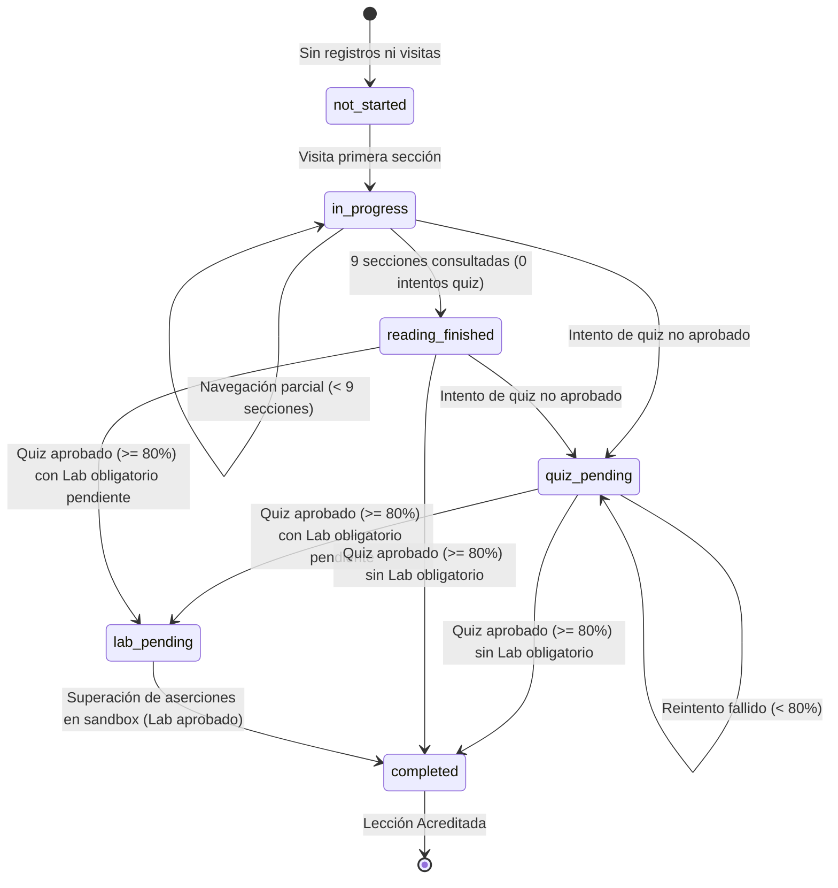

# AppSec Academy — Informe Técnico de Implementación
## Sprint 2 / Hito 2: Continuidad del Aprendizaje, Progreso Académico y Persistencia Resiliente

- **Proyecto**: AppSec Academy (`app-sec-academy-io`)
- **Repositorio**: `https://github.com/YamiCueto/app-sec-academy-io`
- **Línea Base Inicial**: Commit [`244a553d320570da002fbfbfcbf5aae7beeaba29`](https://github.com/YamiCueto/app-sec-academy-io/commit/244a553d320570da002fbfbfcbf5aae7beeaba29) (`main`)
- **Hito**: Sprint 2 / Hito 2 (H2)
- **Estado del Hito**: Completado, Verificado y Publicado en GitHub Pages
- **Fecha de Ejecución**: 11 de noviembre de 2026

---

## 1. Resumen Ejecutivo

El Hito 2 del Sprint 2 resuelve de manera integral el principio pedagógico fundamental: **«Visitar contenido no equivale a dominarlo»**. Se ha implementado una arquitectura de continuidad académica precisa y persistencia resiliente que distingue formalmente entre consultar una sección, finalizar la lectura, aprobar una evaluación formativa y superar un laboratorio práctico en sandbox.

### Logros Principales:
1. **Persistencia Exacta de Posición de Aprendizaje**: El espacio de trabajo (`LessonWorkspaceComponent`) recuerda la lección activa y la sección específica consultada (`lastSectionId`). Al volver o recargar, el estudiante reanuda en el punto exacto donde lo dejó.
2. **Reinicio Seguro de Lectura**: El estudiante puede reiniciar el recorrido de lectura desde la primera sección sin que esto altere sus resultados de evaluación, laboratorios acreditados ni puntos de experiencia acumulados.
3. **Evolución del Esquema a v2.0.0**: Migración automática, defensiva e idempotente que transforma sin pérdida ni corrupción los datos de Sprint 1 (v1.0.0 sin secciones) y Sprint 2 H1 (v1.0.0 con `lastActiveLessonId`).
4. **Desacoplamiento Declarativo de Laboratorios**: Se erradicó por completo la referencia fija a la lección `'1.2'` en `ProgressStore`, estableciendo un registro declarativo de políticas (`LESSON_LAB_POLICIES`) que soporta lecciones sin laboratorio, con laboratorio obligatorio, opcional o pendiente de implementar.
5. **Garantía Matemática de Idempotencia de XP**: Navegar entre lecciones, cambiar de sección, recargar el navegador, reintentar evaluaciones ya aprobadas o ejecutar migraciones otorga **0 XP**. La experiencia sólo se acredita una vez tras demostración verificable de dominio.
6. **Dashboard Pedagógico Enriquecido**: La tarjeta de continuación de `/dashboard` detalla la sección actual, el volumen de secciones consultadas y alerta específicamente si existe una evaluación o laboratorio pendiente.
7. **Retroalimentación Formativa**: El componente `QuizRunnerComponent` conserva la mejor calificación histórica e incorpora orientación pedagógica sobre qué temas repasar tras respuestas incorrectas.
8. **Validación Exhaustiva**: 131 pruebas unitarias e integración aprobadas (17 suites) cubriendo los 20 escenarios requeridos, con 0 violaciones Axe-Core y 0 desbordamiento horizontal en resoluciones móviles (360 px, 390 px) y de escritorio (1440 px).

---

## 2. Diferenciación de los Siete Niveles Académicos

En cumplimiento del modelo instruccional, el sistema establece una taxonomía formal de siete dimensiones:

| Dimensión | Definición Técnica | Persistencia / Estado | Recompensa de XP |
| :--- | :--- | :--- | :---: |
| **1. Lección Visitada** | El estudiante abrió la lección en el espacio de trabajo. | Registrada en `lastActiveLessonId` y en `lessonRecords[id]`. | **0 XP** |
| **2. Sección Consultada** | El estudiante visualizó una de las 9 secciones. | Registrada en `lastSectionId` y `lastActiveSectionId`. | **0 XP** |
| **3. Sección Completada** | El estudiante interactuó con la sección o la recorrió secuencialmente. | Añadida a `visitedSections[]`. Si se consultan las 9 secciones, `readingCompleted = true`. | **0 XP** |
| **4. Cuestionario Aprobado** | El estudiante superó el Knowledge Check formativo con $\ge 80\%$ de aciertos. | Registrado en `quizPassed = true`, conservando `quizScore = max(histórica, actual)`. | **+100 XP** (única vez) |
| **5. Laboratorio Aprobado** | El estudiante superó las 5 aserciones de seguridad en el sandbox Web Worker. | Registrado en `labPassed = true` y `labRecords[labId].passed = true`. | **Hasta +200 XP** (única vez) |
| **6. Lección Completada** | Cumplimiento dual: Cuestionario aprobado ($\ge 80\%$) Y (Laboratorio aprobado O laboratorio no requerido por metadatos). | Incluida en `completedLessons[]` y `completedAt` fijado. | Sin XP duplicado |
| **7. Módulo Completado** | El 100 % de las lecciones oficiales del módulo han sido acreditadas. | Calculado reactivamente en `getModuleProgress(id).isCompleted`. | Habilita Insignia |

---

## 3. Modelo de Estados Académicos de la Lección (`AcademicProgressStatus`)

Se formalizó un contrato con seis estados mutuamente excluyentes, derivados reactivamente mediante `ProgressStore.getLessonAcademicStatus(lessonId)`:



- `not_started`: Sin actividad registrada.
- `in_progress`: Lectura iniciada pero incompleta; evaluación pendiente.
- `reading_finished`: Lectura de las 9 secciones terminada; el estudiante aún no ha tomado la evaluación.
- `quiz_pending`: Lectura finalizada o intento previo realizado; cuestionario pendiente de aprobar ($\ge 80\%$).
- `lab_pending`: Cuestionario aprobado, pero el laboratorio interactivo obligatorio (`LAB-BAC-01`) permanece sin aprobar.
- `completed`: Requisitos pedagógicos satisfechos en su totalidad; lección acreditada.

---

## 4. Evolución del Contrato Persistido y Migraciones

### 4.1. Contrato Anterior (v1.0.0 — Sprint 1 y Sprint 2 H1)
```typescript
export interface UserProgressStateV1 {
  readonly schemaVersion: '1.0.0';
  readonly alias: string;
  readonly createdAt: string;
  readonly updatedAt: string;
  readonly totalXP: number;
  readonly lastActiveLessonId?: string; // Introducido en S2-H1
  readonly completedLessons: readonly string[];
  readonly lessonRecords: Readonly<Record<string, {
    readonly completedAt: string;
    readonly quizScore: number;
    readonly quizAttempts: number;
    readonly quizPassed: boolean;
    readonly labPassed: boolean;
    readonly labScore: number;
    readonly hintsUsed: number;
  }>>;
  readonly labRecords: Readonly<Record<string, LabRecord>>;
  readonly preferences: UserPreferences;
}
```

### 4.2. Contrato Nuevo (v2.0.0 — Sprint 2 H2)
```typescript
export interface UserProgressState {
  readonly schemaVersion: '2.0.0';
  readonly alias: string;
  readonly createdAt: string;
  readonly updatedAt: string;
  readonly totalXP: number;
  readonly lastActiveLessonId?: string;
  readonly lastActiveSectionId?: LessonSectionId;
  readonly completedLessons: readonly string[];
  readonly lessonRecords: Readonly<Record<string, LessonRecord>>;
  readonly labRecords: Readonly<Record<string, LabRecord>>;
  readonly preferences: UserPreferences;
}

export interface LessonRecord {
  readonly completedAt?: string;
  readonly lastAccessedAt?: string;
  readonly lastSectionId?: LessonSectionId;
  readonly visitedSections?: readonly LessonSectionId[];
  readonly readingCompleted?: boolean;
  readonly quizScore: number;
  readonly quizAttempts: number;
  readonly quizPassed: boolean;
  readonly labPassed: boolean;
  readonly labScore: number;
  readonly hintsUsed: number;
}
```

### 4.3. Motor de Migración Idempotente (`StorageService.migrateState`)
- **Política de Compatibilidad Histórica y Distinción entre Visitas Observadas e Inferidas**: Para lecciones completadas en el esquema v1.0.0 donde no se capturó telemetría granular de navegación, el sistema **no inventa ni sintetiza visitas artificiales**. En su lugar, inicializa `visitedSections: ['introduccion']` (única sección de entrada garantizada), establece `readingCompleted: true` e introduce la bandera explícita `isLegacyCompleted: true`. De este modo se reconoce y respeta plenamente la acreditación académica histórica sin falsear evidencias observadas de navegación.
- **Compatibilidad con Sprint 2 H1**: Si existía `lastActiveLessonId`, se retiene y se inicializa `lastActiveSectionId: 'introduccion'`.
- **Idempotencia Estricta**: Si se suministra un estado ya migrado a `2.0.0`, la función preserva todos los campos intactos (incluyendo `isLegacyCompleted`), retornando una copia idéntica sin mutaciones.
- **Normalización Defensiva**: Cualquier sección desconocida o índice fuera de catálogo es normalizado automáticamente a `'introduccion'` mediante `normalizeSectionId()`.

---

## 4.4. Presentación Pedagógica del Progreso en el Dashboard

Para evitar distorsionar la percepción de logro del cadete, el Dashboard no presenta una tasa desmotivante sobre 49 lecciones futuras no publicadas como métrica primaria. En su lugar:
1. **Métrica Principal — Contenido Disponible**: Exhibe el avance sobre el material actualmente interactivo y publicado del Módulo 01:
   - `Módulo 01 Disponible`: `X / 4` lecciones disponibles (`.stat-lessons-value`).
   - `Progreso Módulo 01`: `Y%` del módulo en curso (`.stat-percentage-value`).
2. **Métrica Complementaria — Alcance Total Proyectado**: Exhibe de forma separada y contextual el progreso global sobre la totalidad del currículo proyectado:
   - `Alcance Total Previsto`: `X / 49` lecciones previstas (`.stat-total-planned-value`).

---

## 5. Desacoplamiento Declarativo de Laboratorios

Se sustituyó la verificación cableada `lessonId === '1.2'` por el registro `LESSON_LAB_POLICIES` en `curriculum.constants.ts`:

```typescript
export type LabRequirementPolicy = 'none' | 'optional' | 'mandatory';

export interface LessonLabRequirement {
  readonly lessonId: string;
  readonly labId: string | null;
  readonly requirement: LabRequirementPolicy;
  readonly isExecutable: boolean;
  readonly title?: string;
}

export const LESSON_LAB_POLICIES: Readonly<Record<string, LessonLabRequirement>> = {
  '1.1': { lessonId: '1.1', labId: 'demo-owasp-taxonomy', requirement: 'none', isExecutable: false, title: 'Demostración Guiada de Taxonomía OWASP' },
  '1.2': { lessonId: '1.2', labId: 'LAB-BAC-01', requirement: 'mandatory', isExecutable: true, title: 'Control de Acceso y Remediación IDOR en API' },
  '1.3': { lessonId: '1.3', labId: 'demo-crypto-headers-audit', requirement: 'none', isExecutable: false, title: 'Simulación Guiada de Criptografía y Cabeceras' },
  '1.4': { lessonId: '1.4', labId: 'demo-asvs-checklist', requirement: 'none', isExecutable: false, title: 'Auditoría Conceptual ASVS v4.0.3' }
};

export function isLabMandatoryForLesson(lessonId: string): boolean {
  const policy = getLessonLabRequirement(lessonId);
  return policy.requirement === 'mandatory' && policy.isExecutable;
}
```

---

## 6. Resultados de la Batería de Pruebas Automatizadas

Se ejecutó la suite completa mediante `npm run test:ci`:
- **Suites de Prueba**: 17 archivos de prueba ejecutados y aprobados al 100 %.
- **Total de Pruebas**: **131 pruebas aprobadas** (0 fallidas, 0 omitidas).
- **Tiempo de Ejecución**: 2.61 segundos.

### Cobertura de los 20 Escenarios Específicos Requeridos:

| # | Escenario | Archivo de Prueba | Estado |
| :-: | :--- | :--- | :-: |
| **1** | Estudiante nuevo (estado inicial limpio, 0 XP, rank Apprentice) | `storage.service.spec.ts` & `progress.store.spec.ts` | **APROBADO** |
| **2** | Migración de progreso de Sprint 1 a v2.0.0 | `storage.service.spec.ts` | **APROBADO** |
| **3** | Migración desde estado de Sprint 2 / H1 a v2.0.0 | `storage.service.spec.ts` | **APROBADO** |
| **4** | Última sección persistida (`lastSectionId` y `visitedSections`) | `progress.store.spec.ts` | **APROBADO** |
| **5** | Recuperación tras recarga (reconstrucción desde driver) | `progress.store.spec.ts` | **APROBADO** |
| **6** | Índice o ID de sección inválido normalizado a `'introduccion'` | `storage.service.spec.ts` & `progress.store.spec.ts` | **APROBADO** |
| **7** | Lección inexistente manejada como `'not_started'` sin excepciones | `progress.store.spec.ts` | **APROBADO** |
| **8** | Almacenamiento deshabilitado (manejo de excepciones en lectura) | `storage.service.spec.ts` | **APROBADO** |
| **9** | Cuota de almacenamiento excedida (`QuotaExceededError`) | `storage.service.spec.ts` & `progress.store.spec.ts` | **APROBADO** |
| **10** | Datos JSON corruptos (retorno de estado inicial seguro) | `storage.service.spec.ts` | **APROBADO** |
| **11** | Migración ejecutada dos veces (estrictamente idempotente) | `storage.service.spec.ts` | **APROBADO** |
| **12** | XP idempotente (navegación o reinicio no otorga XP) | `progress.store.spec.ts` | **APROBADO** |
| **13** | Cuestionario aprobado ($\ge 80\%$, otorga 100 XP base una vez) | `progress.store.spec.ts` | **APROBADO** |
| **14** | Cuestionario reprobado ($< 80\%$, registra nota, 0 XP, no completada) | `progress.store.spec.ts` | **APROBADO** |
| **15** | Laboratorio obligatorio pendiente (Lección 1.2: quiz aprobado no completa sin lab) | `progress.store.spec.ts` | **APROBADO** |
| **16** | Laboratorio obligatorio aprobado (Lección 1.2: quiz + lab completa con 300 XP) | `progress.store.spec.ts` | **APROBADO** |
| **17** | Lección sin laboratorio (Lección 1.1: quiz aprobado completa de inmediato) | `progress.store.spec.ts` | **APROBADO** |
| **18** | Continuación desde Dashboard (refleja lab/evaluación pendiente y secciones) | `dashboard.component.spec.ts` | **APROBADO** |
| **19** | Navegación entre lecciones sin alterar completitud académica | `progress.store.spec.ts` | **APROBADO** |
| **20** | Conservación íntegra de resultados anteriores tras migración | `storage.service.spec.ts` | **APROBADO** |

---

## 7. Evidencia de Auditoría en Navegador Real (CDP + Axe-Core)

Se ejecutó una auditoría automatizada en navegador real con **Headless Chrome** vía **Chrome DevTools Protocol (CDP)** sobre la compilación de producción servida en puerto local:

### 7.1. Verificación de Desbordamiento Horizontal
Comprobación en 3 resoluciones críticas (`360x640`, `390x844` y `1440x900`):
- `#/leccion/1.1`: 0 desbordamiento (`scrollWidth === clientWidth`).
- `#/leccion/1.2`: 0 desbordamiento.
- `#/dashboard`: 0 desbordamiento.
- `#/curriculum`: 0 desbordamiento.
- `#/modulo/m01`: 0 desbordamiento.
- **Resultado Global**: **0 desbordamiento horizontal en el 100 % de las pruebas**.

### 7.2. Auditoría de Accesibilidad WCAG 2.1 AA con Axe-Core
- **Resultado Global**: **0 violaciones encontradas** en todas las rutas analizadas bajo resoluciones móviles y de escritorio.
- Focus visible comprobado en botones de reinicio, pestañas de sección y controles de cuestionario.

### 7.3. Flujo Interactivo de Continuidad Comprobado
1. Apertura de `#/leccion/1.1` en sección inicial *"1. Introducción y Contexto"*.
2. Navegación a sección intermedia *"4. Ejemplos Técnicos (Vulnerable vs Remediado)"*.
3. Recarga completa de la página (`Page.reload`): La sección se restaura con exactitud en *"4. Ejemplos Técnicos"*.
   `localStorage` refleja: `schemaVersion: '2.0.0'`, `lastActiveLessonId: '1.1'`, `lastActiveSectionId: 'ejemplos'`.
4. Transición a `#/leccion/1.2` y avance a sección *"3. Explicación Conceptual"*.
5. Retorno a `#/leccion/1.1`: Recuerda con exactitud la sección 4 (*"Ejemplos Técnicos"*).
6. Clic en *"↺ Reiniciar al inicio"*: La lección vuelve a *"1. Introducción y Contexto"* sin afectar resultados previos.
7. Resolución y envío de evaluación formativa de 1.1: Aprobada con 100 %, acreditando +100 XP.
8. Navegación al Dashboard: Tarjeta *"Continuar Aprendizaje"* orienta al siguiente paso (*"Continuar con Lección 1.2"*), reflejando 100 XP, 1 / 4 lecciones del Módulo 01 (25 %) y 1 / 49 sobre el alcance total previsto.
9. Recarga del Dashboard: XP se mantiene en 100 XP (confirmación de cero duplicación de XP).

---

## 8. Puertas de Calidad por Regresión y Presupuesto de Rendimiento

| Puerta de Calidad | Comando | Resultado | Estado |
| :--- | :--- | :--- | :---: |
| **Tipado Estricto TypeScript** | `npm run type-check` | `tsc --noEmit` completado con 0 errores. | **APROBADO** |
| **Auditoría de Cero Comentarios** | `npm run audit:comments` | Superada exitosamente en 85 archivos fuente. | **APROBADO** |
| **Pruebas Automatizadas** | `npm run test:ci` | **131 pruebas aprobadas** en 17 archivos de prueba. | **APROBADO** |
| **Seguridad de Dependencias** | `npm audit --audit-level=high` | 0 vulnerabilidades detectadas. | **APROBADO** |
| **Compilación de Producción** | `npm run build:prod` | Compilación exitosa en 1.8 segundos. | **APROBADO** |
| **Compilación GitHub Pages** | `npm run build:gh-pages` | Compilación exitosa con base-href `/app-sec-academy-io/`. | **APROBADO** |

### Presupuesto de Carga Inicial
- **Paquete Inicial Total**: `265.27 kB` bruto.
- **Paquete Inicial Transferido (Gzip)**: **`69.59 kB`**.
- **Presupuesto Máximo Establecido**: $\le 250.00$ kB.
- **Margen de Cumplimiento**: **180.41 kB** de margen disponible (27.83 % del presupuesto utilizado).
- **Estilos de Componentes**: Todos por debajo del límite de error de 8.00 kB.

---

## 9. Archivos Modificados y Creados en el Hito 2

### Archivos Modificados:
- `src/app/models/progress.model.ts` (esquema v2.0.0, `AcademicProgressStatus`, enriquecimiento de `LessonRecord`).
- `src/app/core/constants/curriculum.constants.ts` (`LESSON_LAB_POLICIES`, `isLabMandatoryForLesson`, `getLessonLabRequirement`).
- `src/app/core/services/storage/storage.service.ts` (esquema v2.0.0, migración idempotente, normalización de secciones).
- `src/app/core/services/storage/storage.service.spec.ts` (14 pruebas de migración, resiliencia y normalización).
- `src/app/core/stores/progress.store.ts` (desacoplamiento de labs, `recordSectionVisit`, `resetLessonReading`).
- `src/app/core/stores/progress.store.spec.ts` (26 pruebas de continuidad, estados e idempotencia de XP).
- `src/app/features/lesson-workspace/lesson-workspace.component.ts` (restauración de sección, reinicio de lectura, estado académico).
- `src/app/features/lesson-workspace/lesson-workspace.component.html` (interfaz de reinicio, avisos de labs/quizzes pendientes).
- `src/app/features/lesson-workspace/lesson-workspace.component.scss` (estilos para reinicio y avisos de estado).
- `src/app/features/lesson-workspace/lesson-workspace.component.spec.ts` (14 pruebas de navegación y restauración).
- `src/app/shared/components/quiz-runner/quiz-runner.component.ts` (conservación de mejor nota histórica).
- `src/app/shared/components/quiz-runner/quiz-runner.component.html` (consejos pedagógicos tras fallo, chip de mejor nota).
- `src/app/shared/components/quiz-runner/quiz-runner.component.scss` (estilos para consejos de repaso y mejor puntuación).
- `src/app/features/dashboard/dashboard.component.ts` (enriquecimiento de tarjeta de continuación con estado de lectura y avisos).
- `src/app/features/dashboard/dashboard.component.html` (renderizado de detalles de avance y requisitos pendientes).
- `src/app/features/dashboard/dashboard.component.scss` (estilos para chips de avance y advertencias).
- `src/app/features/dashboard/dashboard.component.spec.ts` (9 pruebas de integración reactiva).
- `docs/sprints/SPRINT_2_PLAN.md` (sustitución de la propuesta de M02 por el Hito 2 autorizado).

### Archivos Creados:
- `docs/sprints/SPRINT_2_H2_REPORT.md` (este documento).

---

## 10. Riesgos Identificados y Consideraciones para H3

1. **Expansión Curricular y Lazy Loading**: Al iniciar la incorporación de lecciones posteriores (Módulo 02), es imperativo mantener los arrays de datos pesados en módulos de carga diferida para no comprometer el presupuesto inicial transferido ($< 250$ kB).
2. **Definición Declarativa de Nuevos Laboratorios**: Todo nuevo laboratorio que se planifique (ej. `LAB-SEC-01`) debe registrarse en `LESSON_LAB_POLICIES` con su correspondiente flag `isExecutable: false` mientras esté en desarrollo, asegurando que los estudiantes no se vean bloqueados prematuramente.
3. **Consistencia de Cuestionarios**: Mantener la regla pedagógica de exactamente 5 preguntas con umbral del 80 % (4 aciertos requeridos) para garantizar uniformidad en la evaluación de competencias.

---

## 11. Cierre Formal del Hito 2 y Despliegue en Producción

El Hito 2 del Sprint 2 se encuentra verificado al 100 %, integrado en la rama `main` y desplegado en GitHub Pages:
- **URL Pública**: `https://yamicueto.github.io/app-sec-academy-io/`
- **Mensaje de Commit**: `feat: implement resilient learning progress and section persistence`

En estricto apego al FLAG STOP del Sprint 2:
- **NO** se ha iniciado el Hito 3.
- **NO** se han implementado contenidos de módulos posteriores (M02/M03).
- Se requiere aprobación explícita del Product Owner antes de proceder con el siguiente hito.
