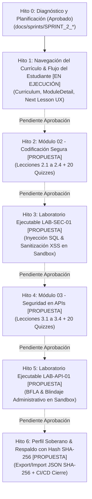

# AppSec Academy — Plan de Ejecución del Sprint 2 (Sprint 2 Plan)
## Expansión Curricular (Módulos 02 y 03), Consolidación de Sandbox y Navegación Soberana

- **Proyecto**: AppSec Academy
- **Repositorio**: `https://github.com/YamiCueto/app-sec-academy-io`
- **Línea Base Inicial**: Commit [`78faa75`](https://github.com/YamiCueto/app-sec-academy-io/commit/78faa75)
- **Marco Metodológico**: Angular 22 Standalone con Signals, Dark-First Design System, Web Workers en cliente, Cero Comentarios en código fuente y Criterios de Aceptación Verificables.
- **Fecha de Planificación**: 10 de noviembre de 2026.
- **Estado de Aprobación**: Hito 1 formalmente autorizado; Hitos 2 a 6 catalogados como propuestas técnicas pendientes de aprobación por el Product Owner.
- **Foco Principal del Sprint 2**: Consolidar la experiencia de aprendizaje del estudiante, la continuidad de la navegación, la accesibilidad universal (WCAG 2.1 AA) y la calidad pedagógica e interactiva.

---

## 1. Meta del Sprint 2 (Sprint Goal)

> **"Consolidar la experiencia integral de aprendizaje del estudiante mediante la navegación curricular fluida (Explorador de Currículo, Detalle de Módulos y continuidad inter-lecciones); como propuestas técnicas para aprobación posterior, expandir el contenido pedagógico con los Módulos Troncales 02 y 03, laboratorios interactivos en Web Worker (`LAB-SEC-01` y `LAB-API-01`), y la gestión soberana del perfil con exportación e importación de respaldos JSON validados mediante hash de comprobación de integridad SHA-256."**

---

## 2. Backlog Priorizado del Sprint 2 (Matriz Impacto / Esfuerzo / Riesgo / Dependencias)

| ID Épica | Historia de Usuario | Prioridad MoSCoW | Impacto | Esfuerzo (SP) | Riesgo Técnico | Dependencias Previas |
| :---: | :--- | :---: | :---: | :---: | :---: | :--- |
| **US-01.4** | **Navegación Integral de Currículo**: Sustituir el placeholder de `/curriculum` por un catálogo interactivo que agrupe los 14 módulos por bloques (Fundacional, Intermedio, Avanzado) y muestre lecciones activas. | **Must Have** | **Alto** | 5 SP | Bajo | `ContentService.getModules()` existente. |
| **US-01.5** | **Detalle de Módulo Dinámico**: Implementar `/modulo/:id` mostrando descripción, objetivos Bloom, estándares (CWE/OWASP/ASVS) y lista navegable de lecciones. | **Must Have** | **Alto** | 3 SP | Bajo | US-01.4 |
| **US-04.4** | **Flujo Continuo de Aprendizaje**: Incorporar botones "Siguiente Lección" / "Lección Anterior" en el pie de `LessonWorkspaceComponent` y tarjeta "Continuar Aprendizaje" en `/dashboard`. | **Must Have** | **Alto** | 3 SP | Bajo | US-01.5 |
| **US-07.2** | **Módulo 02 Completo (Secure Coding)**: Implementar las 4 lecciones de Codificación Segura (2.1 XSS, 2.2 SQLi, 2.3 Memoria, 2.4 Logging Seguro) con 9 secciones, ejemplos Java 21 / Angular y 20 reactivos. | **Must Have** | **Alto** | 8 SP | Medio | US-04.4, `LESSON_TEMPLATE.md` |
| **US-05.5** | **Laboratorio LAB-SEC-01 en Web Worker**: Laboratorio ejecutable para auditar y remediar vulnerabilidades de inyección SQL y templates vulnerables a XSS mediante simulación de base de datos en memoria. | **Must Have** | **Alto** | 8 SP | Medio | US-07.2, `SandboxService` |
| **US-07.3** | **Módulo 03 Completo (API Security)**: Implementar las 4 lecciones de Seguridad en APIs (3.1 BOLA, 3.2 BFLA/Mass Assignment, 3.3 Rate Limiting, 3.4 SSRF) con 9 secciones, ejemplos Java 21 / Angular y 20 reactivos. | **Must Have** | **Alto** | 8 SP | Medio | US-05.5 |
| **US-05.6** | **Laboratorio LAB-API-01 en Web Worker**: Laboratorio ejecutable enfocado en elevación vertical de funciones (BFLA) en endpoints administrativos y asignación masiva de parámetros. | **Must Have** | **Alto** | 8 SP | Medio | US-07.3 |
| **US-03.2** | **Exportación de Progreso con Hash SHA-256**: Generar archivo `appsec-progress-{alias}-{fecha}.json` con payload canonicalizado e integridad garantizada mediante hash de comprobación SHA-256 (`WebCrypto API`). | **Must Have** | **Medio** | 3 SP | Bajo | `ProgressStore` existente. |
| **US-03.3** | **Importación Segura de Progreso**: Validar esquema JSON, formato de fechas, rangos numéricos y hash de integridad antes de restaurar el estado en `ProgressStore`. | **Must Have** | **Medio** | 3 SP | Medio | US-03.2 |
| **US-02.4** | **Vista de Perfil y Preferencias**: Sustituir placeholder de `/perfil` con formulario reactivo de alias, resumen de ranking y herramientas de exportación/importación. | **Should Have** | **Medio** | 3 SP | Bajo | US-03.2, US-03.3 |
| **Total Sprint 2** | **10 Historias de Usuario (H1 en ejecución: 11 SP; H2–H6 propuestas: 41 SP)** | | | **52 SP** | | |

---

## 3. Desglose Detallado de Hitos (H1 a H6) y Criterios Verificables de Aceptación

### Hito 1: Navegación Integral del Currículo, Detalle de Módulos y Flujo del Estudiante [AUTORIZADO Y EN EJECUCIÓN]
- **Objetivo**: Conectar de extremo a extremo el flujo de navegación de la academia, eliminando los marcadores de posición de `/curriculum` y `/modulo/:id`, y garantizando continuidad secuencial entre lecciones.
- **Archivos a Modificar / Crear**:
  - `src/app/features/curriculum/curriculum.component.ts` y `.html` / `.scss` (sustituir placeholder por vista completa).
  - `src/app/features/module-detail/module-detail.component.ts` y `.html` / `.scss` (sustituir placeholder).
  - `src/app/features/lesson-workspace/lesson-workspace.component.ts` y `.html` (añadir navegación entre lecciones contiguas).
  - `src/app/features/dashboard/dashboard.component.html` (tarjeta de reanudación rápida "Continuar Aprendizaje").
  - `src/app/shared/components/header/header.component.html` y `home.component.html` (corregir textos obsoletos "Hito 1").
  - `src/app/core/services/content/content.service.ts` (enriquecer catálogo de módulos con metadatos reales).
- **Criterios de Aceptación Verificables**:
  1. `AC-H1.1`: La ruta `#/curriculum` renderiza los 14 módulos agrupados por bloques (Fundacional, Intermedio, Avanzado), mostrando badge "4 lecciones disponibles" en M01 y "Próximamente" en M02 a M14.
  2. `AC-H1.2`: Al pulsar sobre un módulo, la aplicación transiciona a `#/modulo/:id`, mostrando título, descripción, estándares oficiales y la lista de lecciones con su estado de avance.
  3. `AC-H1.3`: Al concluir la sección 9 de cualquier lección, el usuario visualiza un botón primario para navegar a la siguiente lección (ej. de 1.1 a 1.2), o volver al módulo correspondiente si es la última del bloque.
  4. `AC-H1.4`: La página `#/inicio` y el encabezado global actualizan sus insignias a "Sprint 2" / "Módulo 01 Activo".
  5. `AC-H1.5`: Cero desbordamiento horizontal en 360 px en las nuevas vistas `/curriculum` y `/modulo/:id`.
  6. `AC-H1.6`: Todas las pruebas unitarias e integración aprueban con cero comentarios en código.

---

### Hito 2: Módulo 02: Codificación Segura (Secure Coding) — Lecciones 2.1 a 2.4 [PROPUESTA PENDIENTE DE APROBACIÓN]
- **Objetivo**: Desarrollar el contenido curricular completo del Módulo 02 fundamentado en MITRE CWE Top 25 y SEI CERT Coding Standards.
- **Lecciones a Desarrollar**:
  - **Lección 2.1**: Validación de entrada y codificación contextual (XSS, CWE-79, ASVS V5).
  - **Lección 2.2**: Consultas parametrizadas y prevención de inyección (SQLi, CWE-89, OWASP A03:2021).
  - **Lección 2.3**: Manejo seguro de memoria, enteros y tipos (CWE-119, CWE-190).
  - **Lección 2.4**: Manejo seguro de errores y prevención de fuga de trazas (CWE-209, CWE-532).
- **Archivos a Crear / Modificar**:
  - `src/app/core/services/content/data/lesson-2.1.data.ts` a `lesson-2.4.data.ts`.
  - `src/app/core/services/content/content.service.ts` (registro de lecciones 2.1 a 2.4).
  - `src/app/core/services/content/content.service.spec.ts` (pruebas de integridad del Módulo 02).
- **Criterios de Aceptación Verificables**:
  1. `AC-H2.1`: Cada lección implementa estrictamente las 9 secciones de `LESSON_TEMPLATE.md`.
  2. `AC-H2.2`: Cada lección incorpora ejemplos en Java 21 / Spring Boot y Angular comparando código vulnerable vs remediado sin comentarios en el código.
  3. `AC-H2.3`: Cada lección contiene una batería de exactamente 5 preguntas con opciones barajadas y retroalimentación en todos los distractores.
  4. `AC-H2.4`: El umbral del 80 % se alcanza exactamente con 4 de 5 aciertos; 3 de 5 reprueba (60 %).
  5. `AC-H2.5`: Los ejemplos Java se declaran formalmente como analizados estáticamente y pendientes de validación ejecutable.

---

### Hito 3: Laboratorio Interactivo Ejecutable LAB-SEC-01 (Inyección SQL y Sanitización XSS) [PROPUESTA PENDIENTE DE APROBACIÓN]
- **Objetivo**: Desarrollar el segundo entorno de práctica en sandbox aislado con Web Workers, simulando un motor de persistencia vulnerable a SQL Injection y un renderizador DOM propenso a Cross-Site Scripting.
- **Archivos a Crear / Modificar**:
  - `src/app/core/services/sandbox/sec-simulator.ts` (simulador in-memory de SQL y sanitización contextual).
  - `src/app/core/services/lab/lab-engine.service.ts` (registro formal de `LAB-SEC-01_DEFINITION`).
  - `src/app/features/laboratory/laboratory.component.ts` y `.html` (soporte multi-laboratorio).
  - `src/app/core/services/sandbox/sandbox.service.spec.ts` y `lab-engine.service.spec.ts`.
- **Criterios de Aceptación Verificables**:
  1. `AC-H3.1`: `LAB-SEC-01` se ejecuta dentro del Web Worker aislado sin acceso al DOM anfitrión.
  2. `AC-H3.2`: Suite de 5 aserciones automatizadas comprobando: (1) Consulta legítima con parámetros alfanuméricos, (2) Intento de inyección `OR 1=1` neutralizado, (3) Payload `' UNION SELECT` bloqueado, (4) Inyección de script `<script>` en contexto HTML escapada correctamente, (5) Manejo de errores sin fugar la consulta SQL en la respuesta.
  3. `AC-H3.3`: Otorgamiento de 100 XP en `ProgressStore` al superar las 5 aserciones con idempotencia garantizada.
  4. `AC-H3.4`: Enlace bidireccional entre la lección 2.2 y el laboratorio `LAB-SEC-01`.

---

### Hito 4: Módulo 03: Seguridad en APIs REST (API Security) — Lecciones 3.1 a 3.4 [PROPUESTA PENDIENTE DE APROBACIÓN]
- **Objetivo**: Desarrollar el contenido curricular completo del Módulo 03 basado en OWASP API Security Top 10 (2023) y RFCs de transporte seguro.
- **Lecciones a Desarrollar**:
  - **Lección 3.1**: Broken Object Level Authorization (API1:2023 BOLA / IDOR en APIs).
  - **Lección 3.2**: Broken Function Level Authorization (API5:2023 BFLA) y Asignación Masiva (API3:2023).
  - **Lección 3.3**: Rate Limiting, Throttling y Prevención de Consumo Abusivo (API4:2023 / RFC 6585).
  - **Lección 3.4**: Server-Side Request Forgery (SSRF) en APIs Modernas (API7:2023 / CWE-918).
- **Archivos a Crear / Modificar**:
  - `src/app/core/services/content/data/lesson-3.1.data.ts` a `lesson-3.4.data.ts`.
  - `src/app/core/services/content/content.service.ts` (registro de lecciones 3.1 a 3.4).
  - `src/app/core/services/content/content.service.spec.ts`.
- **Criterios de Aceptación Verificables**:
  1. `AC-H4.1`: Las 4 lecciones cumplen el esquema de 9 secciones de `LESSON_TEMPLATE.md`.
  2. `AC-H4.2`: Ejemplos técnicos en Java 21 Spring Boot (DTOs estrictos con `@Valid`, filtros de IP privada para SSRF, Token Bucket) y Angular (interceptores de rate limit y tipado defensivo).
  3. `AC-H4.3`: 20 reactivos formativos calibrados con umbral del 80 % (4/5 aciertos requeridos).
  4. `AC-H4.4`: Trazabilidad formal con OWASP API Top 10:2023 y MITRE CWE.

---

### Hito 5: Laboratorio Interactivo Ejecutable LAB-API-01 (BFLA y Blindaje de Endpoints Administrativos) [PROPUESTA PENDIENTE DE APROBACIÓN]
- **Objetivo**: Desarrollar el tercer laboratorio interactivo confinado en Web Worker, enfocado en auditar la separación de roles funcionales en APIs REST y la neutralización de asignación masiva de campos privilegiados (`isAdmin: true`).
- **Archivos a Crear / Modificar**:
  - `src/app/core/services/sandbox/api-simulator.ts` (simulador de API Gateway con roles y validación de DTO).
  - `src/app/core/services/lab/lab-engine.service.ts` (registro de `LAB-API-01_DEFINITION`).
  - Pruebas unitarias en `lab-engine.service.spec.ts`.
- **Criterios de Aceptación Verificables**:
  1. `AC-H5.1`: Ejecución aislada en Web Worker con Watchdog Timer (2s) activo.
  2. `AC-H5.2`: Batería de 5 aserciones de prueba evaluando: (1) Invocación autorizada de endpoint administrativo con rol `ADMIN`, (2) Rechazo con 403 Forbidden para usuario con rol `USER`, (3) Intento de inyección de campo `role: "admin"` en payload de registro neutralizado por DTO inmutable, (4) Petición no autenticada rechazada con 401 Unauthorized, (5) Ausencia de fugas de endpoints internos en respuestas de error.
  3. `AC-H5.3`: Otorgamiento de 100 XP e integración con lección 3.2.

---

### Hito 6: Perfil de Ingeniería, Soberanía de Datos y Cierre del Sprint 2 [PROPUESTA PENDIENTE DE APROBACIÓN]
- **Objetivo**: Implementar la vista completa de `/perfil` con soberanía de datos, exportación e importación de respaldos JSON validados mediante hash de comprobación de integridad SHA-256, auditoría de accesibilidad, pruebas E2E y publicación en GitHub Pages.
- **Archivos a Crear / Modificar**:
  - `src/app/features/profile/profile.component.ts` y `.html` / `.scss` (sustituir placeholder por vista interactiva).
  - `src/app/core/services/storage/backup.service.ts` (exportación e importación con hash de comprobación de integridad SHA-256 mediante `crypto.subtle.digest`).
  - `src/app/core/services/storage/backup.service.spec.ts` (pruebas de integridad y rechazo de JSON manipulado).
  - `docs/sprints/SPRINT_2_REPORT.md` (informe técnico exhaustivo de cierre de Sprint 2).
- **Criterios de Aceptación Verificables**:
  1. `AC-H6.1`: `ProfileComponent` permite editar el alias del estudiante de forma reactiva, actualizando instantáneamente el Header y Dashboard.
  2. `AC-H6.2`: La exportación genera un archivo `appsec-backup-{alias}-{timestamp}.json` conteniendo el estado completo de `ProgressStore` y un hash de comprobación de integridad `sha256Hex` (no firma autenticada).
  3. `AC-H6.3`: La importación valida el esquema JSON; si el hash calculado no coincide con el payload (manipulación no autorizada), la importación es rechazada con mensaje de error visible y el estado previo se preserva sin corrupción.
  4. `AC-H6.4`: 0 violaciones de accesibilidad Axe-Core en todas las nuevas rutas.
  5. `AC-H6.5`: El tamaño inicial transferido se mantiene $\le 250.00$ kB en la compilación de producción.
  6. `AC-H6.6`: Pipeline de GitHub Actions completa green y despliega en `https://yamicueto.github.io/app-sec-academy-io/`.

---

## 4. Definición de Hecho (Definition of Done — DoD) para el Sprint 2

Toda funcionalidad del Sprint 2 se considerará terminada únicamente cuando cumpla:
1. **Calidad de Código**: Cero comentarios en todo el código fuente TypeScript, HTML y SCSS (`npm run audit:comments` aprobado en 100 % de archivos).
2. **Tipado Estricto**: Cero errores de tipos con `tsc --noEmit` (`npm run type-check`).
3. **Pruebas Automatizadas**: 100 % de pruebas unitarias e integración aprobadas con Vitest (`npm run test:ci`).
4. **Seguridad y SCA**: 0 vulnerabilidades altas o críticas en dependencias (`npm audit --audit-level=high`).
5. **Presupuesto de Rendimiento**: Paquete inicial transferido (Gzip) inferior o igual a 250 kB; fragmentos de módulos y lecciones cargados mediante lazy loading.
6. **Ergonomía Móvil**: Cero desbordamiento horizontal (`scrollWidth === clientWidth`) verificado en viewport de 360 px.
7. **Accesibilidad**: Contraste certificado mínimo 4.5:1 para texto normal y soporte completo de navegación por teclado.
8. **Trazabilidad Normativa**: Estándares oficiales referenciados con organismo emisor, código y versión formal (OWASP Top 10:2021, ASVS v4.0.3, SAMM v2.0.1, API Top 10:2023, CWE 2024, RFC 9106, RFC 8446).
9. **Despliegue y Verificación en Vivo**: Publicación en `origin/main` y despliegue automatizado validado en GitHub Pages mediante Headless Chrome.
10. **Documentación de Cierre**: Informe técnico formal en `docs/sprints/` con métricas empíricas reproducibles y sin porcentajes arbitrarios de confianza.
